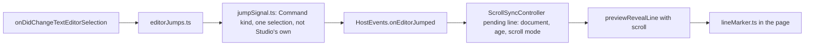

## Summary

When a jump (a search result, Quick Open `file.md:42`, a problem, a link, Go to Line) moves a text editor of a Markdown file to a line while the side preview follows that editor, the side preview now shows the Studio tab's line marker on that line: the arrow in the left margin and the light band. Moving the cursor yourself (arrow keys, a click, typing) never shows it.

## Deliverables

- A jump is told from a cursor move by the kind of the selection change VS Code reports (`Command` with one selection); keyboard, mouse and no-kind changes never mark.
- With the anchor button on, the editor leads: the marker is drawn where the line is and the page scrolls only when the line is off screen. With it off, the page scrolls the line to the reading line, as the Studio tab does.
- The marker stays through scrolls and cursor moves; an edit of the document or a switch to another file removes it. The side preview's own links mark their target line.
- A search click with a replace text marks the real file's line.

After a jump, at `7517dfd` (visual scenario, light theme; no before image exists, the marker did not exist at the base):

## Blast radius

Grade: 2. The opening watcher now reads jumps from the shared jump signal (behaviour unchanged). The pending reveal line gains a document and an age, and is posted only to a visible page showing that document within 5 s; the Studio tab's calls keep their behaviour. The reveal message gains an optional `scroll` field (absent means the previous behaviour). Revert restores the previous behaviour; the new protocol field is optional.

## Autonomous decisions

Settled without the owner, from the owner's "same as the Studio tab" and the earlier open-at-line rules: every `Command` move with one selection marks; only the side preview that follows the editor marks; no setting; same-document path links with a line or fragment mark, plain anchors do not. "Same duration" is read as: in the side preview the marker keeps the Studio tab's rules and also goes on an edit of the document from the text editor or a switch to another file; scrolls and cursor moves keep it.

## Known gaps

- **UNVERIFIED:** Quick Open `file.md:42`, Go to Line, Problems, a terminal link and a Ctrl+click are not driven in the real window (no way to type into those views from a test); they are reached by `vscode.open` with a selection, the call a search click makes. Go to Symbol, Find next (F3) and Go to Next Problem (F8) are not driven; whether they mark depends on the kind VS Code reports.
- **UNVERIFIED:** the real-window run (CI, Linux) recorded no selection change for Go Back, `cursorDown`, `cursorBottom`, Select All and an API selection, so Go Back does not mark, and "arrow keys, a click and typing never mark" is proved by unit tests of the signal, not in a real window. The VSCodeVim `j`/`k` case is not confirmed either.
- **UNVERIFIED:** the real-window trial J6 (anchor off, caret mark on, Studio tab beside the editor, hidden preview inside and past 5 s) is a manual trial, not run.
- **UNVERIFIED:** trials J1 to J5 and J7 ran only in the heavy CI run on Linux, never locally.
- The real-window trial reads the marker from the host (the line the page was asked to draw), not from the page; the page's drawing is proved by the page tests and the visual scenario. Trial J5 asserts only that the last jump on the real file wins, so the marker can end on line 1 in the replace preview.
- A user jump to the very line Studio just selected, within one second, is taken as Studio's own.
- In the replace preview the line is the match's line number, off when an earlier replacement adds or removes lines.
- The visual scenario exists in light only (no dark capture); no before image of a real search click was captured.

Details

### Changes

- `src/core/navigation/jumpSignal.ts`, `src/host-vscode/editorJumps.ts`, `StudioSelections` in `src/host-vscode/openInStudio.ts`; wiring in `activation.ts`, `vscodeHost.ts`, `openingWatcher.ts`.
- Protocol: `previewRevealLine.scroll`, new `previewLineMarkerClear`; page reveal modes in `lineMarker.ts`.
- Session: `onEditorJumped`, document-keyed pending line, `markedLine`, links and history.
- Docs, glossary, changelog, requirements (new SwRS, updated LIFE-178/181/184/185 and StRS LIFE-023, all proposed).

### Human decisions

Owner decisions: same marker as the Studio tab, only on a jump; scroll follows the anchor setting; in-file commands VS Code cannot tell from a search click all mark; a jump into the replace preview marks the real file's line.

### Impacts

Users see the Studio tab's line marker in the side preview after a jump. The screenshot in Deliverables shows the arrow and band on the target line after a reveal with `scroll: "if-off-screen"` (visual scenario `lifecycle-sync/v13-line-marker-jump-if-off-screen-light-900`). No before image of a real search click was captured.

### Test plan

- [x] New or changed tests (they fail on the previous code): jump signal, editor jumps, protocol, page marker, session and host tests; `test/integration/sidePreviewJump.test.ts` (real window, heavy CI)
- [x] Local gates at `7517dfd`: `just check` and `just preflight` pass; focused tests 112 pass; `npm run test:unit` 4648 pass, 0 fail; `just requirements-lint` exit 0
- [x] CI at `7517dfd`: `gh pr checks 468` all pass (integration skipped on a pull request); heavy run 44937061899: static, static-windows, viewer-graph, visual, stress and integration (J1 to J5) pass, gallery pass after one re-run (first run failed on an HTTP 403 downloading `just`)
- [x] Evidence: after at `7517dfd` (visual scenario); no before (feature absent at the base)
- [x] Review: approved at `7517dfd` (recorded)

### Internal references

CR-456 side-preview-jump-marker (split from CR-445 open-at-line-marker).

