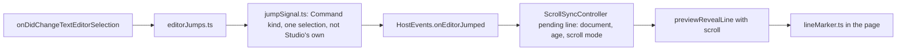

## Summary

When a jump (a search result, Quick Open `file.md:42`, a problem, a link, Go to Line, Find, F8, Go Back) moves a text editor of a Markdown file to a line while the side preview follows that editor, the side preview now shows the Studio tab's line marker on that line: the arrow in the left margin and the light band. Moving the cursor yourself (arrow keys, a click, typing) never shows it.

## Deliverables

- A jump is told from a cursor move by the kind of the selection change VS Code reports (`Command` with one selection); keyboard, mouse and no-kind changes never mark.
- With the anchor button on, the editor leads: the marker is drawn where the line is and the page scrolls only when the line is off screen. With it off, the page scrolls the line to the reading line, as the Studio tab does.
- The marker stays through scrolls and cursor moves; an edit of the document or a switch to another file removes it. The side preview's own links mark their target line.
- A search click with a replace text marks the real file's line.

## Blast radius

The opening watcher now reads jumps from the shared jump signal (behaviour unchanged). The pending reveal line gains a document and an age, and is posted only to a visible page showing that document within 5 s; the Studio tab's calls keep their behaviour. The reveal message gains an optional `scroll` field (absent means the previous behaviour).

## Autonomous decisions

Settled without the owner, from "same as the Studio tab": every `Command` move with one selection marks; only the side preview that follows the editor marks; no setting; same-document path links with a line or fragment mark, plain anchors do not. "Same duration" is read as: in the side preview the marker keeps the Studio tab's rules and also goes on an edit of the document from the text editor or a switch to another file; scrolls and cursor moves keep it.

## Known gaps

- Cursor moves by other extensions through the API (for example VSCodeVim `j`/`k`) carry the same kind as a jump and mark.
- A user jump to the very line Studio just selected, within one second, is taken as Studio's own.
- In the replace preview the line is the match's line number, off when an earlier replacement adds or removes lines.
- Real-window trials J1 to J7 are not run at this stage; the table of which moves mark in `docs/user/open-studio.md` is marked as expected, to be confirmed.

Details

### Changes

- `src/core/navigation/jumpSignal.ts`, `src/host-vscode/editorJumps.ts`, `StudioSelections` in `src/host-vscode/openInStudio.ts`; wiring in `activation.ts`, `vscodeHost.ts`, `openingWatcher.ts`.
- Protocol: `previewRevealLine.scroll`, new `previewLineMarkerClear`; page reveal modes in `lineMarker.ts`.
- Session: `onEditorJumped`, document-keyed pending line, `markedLine`, links and history.
- Docs, glossary, changelog, requirements (new SwRS, updated LIFE-178/181/184/185 and StRS LIFE-023, all proposed).

### Human decisions

Owner decisions: same marker as the Studio tab, only on a jump; scroll follows the anchor setting; in-file commands VS Code cannot tell from a search click all mark; a jump into the replace preview marks the real file's line.

### Impacts

Visual scenario `lifecycle-sync/v13-line-marker-jump-if-off-screen-light-900` shows the side preview with the marker after a reveal with `scroll: "if-off-screen"`. Before and after screenshots of a real search click come from the real-window trial and are added to the evidence.

### Test plan

`just check`, `just requirements-lint`, new unit, host, protocol, page and session tests, the visual scenario, and `test/integration/sidePreviewJump.test.ts` (real window, heavy CI run).

### Internal references

CR-456 side-preview-jump-marker (split from CR-445 open-at-line-marker).

