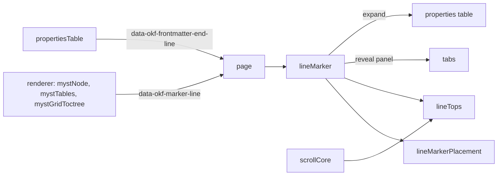

## Summary

When Studio opens at a requested line (a search result, an issue badge, a jump from the editor), the arrow in the left margin now lands on the exact place in three cases that used to mark only the top of the enclosing block:

- a pipe table marks the row of the line, wherever the table sits (top level, quote, alert, admonition, list item, tab item);
- a line in a tab that is not shown selects that tab (and every hidden tab around it, outermost first, sync groups following as on a click), then is marked on its exact line;
- a front matter line marks its property's row in the properties table, which opens if it was collapsed; a line that is no property (a fence, a comment) marks the top of the table.

Renderer risk, plainly: content inside a tab item and every pipe table row now carry source lines under a new attribute, `data-okf-marker-line`, that no click, scroll sync or change bar reads. A wrong line would put the arrow on the wrong row silently, so the renderer has render tests for each container (quote, alert, admonition, list item, tab item, CRLF, tables after front matter). A click inside a tab item still edits the whole item.

Also fixed: a line near the closing front matter fence no longer jumps to the first body block, a tab panel holding a code block then a paragraph no longer puts a paragraph line on a code line, a tab chosen by the marker is not undone by the next content patch, and the user doc no longer says the arrow disappears on scroll.

## Deliverables



Placement order of the marker, now: block (front matter range first), target by marker line, open what hides it (unfold, tabs, properties table; only on the request), hidden check, then the box (table row, front matter row, code line on a code block itself, paragraph line, target top, block top).

```ts
interface TabsControl {
  reveal(panel: Element): boolean  // select the tab like a click, no focus move
}
installTabs(document, onChange?)   // onChange after any shown-tab change
```

## Changes

- Renderer: `data-okf-marker-line` / `-end-line` on content inside tab items and on every pipe table row (`mystNode.ts`, `mystTables.ts`, `mystGridToctree.ts`); the export strips them. `data-okf-frontmatter-end-line` on the properties section (`propertiesTable.ts`).
- Page: placement in `lineMarker.ts` and `lineMarkerPlacement.ts`; `measureLineTops` moved to `lineTops.ts`; `TabsControl.reveal`, `onChange` and the later-choice rule of `apply()` in `tabs.ts`.
- Requirements: new LIFE-192 (table row), LIFE-193 (hidden tabs), LIFE-194 (front matter row); boundary rows of LIFE-178, LIFE-179, LIFE-180, LIFE-119, MYST-098, MYST-099, FMSCHEMA-090.

## Impacts

To be filled with before (1.11.0) and after captures, light and dark.

## Blast radius

Grade: 2. The renderer gives new attributes to tab item content and table rows (rendered HTML snapshots change) and the marker placement changes; a revert restores the previous top-of-block marker, nothing is stored.

## Test plan

- [ ] New or changed tests (they fail on the previous code): `test/core/render/markerLines.test.ts`, `test/page/runtimeLineMarkerPlacement.test.ts`, `test/page/modules/tabs.test.ts`, `propertiesTable.test.ts`, `htmlExport.test.ts`, visual group `lifecycle-sync`
- [x] Requirements: SwRS added and updated, markers in code and tests, `just requirements-update`
- [x] Changelog: one line under `## Unreleased`
- [ ] Local gates: to be filled at ship
- [ ] Review
- [ ] CI green

🤖 Generated with [Claude Code](https://claude.com/claude-code)
