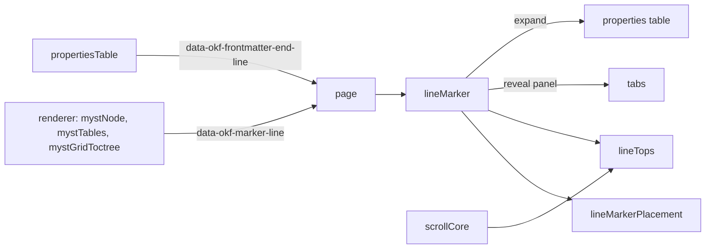

## Summary

When Studio opens at a requested line (a search result, an issue badge, a jump from the editor), the arrow in the left margin now lands on the exact place in three cases that used to mark only the top of the enclosing block:

- a pipe table marks the row of the line, wherever the table sits (top level, quote, alert, admonition, list item, tab item);
- a line in a tab that is not shown selects that tab (and every hidden tab around it, outermost first, sync groups following as on a click), then is marked on its exact line;
- a front matter line marks its property's row in the properties table, which opens if it was collapsed; a line that is no property (a fence, a comment) marks the top of the table.

Renderer risk, plainly: content inside a tab item and every pipe table row now carry source lines under a new attribute, `data-okf-marker-line`, that no click, scroll sync or change bar reads. A wrong line would put the arrow on the wrong row silently, so the renderer has render tests for each container (quote, alert, admonition, list item, tab item, CRLF, tables after front matter). A click inside a tab item still edits the whole item.

Also fixed: a line near the closing front matter fence no longer jumps to the first body block, a tab panel holding a code block then a paragraph no longer puts a paragraph line on a code line, a tab chosen by the marker is not undone by the next content patch, and the user doc no longer says the arrow disappears on scroll.

## Deliverables

Before at `eb3b6ec` (the base), after at `3778f00`; same fixture, same pane, same reveal request. Before, the band sits on the top of the block, the tab stays hidden, or the title row of the properties table is marked.



Before is origin/main at eb3b6ec (1.11.0), after is the head at 3778f00; each capture follows a jump to the line named, light then dark.

| Case | Before | After |
| --- | --- | --- |
| Table row (line 15) |  |  |
| dark |  |  |
| Row of a table in a quote (line 20) |  |  |
| dark |  |  |
| Code line in a hidden tab (line 39) |  |  |
| dark |  |  |
| Nested hidden tabs (line 48) |  |  |
| dark |  |  |
| Front matter property (line 4) |  |  |
| dark |  |  |
| Front matter list property (line 6) |  |  |
| dark |  |  |

Placement order of the marker, now: block (front matter range first), target by marker line, open what hides it (unfold, tabs, properties table; only on the request), hidden check, then the box (table row, front matter row, code line on a code block itself, paragraph line, target top, block top).

```ts
interface TabsControl {
  reveal(panel: Element): boolean  // select the tab like a click, no focus move
}
installTabs(document, onChange?)   // onChange after any shown-tab change
```

## Blast radius

Grade: 2. The renderer gives new attributes to tab item content and table rows (rendered HTML snapshots change) and the marker placement changes; a revert restores the previous top-of-block marker, nothing is stored.

## Autonomous decisions

- The closing front matter fence line, a tab panel holding a code block then a paragraph, a tab choice undone by the next content patch, and the user doc sentence about the arrow disappearing on scroll were fixed in this PR because they sat on the same placement path and gave a wrong arrow position.

## Known gaps

- A collapsed properties table that expands on a row line, and a sync group following a revealed tab, have no screenshot (no fixture or visual scenario covers them); the page and tab tests cover them.

<details>
<summary>Details</summary>

## Changes

- Renderer: `data-okf-marker-line` / `-end-line` on content inside tab items and on every pipe table row (`mystNode.ts`, `mystTables.ts`, `mystGridToctree.ts`); the export strips them. `data-okf-frontmatter-end-line` on the properties section (`propertiesTable.ts`).
- Page: placement in `lineMarker.ts` and `lineMarkerPlacement.ts`; `measureLineTops` moved to `lineTops.ts`; `TabsControl.reveal`, `onChange` and the later-choice rule of `apply()` in `tabs.ts`.
- Requirements: new LIFE-192 (table row), LIFE-193 (hidden tabs), LIFE-194 (front matter row); boundary rows of LIFE-178, LIFE-179, LIFE-180, LIFE-119, MYST-098, MYST-099, FMSCHEMA-090.

## Human decisions

- One change for the three cases: table row, hidden tab, front matter row.
- Once a hidden tab is shown, the arrow sits on the exact paragraph or code line inside it, as everywhere else; a click inside a tab item still edits the whole item.
- Pipe tables inside a quote, an admonition or a list item get their row marked in this change.
- A list table, a captioned table and a raw HTML table keep the top of their block.
- A line that is no front matter property marks the top of the properties table, which opens (only on the request) when it was collapsed.

## Impacts

Before and after captures, light and dark (in Deliverables), show the arrow landing on the table row, on the line inside the newly selected tab, and on the front matter property row instead of the top of the block. The before is the base `eb3b6ec` (1.11.0 plus later fixes).

## Test plan

- [x] New or changed tests (they fail on the previous code): `test/core/render/markerLines.test.ts`, `test/page/runtimeLineMarkerPlacement.test.ts`, `test/page/modules/tabs.test.ts`, `propertiesTable.test.ts`, `htmlExport.test.ts`, visual group `lifecycle-sync`; the 10 new visual scenarios fail on the base and pass at `3778f00`
- [x] Requirements: SwRS added and updated, markers in code and tests, `just requirements-update`
- [x] Changelog: one line under `## Unreleased`
- [x] Local gates at `3778f00`: `just check` pass, `just preflight` pass (unit 4685 pass, visual lifecycle-sync 23 pass)
- [x] Evidence: before at `eb3b6ec`, after at `3778f00`
- [x] Review: approved at `3778f00` (carried from `ca81d11`)
- [x] Verified at `3778f00`
- [x] CI green at `3778f00`: pull request run (static, static-windows, visual, viewer-graph) and the heavy run with real VS Code windows (integration, stress, visual) all pass

## Internal references

CR-457 line-marker-precision.

</details>

🤖 Generated with [Claude Code](https://claude.com/claude-code)
