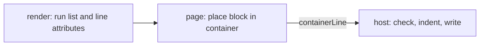

## Summary

In edit mode, runs of two or more blank lines inside a quote, a GitHub alert, an admonition, a context-tag panel, a figure, a card, a definition or a footnote were unreachable or placed wrongly. They now show as the same blank-lines block as at the top level, inside the container that holds them.

## Deliverables

- A run of empty `>` lines in a quote or alert shows a blank-lines block inside it. Deleting the run keeps one empty `>` line and changes nothing else in the file.
- A block typed or pasted there takes the container's prefix and indent (the `>` prefix, the directive's indent, a definition's or a footnote's content indent), so it stays inside.
- A new entry typed between two definitions or two footnotes becomes a sibling entry; other text stays in the entry above.
- A run in a closed dropdown shows only while it is open.
- Arrow navigation stops on each blank-lines block inside a container; after a removal the container is selected.

## Testing

Core, protocol, render, export, page, session and visual tests were added or updated. The visual fixture is numbered 95 (94 is taken). The admonition half of one existing page assertion moved to a new page test file, since a run inside an admonition now shows a block. The new real VS Code test (`blankLines.test.ts`) runs in the heavy CI job only.

## Review

- [ ] Inspector approved

## Internal references

Follows the blank-lines work for top-level blocks and for lists.
