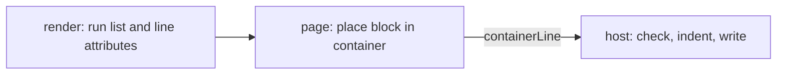

## Summary

In edit mode, runs of two or more blank lines inside a quote, a GitHub alert, an admonition, a context-tag panel, a figure, a card, a definition or a footnote were unreachable or placed wrongly. They now show as the same blank-lines block as at the top level, inside the container that holds them.

## Deliverables

- A run of empty `>` lines in a quote or alert shows a blank-lines block inside it. Deleting the run keeps one empty `>` line and changes nothing else in the file.
- A block typed or pasted there takes the container's prefix and indent (the `>` prefix, the directive's indent, a definition's or a footnote's content indent), so it stays inside.
- A new entry typed between two definitions or two footnotes becomes a sibling entry; other text stays in the entry above.
- A run in a closed dropdown shows only while it is open.
- Arrow navigation stops on each blank-lines block inside a container; after a removal the container is selected.

## Testing

Core, protocol, render, export, page, session and visual tests were added or updated. The visual fixture is numbered 95 (94 is taken). The admonition half of one existing page assertion moved to a new page test file, since a run inside an admonition now shows a block. The new real VS Code test (`blankLines.test.ts`) runs in the heavy CI job only.

## Impacts

Edit mode, full page, same fixture (95) before (base fb5d012d) and after (head fc7c67ac). Before, only the footnote run shows a block, placed as a top-level run. After, six blocks, each inside its container (quote, two alerts, admonition, definition, footnote).

| Theme | Before | After |
| --- | --- | --- |
| Light |  |  |
| Dark |  |  |

Scenario captures at head fc7c67ac: [v51 six blocks, edit mode](https://raw.githubusercontent.com/gsemet/markdown-okf-schema-studio/5bc8e6bd6d503d3e53b0b06cde1c28c33986c1f5/after-v51-edit-light-bar.png), [v52 reading mode shows none](https://raw.githubusercontent.com/gsemet/markdown-okf-schema-studio/5bc8e6bd6d503d3e53b0b06cde1c28c33986c1f5/after-v52-reading-dark.png), [v53 editor open inside the quote after typing](https://raw.githubusercontent.com/gsemet/markdown-okf-schema-studio/5bc8e6bd6d503d3e53b0b06cde1c28c33986c1f5/after-v53-typing-light.png).

## Known gaps

- The visual fixture is numbered 95, not 94 (94 is taken).
- The spec's examples table differs from the code on two rows: `>	- x` (spec expects `>   More`, the code gives five spaces) and a tab before `[^label]:` (the code refuses it). The tests assert the code's behaviour; a spec correction is advisable.
- One existing assertion in `runtimeBlankLines.test.ts` moved to the new page test file.
- `pageRuntime.ts` is at 793 of 800 lines: the next change there needs a split.
- `blankLines.test.ts` (real VS Code) ran only in the heavy CI run (integration and stress success).

## Review

- [x] Inspector approved at fc7c67ac
- [x] Verified at fc7c67ac; local gates (`just check`, `just preflight`) pass at fc7c67ac; CI and the heavy run (integration, visual) green at fc7c67ac

## Internal references

Follows the blank-lines work for top-level blocks and for lists.

🤖 Generated with [Claude Code](https://claude.com/claude-code)

