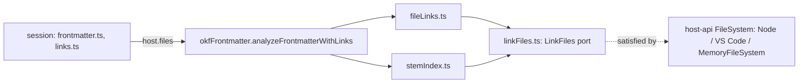

## Summary

The frontmatter linked-file checks and the filename-stem index walked the disk with synchronous `fs` calls inside `src/core`, which blocks a browser-capable host (issue #413) and kept two `NODE_DEBT` entries open. They now go through an async file-system port, so the extension host is no longer blocked by a workspace walk and the core no longer imports `fs` for these two modules.

Part of #413 (first half: the frontmatter side; the other half and the `path` facade come separately, so this PR does not close the issue).

## Deliverables

- `src/core/frontmatter/linkFiles.ts` is a narrow core-local port (`stat`, `readFile`, `readDirectory`, `isSymbolicLink`, `realpath`) that `FileSystem` satisfies structurally; core still never imports `host-api`.
- Stem index choice: built asynchronously on demand, cached as a promise shared by concurrent previews, invalidated by the existing watcher events (a generation counter discards a build that an invalidation overtook). No eager prebuild: the first paint never inspects links (`inspectLinks: false`), so rendering never waits on the index, and links show as pending until the existing debounced enrichment patches the table.
- Both `NODE_DEBT` entries in `.dependency-cruiser.cjs` drop `fs` and keep `path` (removal `PATH_SHIM`); no new exception.

## Changes

- `fileLinks.ts`, `stemIndex.ts`: async, no `fs`; symlinked directories are still not descended (`isSymbolicLink` check), dangling `.md` links still give the "unavailable" state.
- `okfFrontmatter.ts`: `analyzeFrontmatter` stays synchronous (no link inspection); new async `analyzeFrontmatterWithLinks`.
- Session: link enrichment awaits the async analysis with a rejection guard; the link request handler awaits root resolution.
- Tests: new `MemoryFileSystem` tests for both modules (with a Windows path adapter), Node symlink tests, existing tests made async with unchanged assertion intent.
- Requirements: markers stay on the same functions; new tests added to FMSCHEMA-055 and -063; dated entry in `requirements/tiers/log.md`.

## Impacts

No visual change. Link status and stem suggestions give the same results.

## Blast radius

Grade: 2. Shared frontmatter link code and its session callers change from sync to async; a timing race would show as links staying pending or stale suggestions. `git revert` restores the previous behaviour.

## Test plan

- [x] New or changed tests (they fail on the previous code)
- [x] Requirements: SwRS updated or added, markers in code and tests, `just requirements-update`
- [x] Changelog: No user-facing change
- [x] Local gates: `just check-boundaries`, `just check-limits` and `just unit` pass at `7520ed0` (the full `just check` passed before the restack onto CR-467)
- [x] Review: approved at `7520ed0` (restack onto CR-467, only context lines differ from the earlier approval at `116f39d`)
- [x] Verified at `7520ed0`
- [x] CI green at `7520ed0` (to confirm: static, static-windows, visual, viewer-graph)

## Autonomous decisions

- Async on demand rather than eager prebuild, for the reasons above.
- Core-local `LinkFiles` interface instead of extending `FileSystem` (no new port operation was needed).

## Known gaps

- The dangling `.md` symlink test skips on Windows (file symlinks need a privilege); it runs on Linux CI.
- The cold stem-index build time was not measured before and after; the build now yields to the event loop per directory but its total time is unproven.
- The real VS Code integration and stress jobs ran only through a manual heavy run before the restack onto CR-467 (green), not locally; they run once at the top of the stack.

## Internal references

CR-468 (batch-09), from issue #413.
