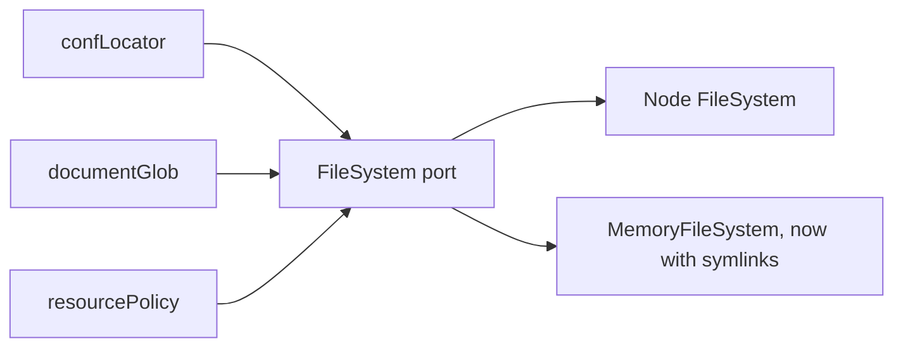

## Summary

The conf.py lookup, the toctree glob expansion and the local-resource security checks read the disk with Node's `fs` directly. That blocks running the renderer in a browser-capable host. They now go through the async `FileSystem` port. Part of #413.

## Deliverables

## Changes

- `confLocator`, `documentGlob` and `resource-policy` use the async port; callers (include, diagram-file and glob stages, webview build, conf events, render worker) became async.
- The resource policy primes its realpath memo asynchronously before the synchronous HTML sanitizer runs; the refusal of paths outside the allowed roots, symlinks included, is unchanged.
- The port interface lives in `src/core/files/fileSystem.ts` (host-api re-exports it) so core need not import host-api.
- `MemoryFileSystem` gained symlinks, with a symlink-escape test.
- `fs` removed from the three `NODE_DEBT` entries.

## Impacts

No visual change; same conf.py, toctree expansion and allowed/refused resources. Render time of a small fixture rose by about 3 ms (median 7.6 ms to 10.4 ms over 15 runs) because lookups are now awaited one by one.

## Blast radius

Grade: 2. Shared render path became async; a revert restores the previous behaviour.

## Test plan

- [x] New or changed tests (they fail on the previous code)
- [x] Requirements: SwRS markers updated, `just requirements-update`
- [x] Changelog: No user-facing change
- [x] Local gates at 2d7152e: `just check` pass; test:unit 4965 and test:security 106 (104 pass, 2 skipped) per the verification; CI static, static-windows, viewer-graph and visual green at the same head
- [x] Review (inspector approved each round)
- [x] CI green at 2d7152e (static, static-windows, viewer-graph, visual, report)
- [x] Verified at 2d7152e
