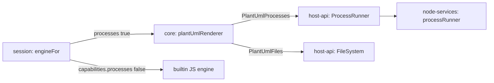

## Summary

The PlantUML renderer in `src/core` imported `child_process` and `fs`, which a browser-capable host cannot provide. It now runs the jar through the `ProcessRunner` port and reads files through the `FileSystem` port; when the host has no `processes` capability, the session falls back to the JS engine, as it does when no jar is configured. Part of #413.

## Deliverables

## Changes

- `plantUmlRenderer.ts` spawns the jar via `processes.run` and stats via `files.stat`; new `plantUmlHost.ts` holds the structural ports (core cannot import `host-api`).
- `session/features/plantUml.ts` picks the builtin engine when `capabilities.processes` is false.
- `ProcessOptions` gets a bounded-output option (early kill, as the renderer had); `ProcessResult.signal` added; the node runner reports it and kills the process group on POSIX.
- `NODE_DEBT` entry of the renderer keeps only `path`.
- Tests on a fake `ProcessRunner` (jar run, jar missing, no processes capability) and on the node runner; DIAG-089 gains a scenario.

## Impacts

No visible change: the same jar, arguments, caps and messages run through the port.

## Blast radius

Grade: 2. The shared `ProcessRunner` port and node runner change (detached child, `signal`, output cap), and every jar diagram goes through them. A plain revert restores the previous behaviour.

## Test plan

- [ ] New or changed tests (they fail on the previous code)
- [ ] Requirements: SwRS updated (DIAG-089), markers kept, `just requirements-update`
- [ ] Changelog: No user-facing change
- [ ] Local gates: `just check`
- [ ] Review
- [ ] CI green

## Known gaps

- The POSIX-only runner tests (process-group kill, signal) are skipped on Windows; Linux CI runs them.
- A stdin EPIPE now shows as "PlantUML exited with code N: <stderr>" instead of the raw "write EPIPE" (the runner ignores stdin errors).
- Windows has no process-group kill (unchanged).

## Autonomous decisions

Taken without the owner:

- Core-local structural port interfaces, because `core` may not import `host-api`.
- The stdin EPIPE diagnostic change above, and the runner ignoring stdin errors.
