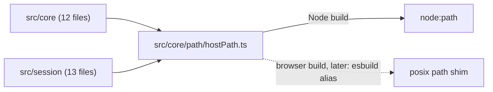

## Summary

The core and session layers imported `node:path` in 25 files, which blocks a browser-capable build of the extension. This change puts all path arithmetic behind one module, so a later browser build swaps a single import for a posix shim. Paths behave exactly as before, Windows drive letters, backslashes and UNC paths included.

Part of #413 (browser-capable host): this is the path step; the issue stays open for the maintainer to close.

## Deliverables

| NODE_DEBT before | after |
| --- | --- |
| 6 pure-path entries, 6 entries with `path` among `fs` or `child_process` | only `hostPath.ts` lists `path` |

## Changes

- New `src/core/path/hostPath.ts` (`import path = require("node:path"); export = path;`, so `win32`, `posix`, `parse` and `sep` stay available) and `test/core/path/hostPath.test.ts` (win32, UNC and drive parity).
- 12 `core` and 13 `session` files import `hostPath` instead of `node:path` (import lines only).
- `.dependency-cruiser.cjs`: one `path` entry left in `NODE_DEBT`; `session` gets `session-no-node-builtins`, replacing the rule that allowed `path`. `CONTRIBUTING.md` describes the module.

## Impacts

No visual change. Contributors import path functions from `src/core/path/hostPath`; a direct `node:path` import in `core` or `session` fails `just check-boundaries`.

## Blast radius

Import lines change in 25 files and the module re-exports the same object; a plain `git revert` restores the previous state.

Grade: 1

## Autonomous decisions

- `export =` instead of `export *` in `hostPath.ts`: the TypeScript compiler rejects `export *` for `node:path`.
- The `session-node-builtins-path-only` rule became `session-no-node-builtins`, since session now needs no built-in at all.
- No new requirement: this is a pure refactor with no behaviour change.

## Known gaps

- The browser alias itself (esbuild swap to a shim) is not built here; it is a later step of the browser-host work.

## Test plan

- [x] New or changed tests: `hostPath.test.ts` pins the Windows semantics; no behaviour change
- [x] Requirements: No behaviour change
- [x] Changelog: No user-facing change
- [x] Local gates at 9ccfd5e: `just check` passes (one run, exit 0); `just requirements-update` and `just check-markers` pass; `just check-boundaries` fails as intended on a probe `node:path` import in core and in session, and passes once it is removed
- [x] Review: approved at 9ccfd5e
- [x] Verified at 9ccfd5e: no `node:path` import left in `core` or `session` outside `hostPath.ts`; the boundary check fails on a probe import and passes without it; `hostPath.test.ts` passes
- [x] CI green at 9ccfd5e

## Internal references

CR-471 "Put core and session path arithmetic behind one path module", batch-09, part of the PATH_SHIM debt of #413.
