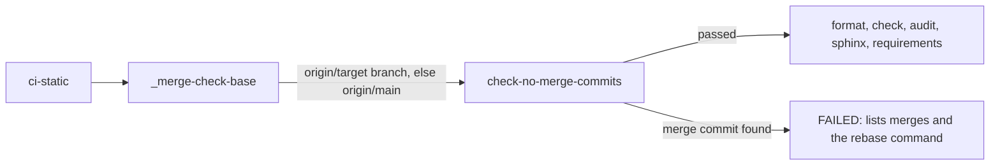

## Summary

A pull request or merge request branch must be updated by rebase, never by merge, because the repository merges by rebase only and history is linear. Twice, a forge's plain "Update branch" button put a merge commit into a pull request branch, and each cost a rebase round. This PR writes the rule down, forge-neutral, and adds a git-only check in `ci-static` that fails a branch carrying a merge commit and prints the command that removes it.

## Deliverables

What the static CI job now does, first step of `just ci-static`:



Failure message for a branch updated by merge (example; the hash and subject vary):

```text
a1b2c3d Merge remote-tracking branch 'origin/main' into feature
The repository merges by rebase only, so a branch is updated by rebase, never by merge.
Remove the merge commits with a rebase (a plain git rebase linearizes them):
  git fetch origin && git rebase origin/main && git push --force-with-lease
check-no-merge-commits: FAILED
```

- The base is the target branch given by `GITHUB_BASE_REF` or `CI_MERGE_REQUEST_TARGET_BRANCH_NAME`, else `origin/main`; a stacked pull request is checked against the branch below it.
- The forge's synthetic test merge at `HEAD` is not counted: its second parent, the branch's real head, is checked instead.
- Both static CI jobs now check out the full history (`fetch-depth: 0`), which the check needs.

## Blast radius

Grade: **2**. A new first step in `ci-static` can turn a pull request red, and the two static jobs fetch the full history, so checkout takes longer. Roll back by reverting this PR; no product code changes.

## Autonomous decisions

- The base computation is a private recipe, `_merge-check-base`, so tests can run the shipped computation with each CI environment.

## Known gaps

- The first CI run on a real pull request is the only proof that `actions/checkout` with `fetch-depth: 0` gives `origin/main` and a usable test merge; GitLab behaviour is proven only by local simulation, as the repository has no GitLab pipeline.

<details>
<summary>Details</summary>

## Changes

- `scripts/check-no-merge-commits.sh`: git-only check of `BASE..HEAD` for merge commits, with the test-merge rule for the tip.
- `justfile`: `check-no-merge-commits`, `_merge-check-base`, `ci-static` runs the check first; the new test file joins `release-tests`.
- `.github/workflows/ci.yml`: `fetch-depth: 0` in the `static` and `static-windows` checkouts.
- `.agents/guidelines/pull-request.guidelines.md`: new "Updating a branch" section.
- `AGENTS.md`, `CONTRIBUTING.md`: list the new target.
- `test/build/test_no_merge_commits.py`: linear, merged, default base, test merge cases, stacked base, unresolved base, base computation, workflow and guideline wiring.

## Human decisions

- The rule lives in the project's pull-request guideline, in forge-neutral words: rebase only (the forge's rebase action, or a local rebase and `--force-with-lease`), never a merge; a GitHub button is named only as an example.
- The check is a git-only script run through the justfile and `ci-static`, taking the target branch from the CI and defaulting to `origin/main` locally.
- Full-history checkout (`fetch-depth: 0`) on both static jobs and the test-merge rule for the tip are confirmed.

## Impacts

No visual change. Contributors updating a branch must rebase (the forge's rebase action, or a local rebase and `git push --force-with-lease`).

## Test plan

- [ ] New or changed tests (they fail on the previous code): `test/build/test_no_merge_commits.py`
- [ ] Requirements: No behaviour change (delivery process only, no SwRS)
- [ ] Changelog: No user-facing change
- [ ] Local gates: `just check-no-merge-commits`, pytest of the new and workflow tests (93), `just check`: pass
- [ ] Review
- [ ] CI green

## Internal references

CR-472 no-merge-commits.

</details>
