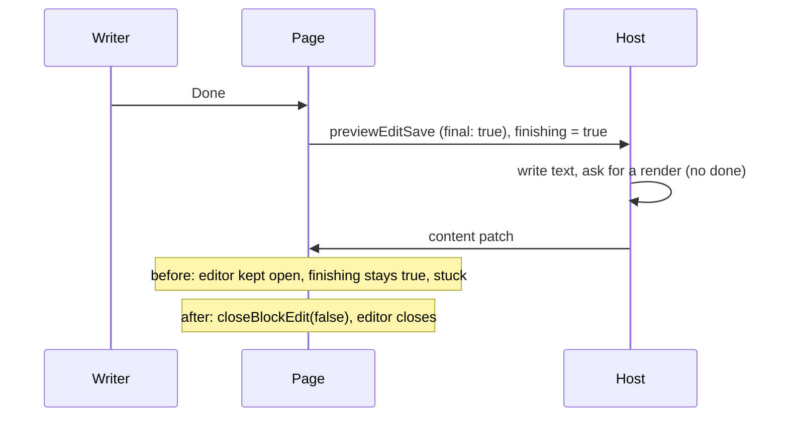

## Summary

Typing in a blank-lines block and pressing Done left the editor stuck on "Saving Markdown…": the text was written and rendered below, but neither Done nor Cancel got the writer out. The render that follows the final save now closes the editor, like the editor of any other block.

Fixes #485

## Deliverables

The page kept the editor of a blank-lines block open across every re-render, so the render of the final save never closed it, and Done and Cancel are ignored while a final save is in flight. The content patch now keeps that editor open only until its final save is posted.

| Open editor at the patch | Before | After |
| --- | --- | --- |
| Blank-run editor, no final save posted (autosave) | stays open | stays open |
| Blank-run editor, final save posted (`finishing`) | stays open, stuck | closes |
| Any other editor | closes | closes |

## Blast radius

Grade: **1**. One condition in the page's content-patch handler, with tests and one requirement. Reverting the commit restores the previous behaviour.

## Autonomous decisions

- The new tests cover Done before and after an autosave, a run inside a list, and an error answer followed by a patch, as the specification lists.

## Known gaps

- Cancel stays ignored while a final save is in flight, and a follow-up change makes Cancel always close the editor and tests that every save path ends.

Details

## Changes

- `src/page/features/contentPatch.ts`: `applyContentPatch` keeps the blank-lines editor open only while `finishing` is false; the comment says both halves.
- `test/page/runtimeBlankLines.test.ts`: page tests of the issue's steps and its variants; they fail on the previous code.
- `test/session/blankRunHost.test.ts`: the final save of a blank-run insertion ends the host edit, asks for a render and posts no `done`.
- `requirements/`: SwRS-MDOKFSTUDIO-BLOCK-268 updated (text, new scenario "Done closes the editor", verification notes), index and log entry.

## Impacts

No visual change: the editor closes where it used to hang.

## Test plan

- [ ] New or changed tests (they fail on the previous code)
- [ ] Requirements: SwRS updated or added, markers in code and tests, `just requirements-update`
- [ ] Changelog: one user-facing line added under `## Unreleased` in `CHANGELOG.md`
- [ ] Local gates at `73037bd`: `just preflight` pass (static stage; the others run in CI on Windows-skipped)
- [ ] Review
- [ ] CI green

## Internal references

CR-474 blank-save (part 1 of 3 for issue #485).

🤖 Generated with [Claude Code](https://claude.com/claude-code)
