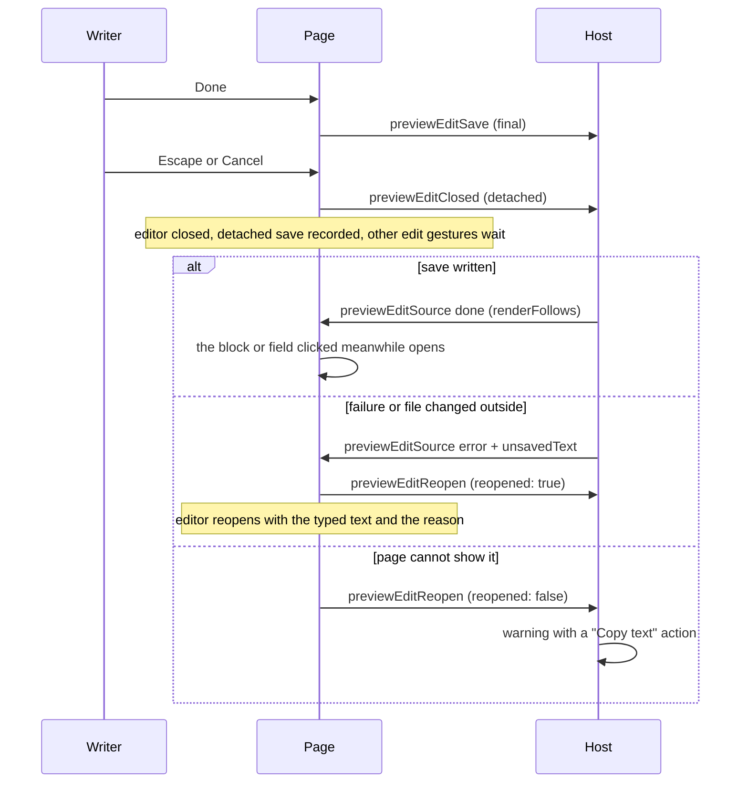

## Summary

A block, table cell or frontmatter editor could stay on "Saving Markdown…" for good, and Cancel and Escape were ignored while it did. Cancel and Escape now always close a block or cell editor, even during a final save: the save the writer asked for with Done goes on and its text is kept. If that save then fails, or the file changes outside the preview before it is written, the editor reopens (or stays open) with the typed text and the reason. If the preview cannot show it again, VS Code offers a "Copy text" action. A frontmatter save that changes nothing no longer hangs on "Saved. Refreshing preview…". There is no time limit, no timeout message and no retry.

Related to #485 (the first hang of this kind, fixed by an earlier pull request).

## Deliverables

| Situation | Before | After |
| --- | --- | --- |
| Cancel or Escape during "Saving Markdown…" | ignored | editor closes, the save goes on |
| Cancelled save fails or file changed outside | text lost or editor stuck | editor reopens with the text and the reason, or "Copy text" |
| Editor on "Saving…" and the file changes outside | edit released silently, text lost | editor stays open with the text and the reason |
| Frontmatter save that changes no text | stuck on "Saved. Refreshing preview…" | field closes, no message |
| Other edit gestures during an edit in flight | only while an editor is open | also while a cancelled save is not finished |

Choices: the end of a cancelled save is only an answer naming its edit (`done` or an error), so a render already in flight cannot end it early; the host answers every end; a retry from a reopened editor keeps the first save's identity so the host accepts it; `HostUi.showWarning` gains optional actions, and only the VS Code adapter calls `vscode.window`.

## Blast radius

Grade: **2**. The page's edit state, the host's edit lock, three protocol messages and the `HostUi` port change; the editing paths are covered by new page, host and protocol tests. Reverting the commit restores the previous behaviour.

## Autonomous decisions

- `previewEditSource` stays addressed to the document (as it is routed today) rather than to the render, so a pending render does not delay it.
- `previewEditClosed` carries a `detached: true` flag, so the host tells a detach from a normal close after an error.
- An open that arrives while a cancelled save is in flight is held at most once on the page and on the host.
- The host releases a detached edit on `onReady` only when the page reports no block editor open; the page reports one while a detached save is in flight, so the edit is kept until its answer.
- The real-window step moved to `test/integration/detachedSaveWindow.ts` because `previewEditing.test.ts` reached the file-size limit.

## Known gaps

- **UNVERIFIED:** the real VS Code scenario (Done, Escape with the apply held, release) is written and compiles but was not run locally; the heavy CI run at 8aeae06 stops at its first step (`preview-smoke`, an `admonition` assertion), which also fails on `main` at 2e2efa6, so this step never ran.
- The changelog line does not name this pull request's number.
- If the host's render never arrives after `done` with `renderFollows`, the page keeps the detached-save record.
- The new page and host tests were run against the previous `src/`: 44 of 95 fail there (detached-save close and reopen for paragraph, cell, insertion and blank lines; frontmatter unchanged save; Escape during a cell save). The gesture-guard tests (block move, delete, paste, checkbox, row and list-item drag, file drop, replace) pass on the previous code, because it has no detached save for them to wait on; they guard the new state only. The new session test file does not compile against the previous code, so it was not run there.

Details

## Changes

- `src/page/features/detachedSave.ts`, `detachedSaveState.ts`: the detached save record, its end on an answer naming its edit, the `editInFlight()` guard, the pending open, the reopen.
- `src/page/features/blockEditor.ts`, `tableCellEditor.ts`: Cancel and Escape close the editor during a final save and post `previewEditClosed`.
- Edit gestures (block moves, delete, paste, replace, file drop, row and list-item drags, frontmatter openers) check `editInFlight()`.
- `src/session/features/detachedEdits.ts`, `blockEdits.ts`, `hostEvents.ts`, `rendering.ts`, `pageMessages.ts`: detached edit handling, every end answered, outside change keeps the text unwritten and the page editor locked until `previewEditReopen`, "Copy text" warning.
- `src/session/features/frontmatter.ts`: a save whose plan changes no text answers `saved` with `unchanged`; the page closes the field.
- `src/core/protocol/*`: validators for `previewEditSource`, `previewFrontmatterResult` and the new `previewEditReopen`; 20 MB bound shared with the content patch.
- `src/host-api/hostUi.ts`, `src/host-vscode/vscodeHost.ts`: `showWarning` accepts action labels.
- Requirements: BLOCK-053, 216, 191, 041, TABLE-025, FMEDIT-019 and StRS BLOCK-006 updated, new SwRS BLOCK-270; glossary "Detached save" and "Edit in flight".
- The page test "Cancel and Escape are ignored while the final save is in flight" is rewritten to the new rule (owner decision); its intent changes on purpose.

## Human decisions

- Cancel during "Saving…" closes the editor and the save goes on; its text is kept.
- A cancelled save that fails, or a file changed outside, reopens the editor with the typed text and the reason; a block or field clicked meanwhile opens when the save ends and is dropped on a failure.
- A frontmatter save that changes nothing closes the field with no message.
- Other edit gestures wait until the save ends.
- When the preview cannot show the failure, VS Code offers a "Copy text" action.
- No time limit, timeout message or retry.

## Impacts

Behaviour change in the editors: Escape and Cancel close the editor during a save; failures keep the typed text.

## Test plan

- [x] New or changed tests; 44 of 95 new page and host tests fail on the previous `src/` (see Known gaps), at 8aeae06
- [x] Requirements: SwRS updated or added, markers in code and tests, `just requirements-update` (run by `just preflight` at 8aeae06)
- [x] Changelog: one user-facing line under `## Unreleased` in `CHANGELOG.md`
- [x] Local gates: `just preflight` (static stage on Windows) pass at 8aeae06
- [x] Review: approved on the same tree at 466a9c0, carried over a clean rebase to 8aeae06
- [x] CI: `gh pr checks 492` at 8aeae06: checks, report, static, static-windows, viewer-graph, visual pass; the heavy run's real VS Code jobs fail at `preview-smoke`, as on `main`

## Internal references

CR-475 save-guard.

