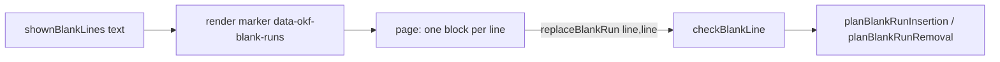

## Summary

In edit mode, a run of blank lines showed as one "Blank lines (N)" block, so a writer who typed a line of text and then 6 blank lines saw a single block instead of 6 empty lines to write in. Each blank line beyond the one Markdown needs as a separator now shows as its own "Blank line" block, at the top level and inside lists, quotes, admonitions, definitions and footnotes. Typing in a block replaces that one line; deleting a block removes that one line.

## Deliverables

- One block per extra blank line: N blank lines between two blocks give N-1 blocks (the first line is the hidden separator); at the end of the body, at the top of a file without front matter, and in a body made only of blank lines after the front matter, every blank line is a block.
- Each block is about one line high and the blocks of one run stack with no gap, so 6 blank lines read as 6 lines. The label is `Blank line`; the status text is "Blank line selected".
- Typing or pasting in a block writes the text in place of that one line and adds a blank line before or after it only where the neighbour line is not blank. Cancel or an emptied editor puts the line back byte for byte.
- Delete, Backspace or the Delete block button removes that one line and never the separator. The selection then goes to the block now at that place, else the one just above it in the same run, else nothing (one more Delete removes no text).
- Up and Down stop on each blank-line block.

Screenshots of the new look are attached below once captured at the pushed head.

## Blast radius

Grade: **2**. The shown-line rule is shared by the render marker, the page, the host checks and the edit plans, and an approved requirement (the insertion rule of a new block) is amended. Reverting the pull request restores one block per run.

## Autonomous decisions

- The separator is the first line of a run (the first empty quote line in a quote run), and a quote run keeps it wherever it stands, since dropping it would end or merge the quote.
- A blank line next to a quote run counts as blank, so no extra `>` line is written before it.
- The label is `Blank line` with no count, since each block is one line.

## Known gaps

- A document made only of whitespace now shows blank-line blocks; its interaction with the "Start writing" button is not verified.
- The real VS Code integration run and the browser captures are not run locally; they run in CI.

## Approved requirements changed

- StRS-MDOKFSTUDIO-BLOCK-011 (approved by the owner on 2026-11-23): its text now says that text typed in a blank-line block replaces that one blank line and keeps the other blank lines around it; a path "Write on a blank line" is added. The owner's review is requested.

Details

## Changes

- `src/core/mapping/blankRuns.ts`: `shownBlankLines` and `blankRunAround`; the render marker lists shown ranges (single lines included).
- `src/core/mapping/blockRange.ts`, `insertion.ts`, `blankRunContainer.ts`, `src/core/edits/sourceEdits.ts`, `src/session/features/blockEdits.ts`: `checkBlankLine`, one-line insertion, removal and paste plans; the protocol requires `endLine === line`.
- `src/page/features/blankLines.ts`, `blockSelectionView.ts` and the edit-mode styles: one block per line, the new label, Up/Down stops, selection after Delete.
- Requirements SwRS BLOCK-004, 265, 266, 267, 268, 269 and StRS BLOCK-011; glossary; visual scenarios and a new six-line fixture; unit, session, page and integration tests.

## Impacts

Edit mode only: blank lines show as one block each. Reading mode and exported output are unchanged.

## Test plan

- [ ] New or changed tests (they fail on the previous code)
- [ ] Requirements: SwRS updated, markers in code and tests, `just requirements-update`
- [ ] Changelog: one user-facing line under `## Unreleased` in `CHANGELOG.md`
- [ ] Local gates: `just preflight`
- [ ] Review
- [ ] CI green

## Internal references

CR-476 blank-per-line (stacked after CR-475; part C of the split of issue #485).

