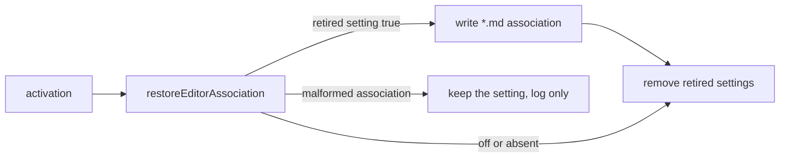

## Summary

Since 1.11.0, a Markdown text tab was replaced by a Studio tab whenever "Open Markdown files in Studio" was on: "Open With... > Text Editor" showed the text for an instant, then Studio took its place. This PR removes that mechanism, so a request for the raw text always gives the text and it stays.

Opening every Markdown file in Studio goes back to VS Code's own setting: `"workbench.editorAssociations": { "*.md": "markdown-okf-schema-studio.editor" }`. A user who had turned the old setting on gets that association back automatically, silently, at the first activation. The side preview's line marker on a jump and the command "Open as Text" stay.

## Deliverables

What a gesture gives now:

| Gesture | `*.md` associated with Studio | No association (default) |
| --- | --- | --- |
| Click a Markdown file in the Explorer | Studio tab (VS Code does it) | text editor |
| "Open With... > Text Editor", "Reopen Editor With... > Text Editor" | text editor, stays | text editor |
| "Open as Text" from a Studio tab | text editor at the top visible line, stays | same |
| Search result, Go to Definition, jump | VS Code's own result: Studio tab at the top (known gap) | text editor at the line |
| Same jump with the side preview open | Studio tab opens, the side preview marks nothing (known limit) | text editor, the side preview marks the line |
| Link, Back, Next followed inside a Studio tab | Studio tab at the top, no line | text editor at the line |

## Changes

- Removed: the opening watcher, the "put Studio in place" code, the opening decision (nine rules), `showDocumentInStudio` and its session helper, the line requests of a Studio tab that opens, the settings `open.searchResultsInStudio` and `open.markdownFilesInStudio` and the "Opening Files" group.
- Kept: the jump recognition and the side preview marker, the line marker drawn in the page, "Open as Text", the feature introductions mechanism and its command (its shipped list is now empty and the class takes the list as an argument).
- Added: the reverse migration. For the user, then the workspace scope: when the retired setting is `true`, write the `*.md` association first, then remove the setting; leftover retired values are removed; another editor's `*.md` entry is left alone; a malformed association keeps the setting; nothing is ever shown.
- Requirements (`lifecycle-sync`): five retired, one superseded by a new SwRS for the reverse migration, the kept ones reworded; StRS LIFE-023 and LIFE-001 amended. No approved requirement is touched.
- Real-window proof: removing a value of an undeclared key works in the user and the workspace scope (no fallback needed). New real-window tests: the opening matrix with and without the association, and a dedicated launch for the reverse migration.

## Impacts

No visual change. Users with default settings: a search result or a jump opens the text editor at the line again, as before 1.11.0. Users who had the old setting on: the Markdown file open at the first activation stays a text editor, the association applies from the next opening. A user with the setting on in the user settings and off in a workspace now gets Studio in that workspace too (VS Code has no "off" for an association in a narrower scope).

Lost until a later release: with the association, a search result or a link followed inside Studio opens Studio at the top, not at the line; with the association, a jump while the side preview is open marks no line.

## Blast radius

Grade: 2. Opening behaviour and a settings migration that writes `workbench.editorAssociations`; a revert restores the watcher but the migration has already removed the old settings of users.

## Test plan

- [x] New or changed tests (they fail on the previous code: 5 of the host and registry tests fail on the base, the migration tests do not compile there)
- [x] Requirements: SwRS updated or added, markers in code and tests, `just requirements-update`
- [x] Changelog: one user-facing line under `## Unreleased` in `CHANGELOG.md`
- [x] Local gates: `just check`, `just requirements-lint`, `just contracts`, `just release-tests` (205), `just release-notes-check`; reverse-migration launch and the opening test run in a real window (VS Code 1.143, Windows)
- [ ] Review
- [ ] CI green (the real-window `integration` job runs on dispatch with `heavy=true`)

### Tests removed or changed, test by test

- Deleted with their code: `openingWatcher.test.ts`, `putStudioInPlace.test.ts`, `openingPolicy.test.ts`, `openingPolicy.holes.test.ts`.
- `editorAssociationMigration.test.ts`: forward migration tests become 7 tests of the inverse (one per row of the rewrite table).
- `associationMigration.test.ts`: the forward migration with a notification becomes 13 tests of the silent reverse.
- `featureIntroductions.test.ts`: each test takes its own introduction entry instead of `openInStudio` (shown once, key stored before the message, nothing in a later session, reset, a store that cannot write: same intent); one added for the empty shipped list.
- `openAtLine.test.ts` (host): watcher-based opening tests become "never closed or replaced" tests.
- `settingsRegistry.test.ts`, `package-contract.test.ts`: the "Opening Files" group and the two settings are no longer expected.
- `toolbarReq.requirements.test.ts`: three tests about links opening Studio at the line become two: a link and Back always call `showDocument`.
- `test/integration/openAtLine.test.ts` rewritten for the matrix; `reverse-migration-suite.ts` added.

## Notes for the release notes (copy)

- What was wrong (since 1.11.0) and what is fixed: the raw text is never replaced by Studio.
- The two settings are removed; use `workbench.editorAssociations` to open every Markdown file in Studio.
- With default settings, a search result or a jump opens the text editor at the line again.
- The automatic restore, and its visible effect: the file open at the first activation stays a text editor.
- User on and workspace off: Studio in that workspace too.
- Until the next release, with the association: results and links inside Studio open at the top; a jump with the side preview open marks no line.

## Internal references

CR-477 `raw-text`, batch-09 (release 1.12.1).

🤖 Generated with [Claude Code](https://claude.com/claude-code)
