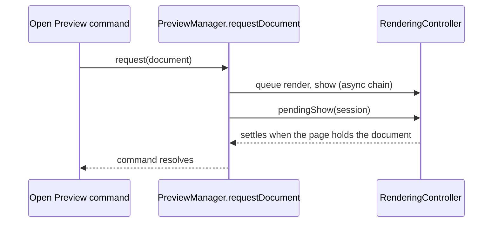

## Summary

The real-VS-Code CI jobs (`integration`, `stress`) have been red on `main` at their first step, `preview-smoke`. Since the render show became asynchronous, Open Preview to Side resolved while the page still held the "Preview pending" status page, so the step read the page before the document was shown. This restores the 1.12.0 behaviour: the command completes once the page shows the document.

## Deliverables

- `RenderingController.pendingShow(preview)` returns the session's pending show (never rejects; resolves at once when nothing is pending: disposed session, hidden panel, result deferred for an open editor).
- `requestDocument` awaits it. This covers Open Preview to Side (first open and same document again), Refresh Preview and a restored panel. The custom editor and Open Preview on another document are unchanged.

## Blast radius

Grade: **1**. One awaited promise in the session layer; a plain `git revert` restores the previous behaviour.

## Autonomous decisions

- The cause (a timing change, not lost admonitions) is proven by the heavy run of this branch rather than by a separate scratch branch: the fixed head leaves the `preview-smoke` assertions untouched, so it is green only if the page lands once the command resolves.

## Known gaps

- None known. Proof: heavy run https://github.com/gsemet/markdown-okf-schema-studio/actions/runs/45244689744 at 0303eaf (on main) is green, integration and stress included (real VS Code). History: after the `preview-smoke` fix, integration failed later in the untrusted suite, then in RI-T34 (run 45232328831); both were test races, fixed below.

Details

## Changes

- Hidden failure, proven a test race (not a product regression; users are unaffected): the host drops a page message whose `requestId` is not the shown stage's, and the stage is set only when the show ends, after the build queue reports `ready`. Tests waited on the queue and sent with its id. `sendPreviewMessageForTests` (`src/host-vscode/testHooks.ts`) now waits for the pending shows first, as a real page posts after it was shown; `getActivePreviewForTests` exposes `shownRequestId` and `waitForCurrentPreview` requires it. This covers every test sender (comment, block move and clipboard, preview editing frontmatter saves, and others), including the same race seen in CR-477's heavy run.
- Rounds 4-6 (test side, no product change): `sendPreviewMessageForTests` waits for the pending show and the shown `requestId`, and handles a message at once when no show is pending (`hasPendingShow`). RI-T34 (`test/integration/realInput/renderPatching.ts`): the content-patch counter incremented after two awaits, so the strict assertions read it before the show ended; a `shownRenderIsCurrent()` wait now precedes every counter read that is not already safe (RI-T34 typing and slow halves, RI-T30, setting off, large document typing); all assertions stay strict. The full sweep table is in the CR work notes (r6.md).
- `test/host/pageMessageWaitsForShow.test.ts`: a message sent while the show is held is applied after it; fails on the previous hook.

- `src/session/features/rendering.ts`: `pendingShow`.
- `src/session/previewManager.ts`: `requestDocument` awaits it.
- `test/host/openCompletes.test.ts`: new test on the real activation and the fake `vscode`; its first case fails without the fix.
- Test-side waits moved into their predicate (edit and switch races, the product is right): `previewEditing.test.ts` (renamed field in the preview; table edit stages) and `stockCoexistence.test.ts` (delayed Open With).
- Requirements: LIFE-003 updated (a sentence in LIFE-032 and LIFE-127, and the test hook), log entry.
- `CHANGELOG.md`.

## Impacts

Users see no visual change; the command finishes later (when the page is shown) as in 1.12.0.

## Test plan

- [x] New or changed tests (they fail on the previous code): `test/host/openCompletes.test.ts`
- [x] Requirements: LIFE-003 updated, markers in code and test, `just requirements-update`
- [x] Changelog: one line under `## Unreleased`
- [x] Local gates: `just check`, `just preflight` (static stage, Windows)
- [x] Review: approved at 0303eaf (round 6 inspector APPROVE, carried over the clean rebase onto main)
- [x] CI green: heavy run 45244689744

## Internal references

CR-479 (heavy-preview-smoke-red), batch-09.

