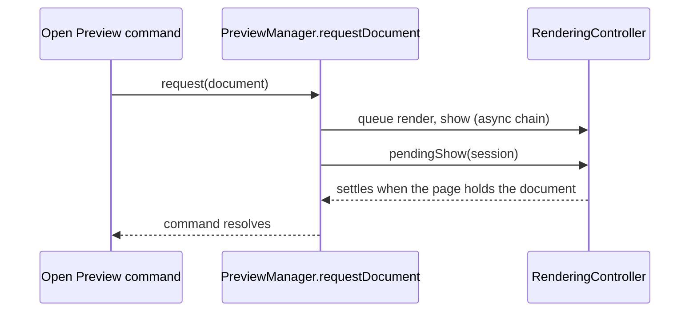

## Summary

The real-VS-Code CI jobs (`integration`, `stress`) have been red on `main` at their first step, `preview-smoke`. Since the render show became asynchronous, Open Preview to Side resolved while the page still held the "Preview pending" status page, so the step read the page before the document was shown. This restores the 1.12.0 behaviour: the command completes once the page shows the document.

## Deliverables

- `RenderingController.pendingShow(preview)` returns the session's pending show (never rejects; resolves at once when nothing is pending: disposed session, hidden panel, result deferred for an open editor).
- `requestDocument` awaits it. This covers Open Preview to Side (first open and same document again), Refresh Preview and a restored panel. The custom editor and Open Preview on another document are unchanged.

## Blast radius

Grade: **1**. One awaited promise in the session layer; a plain `git revert` restores the previous behaviour.

## Autonomous decisions

- The cause (a timing change, not lost admonitions) is proven by the heavy run of this branch rather than by a separate scratch branch: the fixed head leaves the `preview-smoke` assertions untouched, so it is green only if the page lands once the command resolves.

## Known gaps

- **UNVERIFIED:** the heavy run (real VS Code) of this head is not read yet; it is the proof of the cause and the acceptance of the fix.

Details

## Changes

- `src/session/features/rendering.ts`: `pendingShow`.
- `src/session/previewManager.ts`: `requestDocument` awaits it.
- `test/host/openCompletes.test.ts`: new test on the real activation and the fake `vscode`; its first case fails without the fix.
- Test-side waits moved into their predicate (edit and switch races, the product is right): `previewEditing.test.ts` (renamed field in the preview; table edit stages) and `stockCoexistence.test.ts` (delayed Open With).
- Requirements: LIFE-003 updated (a sentence in LIFE-032 and LIFE-127), log entry.
- `CHANGELOG.md`.

## Impacts

Users see no visual change; the command finishes later (when the page is shown) as in 1.12.0.

## Test plan

- [ ] New or changed tests (they fail on the previous code): `test/host/openCompletes.test.ts`
- [ ] Requirements: LIFE-003 updated, markers in code and test, `just requirements-update`
- [ ] Changelog: one line under `## Unreleased`
- [ ] Local gates: `just check`, `just preflight` (static stage, Windows)
- [ ] Review
- [ ] CI green

## Internal references

CR-479 (heavy-preview-smoke-red), batch-09.

