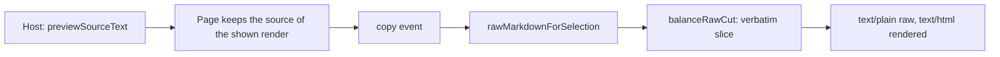

## Summary

Selecting text in Studio and pressing the copy chord copied the rendered text: a table became
tab-separated cells, `---` disappeared and `**bold**` became `bold`. The copy now puts on the
clipboard the raw Markdown under the selection, from the character under its start to the
character under its end, verbatim. The clipboard's HTML still carries the rendered selection, so
pasting into a rich editor stays formatted.

## Deliverables

Before and after for a selection over a thematic break and a table (Chromium capture, same selection on the base and on this branch):

| | Clipboard text/plain |
| --- | --- |
| Before | `Name\tValue\none\tfirst\ntwo\tsecond`: tab-separated cells, no `---`, no `**` (the native copy; the page set nothing) |
| After | `Intro with **bold** and a [link with **strong** words](...) here.`, a blank line, `---`, a blank line, then the table lines `\| Name \| Value \| ...` as written |

The cut is exact and not repaired: a selection starting at "r" of `**world**` copies `rld**`.
Balancing the cut edges is a separate change that fills the seam `balanceRawCut`
(`src/core/mapping/rawCopyEdges.ts`) in a stacked pull request.

## Changes

- Protocol and session: new `previewSourceText` message posted on every page ready of the current render.
- Core: `rawCopy*` modules resolve each selection edge to a source offset; generated content, included blocks, math and computed roles such as `{ref}` are copied whole; the chrome lists of the HTML export move to a shared module.
- Page: a `copy` handler (read and edit mode) with native fallbacks for text controls, a block selection, chrome-only selections, old-side cards in side by side and edges that cannot be placed.
- Requirements and glossary: a new StRS and seven SwRS; the block selection's copy rows reworded; a "Raw copy" glossary entry.

## Impacts

Copying a native selection now gives Markdown source instead of rendered text. Cases whose edge cannot be placed in the source (for example raw HTML, autolinks, reference links, footnotes, tab labels) keep the native copy. The context menu's Copy is not claimed.

## Blast radius

Grade: 2. Shared export chrome lists and the host/page protocol change; revert is a plain `git revert`, behaviour falls back to the native copy.

## Autonomous decisions

- A range that ends at the very start of the next block (a triple-click) stops at the end of the previous text, so the next block's marker and the blank line are not copied.
- Select all, when both edges sit at the sides of the content, copies the whole source exactly; a manual selection from the first to the last text does the same.
- The rendered-to-source projection of the caret mapping was not moved: the raw copy has its own alignment next to it, and the two can be merged later.

## Known gaps

- Edge balancing (closing markers, container fences, table header, list level, heading marker, snapping an unplaceable edge) is not in this PR: it is the stacked follow-up.
- The context menu's Copy, macOS Cmd+C, paste into a rich editor, mouse-drag selection and the text/html flavour in a real VS Code window are not proved; text/html is proved in Chromium only.

## Test plan

Requirements: new `StRS-MDOKFSTUDIO-BLOCK-027` and `SwRS-MDOKFSTUDIO-BLOCK-271` to `-277`; reworded `SwRS-MDOKFSTUDIO-BLOCK-166` (refusal row) and `StRS-MDOKFSTUDIO-BLOCK-016`. Sources: `src/core/mapping/rawCopy*.ts`, `src/page/features/rawCopy.ts`, `src/session/features/rendering.ts`, `src/core/protocol/hostToPage.ts`. Tests: `test/core/mapping/rawCopy.test.ts`, `test/core/protocol/hostToPage.test.ts`, `test/session/previewSourceText.test.ts`, `test/page/runtimeRawCopy.test.ts`, `test/visual/capture_raw_copy.py` (Chromium: text/plain and text/html), `test/integration/realInput/rawCopy.ts` (real VS Code window, keyboard chord).

- [x] New or changed tests (they fail on the previous code): 7 unit tests fail on the base, 39 of 39 pass at c010425; the capture fails before (13 of 13 not prevented) and passes after
- [x] Requirements: SwRS updated or added, markers in code and tests, `just requirements-update`
- [x] Changelog: one user-facing line under `## Unreleased` in `CHANGELOG.md`
- [x] Local gates: `just check` pass; `just preflight` (static stage on Windows) pass at c010425; visual scenario `block-editing/v55-raw-copy-light-900` pass; real-window scenario `raw-copy` pass
- [x] Review: approved at c010425
- [x] CI green: `gh pr checks 498` at c010425 and the heavy run (integration, stress) pass
