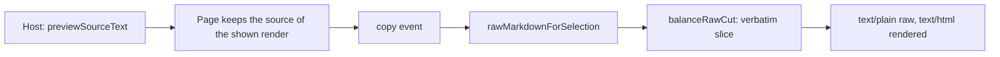

feat(render): copy a text selection as the raw Markdown under it
## Summary

Selecting text in Studio and pressing the copy chord copied the rendered text: a table became
tab-separated cells, `---` disappeared and `**bold**` became `bold`. The copy now puts on the
clipboard the raw Markdown under the selection, from the character under its start to the
character under its end, verbatim. The clipboard's HTML still carries the rendered selection, so
pasting into a rich editor stays formatted.

## Deliverables

Before and after for a selection over a thematic break and a table:

| | Clipboard text/plain |
| --- | --- |
| Before | rendered text, cells separated by tabs, no `---` |
| After | the source lines as written, `---` and the table pipes included |

The cut is exact and not repaired: a selection starting at "r" of `**world**` copies `rld**`.
Balancing the cut edges is a separate change that fills the seam `balanceRawCut`
(`src/core/mapping/rawCopyEdges.ts`) in a stacked pull request.

## Changes

- Protocol and session: new `previewSourceText` message posted on every page ready of the current render.
- Core: `rawCopy*` modules resolve each selection edge to a source offset; generated content, included blocks and math are copied whole; the chrome lists of the HTML export move to a shared module.
- Page: a `copy` handler (read and edit mode) with native fallbacks for text controls, a block selection, chrome-only selections, old-side cards in side by side and edges that cannot be placed.
- Requirements: a new StRS and seven SwRS; the block selection's copy rows reworded.

## Impacts

Copying a native selection now gives Markdown source instead of rendered text. The context menu's Copy is not claimed. Cases that cannot be placed (for example raw HTML, autolinks, reference links, footnotes, roles, tab labels) keep the native copy.

## Blast radius

Grade: 2. Shared export chrome lists and the host/page protocol change; revert is a plain `git revert`, behaviour falls back to the native copy.

## Test plan

Requirements: new `StRS-MDOKFSTUDIO-BLOCK-027` and `SwRS-MDOKFSTUDIO-BLOCK-271` to `-277`; reworded `SwRS-MDOKFSTUDIO-BLOCK-166` (refusal row) and `StRS-MDOKFSTUDIO-BLOCK-016`. Sources: `src/core/mapping/rawCopy*.ts`, `src/page/features/rawCopy.ts`, `src/session/features/rendering.ts`, `src/core/protocol/hostToPage.ts`. Tests: `test/core/mapping/rawCopy.test.ts`, `test/core/protocol/hostToPage.test.ts`, `test/session/previewSourceText.test.ts`, `test/page/runtimeRawCopy.test.ts`, `test/visual/capture_raw_copy.py` (Chromium: text/plain and text/html), `test/integration/realInput/rawCopy.ts` (real VS Code window, keyboard chord).

- [ ] New or changed tests (they fail on the previous code)
- [ ] Requirements: SwRS updated or added, markers in code and tests, `just requirements-update`
- [ ] Changelog: one user-facing line under `## Unreleased` in `CHANGELOG.md`
- [ ] Local gates: `just check` pass; core unit 19 tests; visual scenario `block-editing/v55-raw-copy-light-900` pass; real-window scenario `raw-copy` pass
- [ ] Review
- [ ] CI green

