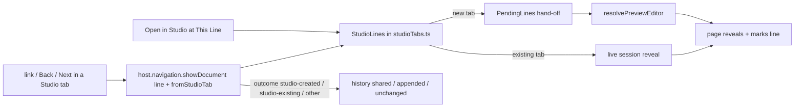

## Summary

A reader who jumps to a line of a Markdown file (search result, Quick Open `file.md:42`, link, Problems panel) cannot get Studio at that line: with the `*.md` association VS Code drops the line, and with the default the text opens. This PR adds an explicit command, **Open in Studio at This Line**, and makes a link, Back or Next followed inside a Studio tab open the target at its line or anchor, with Back returning to the place left. An explicit request for raw text is never replaced.

## Deliverables

- Command `markdown-okf-schema-studio.openInStudioAtLine` (palette on Markdown text editors, editor title menu, no default keybinding); the text tab stays.
- A link, Back or Next to a file whose Studio tab is open in another group reveals that tab; no second tab.
- Probe table: see the header of `test/integration/openAtLineProbe.test.ts` (4 states x 7 entries, VS Code 1.147.0, Windows 11). Verdict per entry (plain jump, Quick Open, link `#L42`, link `#heading`, Problems, Go to Symbol): **no signal** (one Studio tab at the top, no fragment, no selection event, no text editor). Search result: not drivable by command, documented. No entry (search result, Problems, link `#L42`, Quick Open) gives the custom editor a reliable line signal, so a jump under the association keeps opening Studio at the top and the command is the way to reach the line. **UNVERIFIED:** the Linux half of the probe (see Known gaps).

## Blast radius

Grade: 2. The `showDocument` port gains options and an outcome (all fakes updated); links and history change for Studio tabs only. Revert restores today's behaviour.

## Autonomous decisions

- The line signal of 5.1 is not built: the local probe found no reliable signal.

## Known gaps

- The Linux half of the probe is pending (CI run); Search and some Quick Open cells cannot be driven by command.
- The `real-input` integration step times out in this Windows worktree even with the new steps removed; whether it also fails on a clean main is not yet shown.
- **UNVERIFIED:** the full real-window matrix rows of the specification beyond the probe.

Details

## Changes

- `src/core/navigation/pendingLine.ts`: `PendingLines` (take once, 5 s window).
- `src/host-api/navigation.ts`: `showDocument(id, selection?, options?)` returns an outcome.
- `src/host-vscode/studioTabs.ts`, `openInStudioAtLine.ts`, `activation.ts`, `vscodeHost.ts`.
- `src/session/features/links.ts`, `history.ts`, `previewSession.ts`, `previewManager.ts`: Studio-tab flag, shared and appended history.
- `package.json`, docs, glossary, requirements (new LIFE-196..198, amended LIFE-181, TOOLBAR-059, StRS LIFE-023).

## Impacts

No visual change beyond the new menu entry and the marked line in Studio.

## Test plan

- [ ] New or changed tests (they fail on the previous code)
- [ ] Requirements: SwRS updated or added, markers in code and tests, `just requirements-update`
- [ ] Changelog: one user-facing line under `## Unreleased` in `CHANGELOG.md`
- [ ] Local gates
- [ ] Review
- [ ] CI green

## Internal references

CR-483 searched-line.

