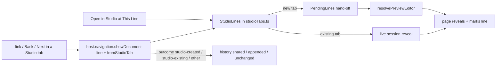

## Summary

A reader who jumps to a line of a Markdown file (search result, Quick Open `file.md:42`, link, Problems panel) cannot get Studio at that line: with the `*.md` association VS Code drops the line, and with the default the text opens. This PR adds an explicit command, **Open in Studio at This Line**, and makes a link, Back or Next followed inside a Studio tab open the target at its line or anchor, with Back returning to the place left. An explicit request for raw text is never replaced.

## Deliverables

- Command `markdown-okf-schema-studio.openInStudioAtLine` (palette on Markdown text editors, editor title menu, no default keybinding); the text tab stays.
- A link, Back or Next to a file whose Studio tab is open in another group reveals that tab; no second tab.
- Probe (VS Code 1.147.0, Windows 11; header of `test/integration/openAtLineProbe.test.ts`). The Studio tab's URI never carries a fragment or query, VS Code gives no selection event and no text editor at resolve, so no entry has a line signal and the automatic line signal is not built:

| State | Entry | Result |
| --- | --- | --- |
| associated, file not open | plain jump, Quick Open `file.md:42`, link `#L42`, link `#heading`, Problems, Go to Symbol | 1 Studio tab, no line signal |
| associated, file not open | Search | commands opened nothing (not drivable) |
| default, file not open | jump, links, Problems, Go to Symbol | text editor at 42 |
| default, file not open | Quick Open, Search | flaky or nothing opened |
| associated, Studio tab elsewhere | jump, Quick Open, links | second Studio tab, at the top |
| associated, Studio tab elsewhere | Problems, Go to Symbol, Search | existing tab revealed or nothing, no line |
| default, Studio tab elsewhere | jump, links, Problems, Go to Symbol | text editor at 42, Studio tab kept |
| default, Studio tab elsewhere | Quick Open | second Studio tab |

- Real-window rows now run (`openAtLineStudio.test.ts`): the command (associated and default, text tab stays), `#heading` link from a Studio tab, Studio Back/Next, VS Code Go Back/Go Forward, Reopen With Text Editor and `openWith default` stay text, reveal in another group with no second tab, default link opens text with history unchanged, Explorer-style open with no marker.

## Blast radius

Grade: 2. The `showDocument` port gains options and an outcome (all fakes updated); links and history change for Studio tabs only. Revert restores today's behaviour.

## Autonomous decisions

- The automatic line signal is not built: the local probe found no reliable signal.

## Known gaps

- The probe table was measured on Windows; the Linux half ran in the heavy CI run [45444316305](https://github.com/gsemet/markdown-okf-schema-studio/actions/runs/45444316305) at 9d956ea (integration, stress, visual all green); its probe lines show the same on Linux: with the association, no entry gives a selection event or a tab fragment or query (`tabUri=-/-`, `selections=none`), so no automatic line signal is built. **UNVERIFIED:** the verdict "no signal" for the Search entry and for Quick Open in the default state rests on absence of evidence: they cannot be driven reliably by command.
- **UNVERIFIED:** the Windows probe table above (VS Code 1.147.0, Windows 11) is a local measurement and was not run again at the pushed head; the Linux CI probe lines agree on every associated row, but differ on two default rows: with the default, Go to Symbol opened nothing on Linux (text editor at 42 on Windows) and Quick Open opened nothing.
- The `real-input` integration step times out in this Windows worktree even with the new steps removed; it passes in the Linux heavy CI run above and on main's CI, so it is a local Windows limit, not shown to come from this change.

Details

## Changes

- `src/core/navigation/pendingLine.ts`: `PendingLines` (take once, 5 s window).
- `src/host-api/navigation.ts`: `showDocument(id, selection?, options?)` returns an outcome.
- `src/host-vscode/studioTabs.ts`, `openInStudioAtLine.ts`, `activation.ts`, `vscodeHost.ts`.
- `src/session/features/links.ts`, `history.ts`, `previewSession.ts`, `previewManager.ts`: Studio-tab flag, shared and appended history.
- `package.json`, docs, glossary, requirements (new LIFE-196..198, amended LIFE-181, TOOLBAR-059, StRS LIFE-023).

## Human decisions

- No automatic replacement of a text tab by Studio, ever; raw text requests (Open as Text, Open With, Reopen With Text Editor) always give the text.
- Proof first in a real window; with no reliable signal, an explicit command opens Studio at the line and an entry with no signal opens Studio at the top (documented limitation).
- No default keybinding for the command; the text tab stays and Studio opens in its group.
- Links, Back and Next inside Studio keep the line; a Studio tab already open in another group is revealed, never duplicated; its own history is kept and the move appended.
- A link followed as text (default settings) is not recorded in Studio's history.

## Impacts

No visual change beyond the new menu entry and the marked line in Studio.

## Test plan

- [x] New or changed tests (they fail on the previous code)
- [x] Requirements: SwRS updated or added, markers in code and tests, `just requirements-update`
- [x] Changelog: one user-facing line under `## Unreleased` in `CHANGELOG.md`
- [x] Evidence: none, no screenshots captured (probe table from the test header and CI log lines)
- [x] Local gates at 9d956ea (carried from eb25d83: only the changelog line changed): `just check` pass, `just requirements-update`/lint, `npm run test:integration -- --trusted-only` (open-at-line, probe and studio steps pass; `real-input` times out on this Windows worktree only, see Known gaps)
- [x] Review: approved at eb25d83 (committed as 2d64c81, rebased; the later commit 9d956ea only changes the changelog PR number)
- [x] Verified at 9d956ea
- [x] CI green at 9d956ea (PR checks and heavy run 45444316305)

## Internal references

CR-483 searched-line.

