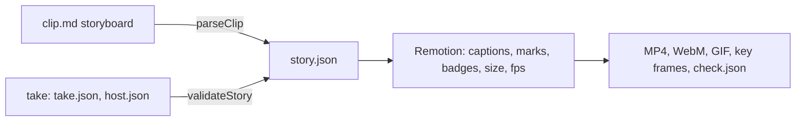

## Summary

The feature clip of the raw copy setting (merged earlier) is one shot with a single caption and a single mark, and its texts live in a one-table `clip.md`. This change gives every feature clip a Markdown storyboard the maintainer can read and edit like the main video's, teaches the clip kit two captions in turn, several marks in turn, combined key badges and a size and frame rate read from that storyboard, and films the raw copy clip again with a new scene.

## Deliverables

The new clip (1280x720, 15 fps, silent, loops), played from the committed GIF at the head; the MP4 and WebM are linked next to it:

- [MP4](https://github.com/gsemet/markdown-okf-schema-studio/raw/f42acf7c5f50b7fe580614f13f22f9233c89c82c/docs/demo-video/clips/raw-copy-balance-edges/raw-copy-balance-edges.mp4)
- [WebM](https://github.com/gsemet/markdown-okf-schema-studio/raw/f42acf7c5f50b7fe580614f13f22f9233c89c82c/docs/demo-video/clips/raw-copy-balance-edges/raw-copy-balance-edges.webm)

## Changes

- `clip-kit/lib/storyboard.mjs`: pure `parseClipText` and `validateStory`; fenced blocks skipped; `Size`, `Frame rate`, several `Text n` captions and several `Mark` rows, with clear `clip.md:` refusals.
- `clip-kit/remotion/src/Clip.tsx`, `lib/encode.mjs`, `lib/check.mjs`: captions and marks in turn, combined badges, dimensions and timings scaled to the storyboard's size and frame rate, one key frame per mark.
- `clip-kit/lib/storyboard.test.mjs` and the `just clip-kit-test` recipe, part of `just check`.
- The raw copy clip: live storyboard, new stage document and scenario, new take and render.
- The feature clip guideline (storyboard first, review rules, PR rule), the glossary, `AGENTS.md`, the alt text in `docs/user/settings.md`.

## Impacts

Documentation tooling only: no change to `src/`. The clip in the user docs changes: before, one shot with a single caption and a single mark on a short selection; after, a selection from inside a bold text in an admonition, across a table and a thematic break, to inside another admonition, with two captions and three marks in turn.

[MP4](https://github.com/gsemet/markdown-okf-schema-studio/raw/f42acf7c5f50b7fe580614f13f22f9233c89c82c/docs/demo-video/clips/raw-copy-balance-edges/raw-copy-balance-edges.mp4), [WebM](https://github.com/gsemet/markdown-okf-schema-studio/raw/f42acf7c5f50b7fe580614f13f22f9233c89c82c/docs/demo-video/clips/raw-copy-balance-edges/raw-copy-balance-edges.webm)

## Blast radius

Grade: 1. Isolated to `docs/demo-video/`, one `just` recipe and doc lines; a plain `git revert` restores the previous clip and kit.

## Test plan

- [x] New or changed tests (they fail on the previous code): `storyboard.test.mjs`, 13 tests
- [x] Requirements: no behaviour change (no `src/` change)
- [x] Changelog: No user-facing change
- [x] Local gates: `just clip-kit-test` 13 of 13, `just check`, `just format`; `just preflight` passes (static stage on Windows)
- [x] Review: inspector approved, committed as f42acf7c
- [ ] CI green

## Autonomous decisions

- Field names `Size`, `Frame rate`, `Outputs`, and a `Zoom` row in the zoom section.
- Mark ids are the storyboard row numbers; allowed ranges 16:9 and 12 to 30 fps.
- Parser tests run in `just check`; key frame names `NN-mark-<id>.png`; alt text and glossary updated.
- The parser skips fenced blocks; the "`-` for none" convention of `Mark` is dropped.
- The loop seam ramp is eased in `Clip.tsx`: at 15 fps a linear ramp gave a seam SSIM of 0.9556, below the 0.98 bound.
- Griller's choices: the `-assets` fallback for the video if GitHub does not play the GIF from the head; the floating "Comment" button kept as filmed.

Not checked: motion, rhythm and the loop as watched (stills only); macOS Cmd+C is not proved in a real window.

🤖 Generated with [Claude Code](https://claude.com/claude-code)
