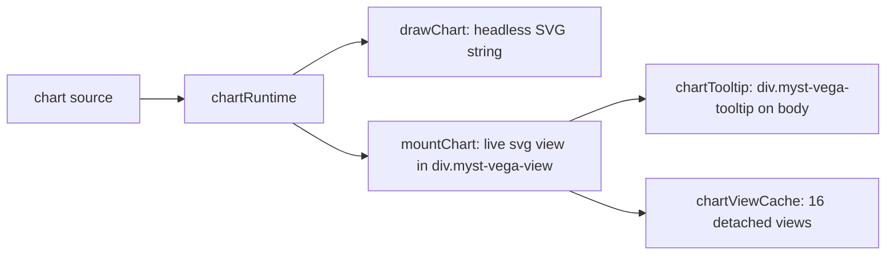

## Summary

A Vega-Lite or Vega chart in the preview was an `img`, which gets no mouse event, so no hover detail could show. Each chart is now a live Vega SVG view. Hovering a Vega-Lite mark shows its fields as key and value rows in a box that follows the page theme, text size and zoom. `"tooltip": null` on a mark turns it off; a full Vega spec shows only the tooltips its marks define. The HTML export keeps a static picture: the drawn inline SVG, with no hover box and no script.

Stacked on the chart text pull request (#520).

## Deliverables

Hover detail on the grouped bar chart, Cream and Dark, at 4404b98 (unchanged by the last commit, which touches only a clip scenario; the pointer is on the first bar):

| Cream | Dark |
| --- | --- |
|  |  |

## Changes

- `vegaView.ts` holds `chartRuntime`, `drawChart` (unchanged result) and `mountChart`; the loader and expression interpreter are shared, so data loading and the security rules are unchanged. `chartConfig` gains `events.bind: "none"`; only the Vega-Lite config gets `mark.tooltip: true`.
- `chartViewCache.ts`: keeps at most 16 detached live views; a view is reused only when detached, so two identical charts each get their own; evicted detached views are finalized.
- `chartTooltip.ts` and `chartTooltipStyles.ts`: one shared box on `body`, rows built as text, positioned through the CSSOM, hidden on scroll, content replacement, redraw and finalize.
- Find skips `.myst-vega-view`; the export rewrites gradient `url(<page>#id)` references to `url(#id)`.
- Clip scenarios, the showcase scenario, docs, skill row, glossary, changelog and requirements follow the new markup; a real-window `live-chart` scenario is added.

## Impacts

Visible: hover detail on charts in the preview. No change to the exported HTML apart from the chart being inline SVG as before for static content.

## Blast radius

Grade: 2. Charts are drawn through a different renderer and cache; revert restores the image chart.

## Test plan

- [x] New or changed tests (they fail on the previous code)
- [x] Requirements: DIAG-123, DIAG-128, DIAG-009 and StRS DIAG-015 updated, markers in code and tests, `just requirements-update`
- [x] Changelog: one user-facing line under `## Unreleased` in `CHANGELOG.md`
- [x] Local gates: `just preflight` (static stage, Windows) passes at 4404b98
- [x] Real window: the `live-chart` scenario passes in the heavy run [45617988132](https://github.com/gsemet/markdown-okf-schema-studio/actions/runs/45617988132) at 4404b98 (`PASS real-input screenshot: diagrams/r01-live-chart-hover`)
- [x] Review: approved at 4404b98 (reviewed as the uncommitted diff on 3df0c86, committed as 4404b98); round 4 (one line of `docs/demo-video/clips/export-html/scenario.mjs`) approved, committed as 124a348
- [x] CI green: static, static-windows, visual and viewer-graph pass at 124a348 (and at 4404b98); heavy run [45625193289](https://github.com/gsemet/markdown-okf-schema-studio/actions/runs/45625193289) at 124a348: live-chart scenario passes
- [x] Clip: `just clip export-html take` (verify included) passes at 124a348 on a fresh VSIX

## Known gaps

- The heavy run's `integration` job failed on a launch timeout of the trusted suite at the `diff-preview` step, which is not this change; the default branch's own heavy run [45580228461](https://github.com/gsemet/markdown-okf-schema-studio/actions/runs/45580228461) failed the same way (at `lifecycle`).
- The hover box and the chart's SVG root get their position and size through the CSSOM, which Chromium shows as a `style` attribute; no Content Security Policy violation is raised, which the `live-chart` scenario checks.
- The `live-chart` real-window pass is the heavy run at 4404b98; the heavy run [45625193289](https://github.com/gsemet/markdown-okf-schema-studio/actions/runs/45625193289) at 124a348 passes it again (`PASS real-input screenshot: diagrams/r01-live-chart-hover`); its `integration` job failed again on a launch timeout of the trusted suite (step `generic-markdown`), the same class as above, and static, visual, stress and viewer-graph pass.

## Internal references

- CR-503 (batch-09), after CR-502.
