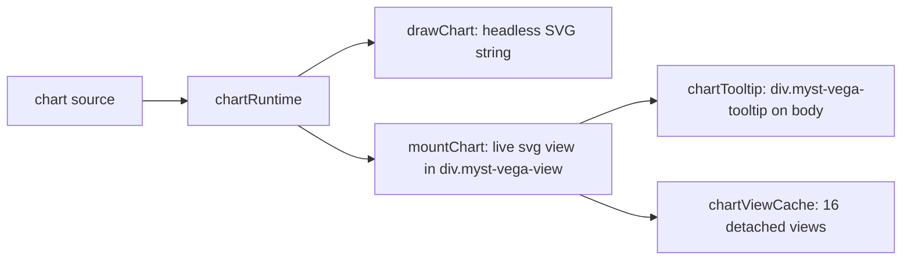

## Summary

A Vega-Lite or Vega chart in the preview was an `img`, which gets no mouse event, so no hover detail could show. Each chart is now a live Vega SVG view. Hovering a Vega-Lite mark shows its fields as key and value rows in a box that follows the page theme, text size and zoom. `"tooltip": null` on a mark turns it off; a full Vega spec shows only the tooltips its marks define. The HTML export keeps a static picture: the drawn inline SVG, with no hover box and no script.

Stacked on the chart text pull request (#520).

## Deliverables

Hover detail, Cream and Dark (screenshots are attached below once uploaded).

## Changes

- `vegaView.ts` holds `chartRuntime`, `drawChart` (unchanged result) and `mountChart`; the loader and expression interpreter are shared, so data loading and the security rules are unchanged. `chartConfig` gains `events.bind: "none"`; only the Vega-Lite config gets `mark.tooltip: true`.
- `chartViewCache.ts`: keeps at most 16 detached live views; a view is reused only when detached, so two identical charts each get their own; evicted detached views are finalized.
- `chartTooltip.ts` and `chartTooltipStyles.ts`: one shared box on `body`, rows built as text, positioned through the CSSOM, hidden on scroll, content replacement, redraw and finalize.
- Find skips `.myst-vega-view`; the export rewrites gradient `url(<page>#id)` references to `url(#id)`.
- Clip scenarios, the showcase scenario, docs, skill row, glossary, changelog and requirements follow the new markup; a real-window `live-chart` scenario is added.

## Impacts

Visible: hover detail on charts in the preview. No change to the exported HTML apart from the chart being inline SVG as before for static content.

## Blast radius

Grade: 2. Charts are drawn through a different renderer and cache; revert restores the image chart.

## Test plan

- [x] New or changed tests (they fail on the previous code)
- [x] Requirements: DIAG-123, DIAG-128, DIAG-009 and StRS DIAG-015 updated, markers in code and tests, `just requirements-update`
- [x] Changelog: one user-facing line under `## Unreleased` in `CHANGELOG.md`
- [ ] Local gates: `just check`, `just clip-kit-test` pass; preflight pending
- [ ] Review
- [ ] CI green

## Known gaps

- The `live-chart` real-window scenario runs only in the heavy CI job, not yet run.

## Internal references

- CR-503 (batch-09), after CR-502.
