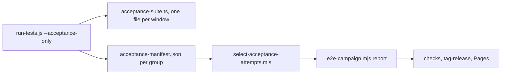

## Summary

A stakeholder requirement (StRS) declares its main paths, but until now no CI job walked a path in a real VS Code to accept it. This PR adds that bench: acceptance tests under `test/integration/acceptance/`, an `acceptance` CI job with one runner per requirement group, and the report, release tagging and Pages steps that take its results. It delivers the first group, trust and security: 5 of its 8 paths are accepted, and each of its software requirement scenarios has a test. The requirements coverage mode is not switched yet.

## Deliverables



An acceptance file exports its window kind and its `run`; each path is one function that carries its marker:

```ts
// test/integration/acceptance/<group>[.<kind>].acceptance.ts
export const windowKind: WindowKind = "trusted"; // or "restricted", "vsix" (the built VSIX, unpacked)
/** <the path, in words> */
// @accepts_req StRS-...#S<n>
async function walksThePath(): Promise<void> { ... }
export async function run(): Promise<void> { await step("<name>", walksThePath); }
```

- One file is one launch and one VS Code window; the tests of a file run in sequence in it.
- `just ci-acceptance [GROUP]` runs the files, on Linux or macOS.

Accepted paths added here (17 were already accepted by tests under `test/integration/`; 22 of 156 are accepted at this head):

| Use case (StRS) | Path | Test file under `test/integration/acceptance/` | Bench |
| --- | --- | --- | --- |
| `StRS-MDOKFSTUDIO-TRUST-001` | S1 | `trust-security.restricted.acceptance.ts` | real VS Code, Restricted Mode |
| `StRS-MDOKFSTUDIO-TRUST-004` | S1 | `trust-security.acceptance.ts` | real VS Code |
| `StRS-MDOKFSTUDIO-TRUST-006` | S1 | `trust-security.acceptance.ts` | real VS Code |
| `StRS-MDOKFSTUDIO-TRUST-009` | S1, S2 | `trust-security.acceptance.ts` | real VS Code |

Groups with no acceptance file yet: rendering-core, code-blocks, gfm, myst, diagrams, frontmatter-schema, frontmatter-editing, layout-width, theme-zoom, toolbar-navigation, block-editing, palette-slash, table-editing, review-annotations, lifecycle-sync.

## Changes

- Runner: `--acceptance-only` and `--group <id>`; argument parsing in `test/shared/runnerArgs.ts`; a suite entry `test/integration/acceptance-suite.ts`.
- Report: `scripts/e2e-campaign.mjs` gains an `acceptance` stage, one manifest per group; `scripts/select-acceptance-attempts.mjs` keeps the newest attempt of each group.
- Built-VSIX window: the VSIX is packaged and unpacked by `scripts/unpack_vsix.py`.
- CI: the heavy `acceptance` job; `report`, `tag-release` and the Pages reuse (`scripts/select_e2e_run.py`) require it.
- Tests: trust and security acceptance files (trusted, Restricted Mode, built VSIX). The built-VSIX window checks the installed texts and icon and accepts no path. A new check under `test/security/` builds the bundles and lists the package files.
- Requirements and docs: the software requirement (SwRS) `SwRS-MDOKFSTUDIO-CORE-076` states the new heavy job; `SwRS-MDOKFSTUDIO-TRUST-092` names the new check; CI and release guidelines, `AGENTS.md` and `CONTRIBUTING.md`.
- Tests and markers: new unit tests for trust and security scenarios that had none, and corrected scenario fragments on existing tests (tables below).
- Docs: `docs/how-we-ship.md` and the requirements project guideline name the new job.
- No file under `src/` changes.

### Trust and security software requirements

Every one of the 94 scenarios of this group's software requirements now has a test marker (74 at the base of this change); no scenario was removed. In the tables, `NNN` stands for `SwRS-MDOKFSTUDIO-TRUST-NNN` and file paths are under `test/`. Across all groups, 702 of 2638 scenarios still have no marker, and 134 of 156 use case paths are not accepted.

| SwRS | Scenario | Now covered by |
| --- | --- | --- |
| 001 | S2 | session/readOnlyImagesSession, session/readOnlyFirstLoad, integration/commentWrite, visual/scenarioDefinitions2 (fragments moved to S2) |
| 005 | S6 | host/lifeReq (new test), session/diagReq.viewState, session/reviewReqComments |
| 007 | S3 | session/trustReq.roots |
| 007 | S4 | session/trustReq.roots |
| 025 | S2 | security/resource-policy (new test) |
| 025 | S4 | security/trustReq.pageBuild (new test) |
| 036 | S3 | security/trustReq (new test) |
| 036 | S5 | security/trustReq (new test) |
| 052 | S1 | session/renderReq.codeCopy |
| 052 | S3 | core/protocol/pageStateMessages (new test) |
| 052 | S5 | core/protocol/pageStateMessages (new test) |
| 052 | S6 | core/protocol/pageStateMessages (new test) |
| 065 | S2 | session/trustReq (new test) |
| 065 | S4 | session/trustReq, session/diagReq.plantuml, session/paletteReq, integration/commentWrite |
| 074 | S3 | security/package-contract (new test) |
| 090 | S8 | page/runtimePaletteActions (new test) |
| 090 | S10 | page/runtimePaletteActions (new test), session/trustReq |
| 092 | S4 | security/package-contract (new test) |
| 092 | S1 | security/builtPackage (new test) |
| 092 | S2 | security/builtPackage (new test) |

Markers dropped by the earlier scenario numbering without a replacement, for this group:

| Dropped marker | Test | Outcome |
| --- | --- | --- |
| 090 S9 | integration/mystPickers `run` | no marker: it calls test hooks and exchanges no page request and answer; S9 is covered elsewhere |
| 005 S1 | integration/standalone-suite `run` | 005 S1 (replaces 007 S1) |
| 005 S1 | integration/untrusted-suite `run` | 005 S1 (replaces 005 S3) |
| 001 S1,S4 | session/blockReq, block save on a read-only file | 001 S1 |
| 001 S1 | session/dropFiles, drop on a read-only file | 001 S1 |
| 005 S2 | session/dropFiles, drop on a standalone file | 005 S1 |
| 001 S1,S4 | session/renderReq.labelRename, rename on a read-only file | 001 S1 |
| 001 S1 | session/reviewReqThreads, reply, delete and find on a read-only file | 001 S1 |

Wrong scenario fragments corrected, per test file. A marker stays only when the test sets up the scenario and observes its result (`xN`: in N tests).

| Test file | Removed | Added |
| --- | --- | --- |
| `core/preview/contentPatch.test.ts` | 022 S5 | none |
| `core/preview/previewStyles.test.ts` | 001 S3, S4 | none |
| `core/protocol/hostToPage.holes.test.ts` | 059 S1, S3, S4 x3 | 059 S6 x3 |
| `core/protocol/hostToPage.test.ts` | 059 S3, S5, S6 | 059 S3, S5 |
| `core/protocol/pageStateMessages.test.ts` | 052 S2, S4 | 052 S3, S4, S5, S6 |
| `core/protocol/pageToHost.test.ts` | 052 S2; 090 S1, S7 | none |
| `host/fmtableReq.requirements.test.ts` | 001 S3, S4; 005 S4, S5; 065 S3 | 001 S1; 005 S1; 065 S6 |
| `host/lifeReq.requirements.test.ts` | 001 S4 | 001 S1; 005 S6; 022 S5 |
| `host/trustReq.requirements.test.ts` | 042 S5 | none |
| `integration/blockClipboard.test.ts` | 005 S3; 065 S5 | none |
| `integration/blockMove.test.ts` | 005 S3; 065 S3 | none |
| `integration/commentWrite.test.ts` | 001 S1, S5; 005 S3; 065 S5; 090 S1, S4 | 001 S2; 065 S3, S4; 090 S7 |
| `integration/imagePaste.test.ts` | 005 S1, S5; 090 S1 | none |
| `integration/imagePicker.test.ts` | 090 S1 | none |
| `integration/inlineThread.test.ts` | 090 S4, S6 | none |
| `integration/labelRename.test.ts` | 065 S5 | none |
| `integration/standalone-suite.ts` | 007 S1 | 005 S1 |
| `integration/trusted-suite.ts` | 011 S1; 012 S1; 036 S1, S4 | none |
| `integration/untrusted-suite.ts` | 005 S3; 025 S3 | 005 S1 |
| `page/hostMessages.test.ts` | 059 S3 x2 | 059 S1, S4 x2 |
| `page/modules/commentCompose.test.ts` | 090 S3 | none |
| `page/modules/commentThreads.test.ts` | 001 S4; 090 S3 | none |
| `page/modules/editPalette.test.ts` | 090 S2 | none |
| `page/modules/hostRequests.test.ts` | 090 S1 x2, S3 x3, S4 | 090 S2, S5 |
| `page/modules/plantumlFileRequests.test.ts` | 090 S3, S4 | 090 S1 |
| `page/runtimeBlockEditor.test.ts` | 059 S2, S3 | 059 S6 |
| `page/runtimeBlockMoves.test.ts` | 059 S2 | 059 S5 |
| `page/runtimeContentPatch.test.ts` | 059 S1, S4 | 059 S6 x2 |
| `page/runtimePaletteActions.test.ts` | 090 S6 | 090 S4, S8, S10 |
| `security/cspInjection.test.ts` | 012 S1, S4 x2, S5 | none |
| `security/html-policy.test.ts` | 022 S1, S2; 036 S1, S2, S4, S6 x2; 042 S3, S5, S6 | none |
| `security/package-contract.test.ts` | none | 074 S3; 092 S4 |
| `security/readOnlyRoot.requirements.test.ts` | 002 S1, S2 x2, S3, S4 x3 | 002 S4 x2 |
| `security/resource-policy.memory.test.ts` | 025 S3 | none |
| `security/resource-policy.test.ts` | 025 S5 | 025 S1, S2 |
| `security/svgSanitizer.test.ts` | 036 S6 | none |
| `security/trustReq.pageBuild.requirements.test.ts` | none | 025 S4 |
| `security/trustReq.requirements.test.ts` | 042 S4 | 012 S1, S5; 025 S5; 036 S3, S4, S5, S6 x2 |
| `session/baselineDiff.test.ts` | 002 S2 | none |
| `session/blockReq.requirements.test.ts` | 001 S3, S4; 005 S2 | 001 S1 x2; 005 S1 |
| `session/checkboxRefusal.test.ts` | 005 S2 | 005 S1, S3 |
| `session/diagReq.plantuml.requirements.test.ts` | 065 S1; 090 S4 | 065 S4 |
| `session/diagReq.viewState.requirements.test.ts` | none | 005 S6 |
| `session/dropFiles.requirements.test.ts` | 001 S1; 005 S2 | 001 S1; 005 S1 x2 |
| `session/paletteReq.requirements.test.ts` | 005 S2, S4; 065 S3, S6 | 001 S3; 005 S1 x2; 065 S4, S5 x4; 090 S3 |
| `session/previewRuntimeFile.test.ts` | 012 S1, S3; 022 S3 | none |
| `session/readOnlyFirstLoad.test.ts` | 001 S1 | 001 S2 |
| `session/readOnlyImages.test.ts` | 002 S1 x5, S2 x3, S5; 091 S1 x3, S2 | 002 S2 x2 |
| `session/readOnlyImagesSession.test.ts` | 001 S1; 002 S2 | 001 S2; 042 S5 |
| `session/readOnlyLocalRoots.test.ts` | 002 S1, S2; 007 S2, S7 | none |
| `session/renderReq.codeCopy.requirements.test.ts` | 005 S1; 065 S6 | 005 S2; 052 S1 |
| `session/renderReq.labelRename.requirements.test.ts` | 005 S2, S5 | 001 S1; 005 S1 |
| `session/reviewReqComments.requirements.test.ts` | 005 S2 x3 | 005 S1 x2, S6 |
| `session/reviewReqThreads.requirements.test.ts` | 005 S2 | 001 S1; 005 S1 |
| `session/toolbarReq.requirements.test.ts` | 007 S1; 065 S5, S6 | 065 S3 |
| `session/trustReq.requirements.test.ts` | none | 052 S2; 065 S2, S3 x2, S4 x3, S5; 090 S4, S10 |
| `session/trustReq.roots.requirements.test.ts` | 007 S1, S5, S7 x3 | 007 S1, S2, S3, S4 |
| `session/webview.priming.test.ts` | 025 S6, S7 | none |
| `visual/capture_layout_checks.py` | 001 S4 | none |
| `visual/readOnlyImagesScenarios.ts` | 002 S5 | none |
| `visual/scenarioDefinitions2.ts` | 001 S1 | 001 S2 |

## Impacts

No visual change: no file of the extension changes. For maintainers: a release is tagged, and Pages reuses a run's reports, only when every `acceptance` shard is green; `just preflight` runs acceptance on Linux and macOS.

## Blast radius

Grade: **3**. CI, release tagging and the Pages report reuse change. A `git revert` of the commits restores the previous jobs.

## Autonomous decisions

- The first delivery is one requirement group (trust and security); the other groups, the coverage-mode switch and its gate are left for follow-up changes, because the whole set of paths and scenarios does not fit in one change.
- A scenario marker was removed wherever the test does not set up the scenario and observe its result; no requirement scenario was removed.
- Pages now requires the stress job on a manually dispatched run too, as on a push to `main`, and refuses a run where a green acceptance shard has no live artifact.
- Three trust and security paths carry no acceptance marker, because their test does not perform or observe every step a path names: reading a text of the preview, finding the Studio in the Extensions view, and installing and packaging from pinned dependencies.

## Known gaps

- **UNVERIFIED:** the real VS Code acceptance tests have not run yet.
- `StRS-MDOKFSTUDIO-TRUST-012` (both paths) and `StRS-MDOKFSTUDIO-TRUST-014` S1 are not accepted: the public VS Code API cannot read the preview's texts or the Extensions view, and a test performs no install. Each needs another kind of test, or a decision, before the coverage mode can be switched.
- The table of `SwRS-MDOKFSTUDIO-TRUST-065` scenario S2 omits newer message types of the preview page; its test checks the listed types only. The requirement text needs an update.
- The other requirement groups have no acceptance file; the coverage mode is not switched and no gate fails on an untested scenario or a path not accepted.

<details>
<summary>Details</summary>

## Human decisions

- A path is walked in one nominal acceptance test; a human step is a simulated input.
- The acceptance job runs one shard per requirement group, one shared window per test file, with no raised timeout.
- Coverage counts test markers; the proof that a test passes is its CI job.
- The delivery may stop after any complete group; the coverage-mode switch lands last.

## Test plan

- [ ] New or changed tests (they fail on the previous code)
- [ ] Requirements: SwRS updated or added, markers in code and tests, `just requirements-update`
- [x] Changelog: no user-facing change
- [ ] Local gates: pending
- [ ] Evidence: pending
- [ ] Review: pending
- [ ] Verified: pending
- [ ] CI green: pending

## Internal references

- CR-505 strs-acceptance (stacked on CR-504, pull request #524).

</details>

🤖 Generated with [Claude Code](https://claude.com/claude-code)
