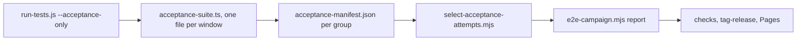

## Summary

A stakeholder requirement (StRS) declares its main paths, but until now no CI job walked a path in a real VS Code to accept it. This PR adds that bench: acceptance tests under `test/integration/acceptance/`, an `acceptance` CI job with one runner per requirement group, and the report, release tagging and Pages steps that take its results. It delivers the first group, trust and security (8 paths). The requirements coverage mode is not switched yet.

## Deliverables



An acceptance file exports its window kind and its `run`:

```ts
// test/integration/acceptance/<group>[.<kind>].acceptance.ts
export const window = "trusted"; // or "restricted", "vsix" (the built VSIX, unpacked)
/** <the path, in words> */
// @accepts_req StRS-...#S<n>
export async function run(): Promise<void> { ... one step() per path ... }
```

- One file is one launch and one VS Code window; the tests of a file run in sequence in it.
- `just ci-acceptance [GROUP]` runs the files, on Linux or macOS.

## Changes

- Runner: `--acceptance-only` and `--group <id>`; argument parsing in `test/shared/runnerArgs.ts`; a suite entry `test/integration/acceptance-suite.ts`.
- Report: `scripts/e2e-campaign.mjs` gains an `acceptance` stage, one manifest per group; `scripts/select-acceptance-attempts.mjs` keeps the newest attempt of each group.
- Built-VSIX window: the VSIX is packaged and unpacked by `scripts/unpack_vsix.py`.
- CI: the heavy `acceptance` job; `report`, `tag-release` and the Pages reuse (`scripts/select_e2e_run.py`) require it.
- Tests: trust and security acceptance files (trusted, Restricted Mode, built VSIX) and a package check under `test/security/`.
- Requirements and docs: `SwRS-MDOKFSTUDIO-CORE-076` states the new heavy job; CI guidelines, `AGENTS.md` and `CONTRIBUTING.md`.
- No file under `src/` changes.

## Impacts

No visual change: no file of the extension changes. For maintainers: a release is tagged, and Pages reuses a run's reports, only when every `acceptance` shard is green; `just preflight` runs acceptance on Linux and macOS.

## Blast radius

Grade: **3**. CI, release tagging and the Pages report reuse change. A `git revert` of the commits restores the previous jobs.

## Autonomous decisions

- The first delivery is one requirement group (trust and security); the other groups, the coverage-mode switch and its gate are left for follow-up changes, because the whole set of paths and scenarios does not fit in one change.
- Pages now requires the stress job on a manually dispatched run too, as on a push to `main`.

## Known gaps

- **UNVERIFIED:** the real VS Code acceptance tests have not run yet.
- The other requirement groups have no acceptance file; the coverage mode is not switched and no gate fails on an untested scenario or a path not accepted.

<details>
<summary>Details</summary>

## Human decisions

- A path is walked in one nominal acceptance test; a human step is a simulated input.
- The acceptance job runs one shard per requirement group, one shared window per test file, with no raised timeout.
- Coverage counts test markers; the proof that a test passes is its CI job.
- The delivery may stop after any complete group; the coverage-mode switch lands last.

## Test plan

- [ ] New or changed tests (they fail on the previous code)
- [ ] Requirements: SwRS updated or added, markers in code and tests, `just requirements-update`
- [x] Changelog: no user-facing change
- [ ] Local gates: pending
- [ ] Evidence: pending
- [ ] Review: pending
- [ ] Verified: pending
- [ ] CI green: pending

## Internal references

- CR-505 strs-acceptance (stacked on CR-504, pull request #524).

</details>

🤖 Generated with [Claude Code](https://claude.com/claude-code)
