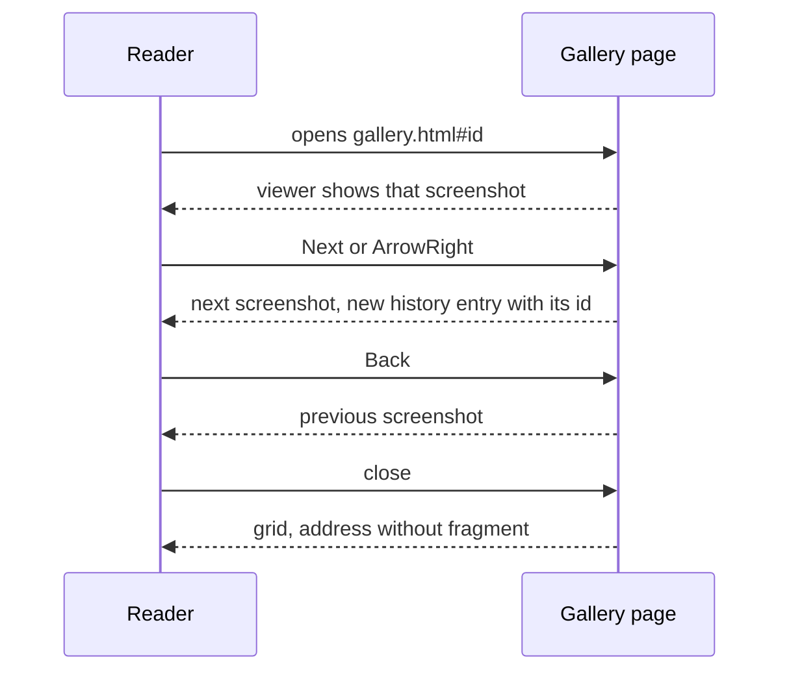

## Summary

On the published screenshot gallery (`gallery.html` on GitHub Pages), opening a screenshot or moving
with Previous and Next never changed the address. A screenshot could not be linked, bookmarked or
reloaded, and Back left the gallery. Each screenshot now has its own stable link.

## Deliverables

Each screenshot has the address `gallery.html#<capture id>`. The capture id comes from the scenario
and step that took the screenshot, so it stays the same from one CI run to the next:

| Screenshot file, under the screenshot folder | Link |
| --- | --- |
| `visual/<scenario id>.png` | `gallery.html#<scenario id>` |
| `visual/<scenario id>--<step>.png` | `gallery.html#<scenario id>--<step>` |
| `<run folder with a random suffix>/<group>/rNN-<slug>.png` | `gallery.html#<group>/rNN-<slug>` |
| any other file | `gallery.html#<path without extension>` |

The address follows what the reader looks at:

## Changes

- Each card of the grid is a real link, so a middle click, a Ctrl click and "Copy link address" give
  the screenshot's address. A plain click opens the viewer as before.
- The page script opens the screenshot the address names, adds a history entry on open, Previous,
  Next and close, sets the tab title to the capture id, and returns the focus to the card on close.
- A link to a screenshot that no longer exists shows a notice above the grid instead of a viewer.
- When two screenshots would get the same id (two local runs of one suite), the first keeps the
  short id and the others take their full path.
- The gallery page code moves to its own module, `test/site/galleryPage.ts`.
- New browser test of the links, run by the `viewer-graph` CI job (and a comment on that job).
- `CONTRIBUTING.md` describes the screenshot links, and the glossary gains the term "Capture id".

## Impacts

- Readers can link, bookmark and reload a screenshot, and step back through those they saw.
- The addresses published today keep working: `gallery.html`, the image files and the Markdown group
  pages. The order of the screenshots, the position counter and the side panel do not change.
- The grid looks the same.

Before is the base `4a47151`, after is `c715355`, both built from the same CI screenshots. The
yellow strip at the bottom of each image prints the page address (added for the capture).

| | Before | After |
| --- | --- | --- |
| Open a screenshot, then Next |  |  |
| Open a link to a missing screenshot |  |  |

## Blast radius

- **1**: local and isolated; a plain `git revert` restores the previous behaviour.

Grade: 1 (only the generated gallery page of the published site and its tests; the extension itself
does not change).

## Autonomous decisions

- One page with a link fragment, rather than one HTML page per screenshot. A shared link therefore
  shows the gallery's social card.
- The arrow keys held with Alt or Meta, and Alt with a click on a card, are left to the browser, so
  that its Back and Forward shortcuts keep working in the viewer.
- Closing the viewer also adds a history entry, so Back after a close reopens the screenshot just
  closed.
- The new requirement is recorded as proposed.

## Test plan

- [x] New or changed tests (at c715355 they fail on the previous code, 4a47151): unit tests of the
      page and a Chromium test of the links
- [x] Requirements: `SwRS-MDOKFSTUDIO-CORE-096` added (proposed), implemented in
      `test/site/galleryPage.ts`, tested in `test/site/gallery.test.ts` and
      `test/site/galleryLinks.browser.test.ts`; `just requirements-update` clean at c715355
- [x] Changelog: one user-facing line under `## Unreleased` in `CHANGELOG.md`
- [x] Local gates: `just preflight` passes at c715355 (static stage on Windows);
      `just ci-viewer-graph` passes at c715355
- [x] Review: approved at c1037ae (last change, in the changelog), committed as c715355
- [x] CI green at c715355

🤖 Generated with [Claude Code](https://claude.com/claude-code)
