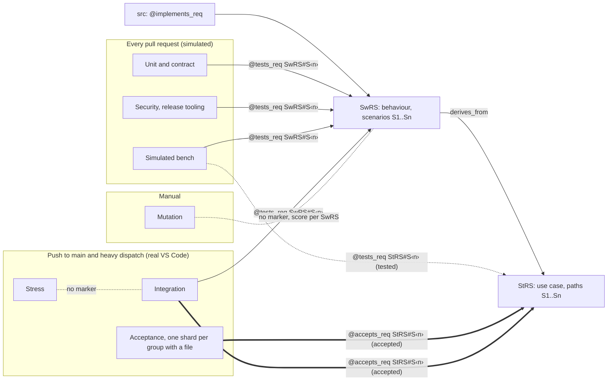

# How we test: a docs page linking test levels to requirements

A new page, `docs/how-we-test.md`, published on the site as `docs/how-we-test.html` and linked
from the site header. It explains every level of test the Studio runs (unit, contract, security,
release tooling, the simulated bench, real VS Code integration, acceptance, stress, mutation) and
how each one is tied to a level of requirement (StRS paths, SwRS scenarios, the `@tests_req` and
`@accepts_req` markers with their `#S<n>` fragments, the okfreq coverage reports and the viewer
cards). It has one diagram of the levels and one table that maps each test level to the
requirement level it proves. It describes the project as CR-505 delivers it in batch-09, and says
plainly what is not enforced yet. A drift test keeps the checkable facts of the page in step with
the repository, and fails when a later change (the coverage-mode switch among them) changes what
the page states.

For the owner: one page answers "what proves that this use case works, and where does that proof
run", in the words the requirements viewer and the CI use.

Short name: `how-we-test`.

## Sources

- This CR folder: `intake/request.md`, `01-intent.md`, `02-answers.md` (Q1, how-we-test-Q2).
- The state the page describes: CR-505's delivered head,
  `9d7e788a479dec70fd882d295bf0d5e78f4f6b98` (pull request
  https://github.com/gsemet/markdown-okf-schema-studio/pull/532), which contains `origin/main`
  with CR-504 (`changes/4-batch/3-done/504-strs-path-validation/`) merged. Every fact below was
  read there with `git show <sha>:<path>`. The main checkout's files are behind and are not a
  source.
- The CR-504 and CR-505 specs, for the words of the model only (`scenarios:`, `#S<n>`, benches,
  acceptance files): `changes/4-batch/3-done/504-strs-path-validation/03-change-spec.md` and
  `changes/4-batch/2-actives/505-strs-acceptance-tests-and-okfreq-mode-sw/03-change-spec.md`.
  Where those specs describe a later state (CR-505's B9 gate and B10 mode switch, which O-158
  sends to the batch after batch-09), the page does not follow them.
- In the Studio repository at that head: `test/`, `sphinx/tests/`, `justfile`, `package.json`
  (`test:*` scripts), `.github/workflows/ci.yml`, `requirements/config.yml`,
  `scripts/check-marker-companions.mjs`, `scripts/check_main_paths.py`, `CONTRIBUTING.md`
  ("Checks", "Mutation testing of src/core"), `.agents/guidelines/ci.guidelines.md` (rules 13
  and 14), `requirements/guidelines/project.guidelines.md` ("Benches", "Scenario and path
  markers"), `test/shared/e2eGroups.ts`, `test/shared/stressPlan.ts`,
  `test/integration/acceptanceRunner.ts`, `test/site/buildSite.ts`, `test/site/siteHeader.ts`,
  `test/site/requirementsViewer/home.ts`, `docs/how-we-ship.md`.
- okfreq (`okf-schema` 0.18.1, the version of `uv.lock`): the meaning of the coverage modes, from
  `STRS_TEST_COVERAGE_DESCRIPTIONS` in `okf_schema/okfreq/core.py`.

The project rules apply as written and this spec does not restate them: the constitution
(`.agents/constitution.md`), `AGENTS.md`, `requirements/guidelines/requirements.guidelines.md`,
`requirements/guidelines/project.guidelines.md`, `.agents/guidelines/ci.guidelines.md` and
`.agents/guidelines/pull-request.guidelines.md`.

## The state the page describes (read at CR-505's head)

The coder re-reads each of these on the parent when starting (H6); this list is what the spec was
written against.

- `requirements/config.yml`: `strs_test_coverage_mode: linked-swrs-and-validation-test`; markers
  `@implements_req`, `@tests_req`, `@accepts_req`.
- okfreq's meaning of that mode: a StRS is covered when it is linked to at least one SwRS, every
  linked SwRS has at least one test marker, and at least one `@tests_req <StRS-ID>` (a "validation
  test") names the StRS. An `@accepts_req` does not count toward a StRS's coverage in this mode, a
  SwRS counts as tested with any one test marker (not one per scenario), and `okfreq
  update-coverage` writes no `tested_in_files` or `accepted_in_files` on a StRS. The stricter mode,
  `linked-swrs-and-acceptance-paths` (every declared SwRS scenario tested, every StRS path
  accepted), is not the project's mode.
- `just requirements-lint`: `okfreq validate`, `okfreq lint --check`, `okfreq update-coverage
  --check`, `scripts/check_main_paths.py`, `npm run check:diagrams`. None of them fails on an
  untested SwRS scenario, on a StRS path with no acceptance test, or on a StRS with no
  `scenarios:`. There is no `scripts/check_scenario_coverage.py`.
- `just check-markers` (`scripts/check-marker-companions.mjs`, in `just check`) holds placement,
  not coverage: rules 1 to 3 (a source marker on every in-force SwRS, at most 3 IDs per marker
  block, companions), rule 4 (fragments: `fragment-undeclared`, `fragment-required`,
  `fragment-unexpected`, `implements-fragment`) and rule 5 (benches: `accepts-placement`,
  `accepts-on-swrs`, `strs-tests-in-integration`, the last one on a ratchet).
- Acceptance: files `test/integration/acceptance/<group>[.<kind>].acceptance.ts`, one VS Code
  launch per file (`acceptanceRunner.ts`); `just ci-acceptance [GROUP]`; the CI job `acceptance`
  has one shard per group in its `matrix.group`, today `[trust-security]` only. Other real-window
  suites under `test/integration/` also carry `@accepts_req <StRS-ID>#S<n>` and run in the
  `integration` job. No StRS of CORE-007, CORE-008 or TRUST-014 carries an `@accepts_req` yet:
  `check-markers` allows it on their own bench, nothing uses that yet.
- `@tests_req <StRS-ID>#S<n>` (a simulated walk of a path) sits only under `test/visual/` today.
- A release tag needs `checks`, `integration`, `acceptance` and `stress` green (ci.guidelines
  rule 14); that gate is on test results, not on coverage.
- Viewer home cards (`test/site/requirementsViewer/home.ts`): "StRS paths tested", "StRS paths
  accepted", "StRS covered" ("Follows okfreq's current coverage mode."), "SwRS scenarios tested";
  area table columns "Paths tested" and "Paths accepted".
- Unit test folders (`test:unit` in `package.json`): `test/build`, `test/core`, `test/host`,
  `test/host-memory`, `test/host-vscode`, `test/node-services`, `test/page`, `test/session`,
  `test/site`. Other folders directly under `test/`: `test/fixtures`, `test/integration`,
  `test/probe`, `test/release` (one script, `audit-lockfile.mjs`, that no `justfile` target,
  `package.json` script or workflow calls at that head), `test/security`, `test/shared`,
  `test/visual`. The Sphinx fixtures live in `sphinx/tests/fixtures/`; there is no top-level
  `tests/` folder.
- CI jobs: the page and the drift test take them from `.github/workflows/ci.yml` on the parent,
  never from a list in this spec (H15). A change below CR-507 in the stack splits the `visual`
  job in two; whatever jobs the parent has, the page names.

## Decisions

### From the answers

- **Q1:** a docs page, written in English, with a diagram of the levels and a table linking each
  test level to the requirement level it proves. It follows CR-505 in the stack (`depends.json`:
  after `strs-acceptance-tests-and-okfreq-mode-sw`). The existing docs and the contributor guide
  link to it.
- **how-we-test-Q2:** the page is written now, in batch-09, for the state CR-505 delivers. It does
  not wait for the coverage-mode switch, which goes to the batch after batch-09. (This removes the
  former prerequisite H7.)

### Taken by this spec

- **H1. Place and name.** The page is `docs/how-we-test.md`, next to `docs/how-we-ship.md`. The
  site build already renders every Markdown file under `docs/` (`walkMarkdown` in
  `test/site/buildSite.ts`), so it is published as `out/site/docs/how-we-test.html` with no
  change to the walk. The title is "How we test".
- **H2. Site navigation.** The site header (`siteHeader` in `test/site/siteHeader.ts`) gains a
  sixth link, "How we test", between "How we ship" and "Gallery":
  Home, Contributing, How we ship, How we test, Gallery, Requirements. Every page of the site,
  the requirements viewer included, carries it, because they all use `siteHeader`.
- **H3. Social card.** `SIMPLE_CARDS` in `test/site/buildSite.ts` gains an entry for
  `docs/how-we-test.md`: page `docs/how-we-test.html`, image `og/how-we-test.png`, eyebrow
  "How we test", headline "From a use case to its proof", line "Every test level and the
  requirement it proves", title "How we test: Markdown OKF-Schema Studio", description "How
  Markdown OKF-Schema Studio is tested, from unit tests to acceptance tests in a real VS Code
  window, and how each test is tied to a requirement."
- **H4. The diagram is a hand-written SVG**, `images/how-we-test/test-levels.svg`, like
  `images/how-we-ship/release-1-6-1.svg`. Reason: the site renders Markdown through `renderMyst`,
  which leaves a Mermaid fence as its source text (`normalizeDiagram` in
  `src/core/render/mystNormalize.ts`); the site pages load no Mermaid script. A committed SVG shows
  the same on GitHub, in Studio and on the site. Its content is given in "The diagram" below.
- **H5. The page states no counts.** It gives no number of requirements, paths, tests or files,
  since every such number drifts with each change. It points to the live counts instead: the
  requirements viewer home cards and the generated reports. Lists of names (test folders, jobs,
  groups, the groups with acceptance files) are not counts and are checked by the drift test.
- **H6. The page describes the parent as it is.** The coder writes every row from the stack parent
  as it is when the coder starts (CR-505's head, plus any CR stacked between CR-505 and CR-507,
  such as the split of the `visual` job), not from this spec. A fact of this spec that differs on
  the parent is written as the parent has it, and listed in the PR body.
- **H7. Removed** by how-we-test-Q2: no prerequisite on the coverage-mode switch. The page is
  written for the mode the parent has.
- **H8. A drift test guards the checkable facts.** A new unit test,
  `test/site/howWeTest.test.ts`, reads the shipped page and the repository and fails when they part
  (see "The drift test"). It runs in `just unit`, so in `just check` and in the CI jobs that run
  `just ci-static`.
- **H9. Who keeps it current.** The agent whose change adds, removes or renames a test folder
  under `test/`, a job of `ci.yml`, an e2e group, a group of the `acceptance` matrix, a marker
  verb, a line of `requirements-lint` or the coverage mode updates the page in the same pull
  request; the drift test fails until it does. Two rules say it for what the test cannot see (a
  command, when a level runs, the wording of a rule): a new rule in
  `.agents/guidelines/ci.guidelines.md`, and a bullet in "Requirements traceability" of
  `requirements/guidelines/project.guidelines.md` (see "Keeping it current"). The Inspector checks
  them like any other rule.
- **H10. No new requirement.** The page is documentation; the drift test is a doc-consistency
  test, like `test/build/test_guideline_isolation.py` and `test/build/marketplaceReadme.test.ts`,
  which carry no marker. The only behaviour that changes is the site header (H2) and the set of
  pages with a social card (H3): that is SwRS-MDOKFSTUDIO-CORE-086 (proposed at CR-505's head,
  derived from StRS-MDOKFSTUDIO-CORE-008), updated here.
- **H11. One commit.** `docs: add a How we test page linking test levels to requirements`
  (no scope: scopes are for `feat` and `fix` only). No CHANGELOG line: it is not a `feat` or a
  `fix`, and no user of the extension sees it.
- **H12. Who links to it.** `CONTRIBUTING.md` ("Checks"), `docs/how-we-ship.md` ("The rules that
  keep it honest"), `requirements/guidelines/project.guidelines.md` ("Benches") and the site header
  (H2). The requirements viewer home is reached from the page, not changed by it.
- **H13. Links inside the page.** Repository files are linked by relative path (`../test/...`,
  `../CONTRIBUTING.md`); the site build rewrites them (`rewriteLinkTarget`). The requirements
  viewer, which exists only on the published site, is linked by its absolute URL,
  `https://gsemet.github.io/markdown-okf-schema-studio/requirements/`, as `docs/how-we-ship.md`
  already does.
- **H14. The page says plainly what is not enforced yet.** It states the coverage mode the parent
  has, what okfreq counts in that mode, and, in its own section, what no gate checks today: an
  untested SwRS scenario, a StRS path with no acceptance test, and the groups with no acceptance
  file are reported (viewer cards, reports), never a failure. It names the stricter okfreq mode
  as not used, with no date and no promise ("not enforced yet", never "will be enforced in ...").
- **H15. CI job names come from `ci.yml`.** Neither this spec, the drift test nor the guideline
  holds a fixed list of job names. The page names each job of the parent's `ci.yml` (in the table,
  by the command its step runs: the jobs whose step runs `just ci-static`, `just ci-visual`, and
  so on); the drift test reads the keys of `jobs:` at the head under test. A job that runs no
  test level (`report`, `checks`, `release-check`, `tag-release`, `release`, `pages`, `gallery`
  at CR-505's head) is named in one short list in "What a count does not prove" or "The levels
  at a glance", with its role in a few words.
- **H16. The drift test ties the page to the current mode.** It fails when the coverage mode, the
  groups of the `acceptance` matrix or the commands of `requirements-lint` change, so the change
  that switches the mode or adds the coverage gate (the batch after batch-09) must rewrite the
  page's statements on coverage and on what is not enforced (checks 6 to 8 of "The drift test").

## The page

`docs/how-we-test.md`, plain GFM plus the one image (the site renders it through `renderMyst`,
and a rendering error fails the build). Its outline, with what each section says:

1. **`# How we test`.** Two short paragraphs: every behaviour of the Studio is a requirement, and
   requirements are proved by tests that name them with a marker; okfreq counts those markers and
   the CI jobs prove that the tests pass. The page follows one use case from its paths to the
   tests that prove them, and ends with what is not enforced yet.
2. **`## Two levels of requirements`.**
   - A **StRS** (stakeholder requirement) is a use case. Its `### Main paths` are declared in its
     `scenarios:` frontmatter as `S1`, `S2`, … and headed `#### Path S<n>: <title>`.
   - A **SwRS** (software requirement) is one behaviour, derived from a StRS (`derives_from`). Its
     transition scenarios are declared the same way and headed `### Scenario S<n> (<kind>): <title>`.
   - Code that implements a SwRS carries `@implements_req <SwRS-ID>`, with no fragment.
   - A short example with one real StRS path and one real SwRS scenario (the coder picks one pair
     from the parent, for example StRS-MDOKFSTUDIO-TRUST-001 path S1, accepted in
     `test/integration/acceptance/trust-security.restricted.acceptance.ts`, and one scenario of a
     SwRS it derives to; both files linked under `requirements/tiers/`).
3. **`## The levels at a glance`.** The diagram (H4), with an alt text that says what it shows,
   then one sentence per lane: every pull request (simulated), every push to `main` and heavy
   dispatch (real VS Code), manual.
4. **`## Which test proves which requirement`.** The table (see "The table"), then the rules in a
   list, as `check-markers` holds them:
   - a SwRS scenario is **tested** by `@tests_req <SwRS-ID>#S<n>` on any bench;
   - a StRS path is **tested** by `@tests_req <StRS-ID>#S<n>` where a simulated walk of the path
     exists (outside `test/integration/`), and **accepted** by `@accepts_req <StRS-ID>#S<n>` on a
     walk in a real VS Code window, under `test/integration/`; the StRS whose product is not the
     editor (CORE-007 the release, CORE-008 the site, TRUST-014 the built VSIX) may be accepted on
     the test closest to their product (`test/build`, `test/security`, `test/site` or
     `test/core`);
   - `@accepts_req` never targets a SwRS, and no new `@tests_req <StRS-ID>` goes under
     `test/integration/`;
   - a marker on a requirement that declares `scenarios:` has a fragment naming a declared id;
     one with no `scenarios:` has none.
5. **`## The test levels`.** One `###` section per level, each with: what it runs, its folder, its
   local command, its CI job (H15), when it runs, the marker it carries. Levels, in this order:
   - **Unit tests**: the folders of `test:unit` (`test/build`, `test/core`, `test/host` with its
     fake VS Code host harness and `*.requirements.test.ts` files, `test/host-memory`,
     `test/host-vscode`, `test/node-services`, `test/page`, `test/session`, `test/site`); `just
     unit`; in `just check`, so in the jobs that run `just ci-static`; every pull request.
   - **Contract tests**: `test/core/render/*.contract.ts` (`just contracts`) and the Python Sphinx
     source-mapping contract (`just sphinx-check`, tests and fixtures in `sphinx/tests/`); in
     `just ci-static`; every pull request.
   - **Security tests**: `test/security` (`just security`) and the online npm audit (`just
     audit`); in `just ci-static`; every pull request. `test/release` is described as the parent
     has it (at CR-505's head, a lockfile audit script no target calls).
   - **Release and tooling tests**: the Python tests of `test/build/` (`just release-tests`:
     workflows, release, run selection, guideline isolation, main paths and the other files of its
     pytest line); in `just check`; every pull request.
   - **Simulated bench**: `test/visual` (Playwright Chromium against a mock host, with the
     screenshots of the gallery) and the table and code block breakout tests, `just ci-visual`;
     the use case map and gallery link tests in Chromium, `just ci-viewer-graph`; every pull
     request. A simulated walk of a StRS path carries `@tests_req <StRS-ID>#S<n>`. The job names
     are the parent's (H15).
   - **Real VS Code integration**: `test/integration` (one window per suite, real keys through
     `realInput/`), `just ci-integration`, job `integration`; every push to `main` and every heavy
     dispatch (`gh workflow run ci.yml --ref <branch> -f heavy=true`), never a pull request. It
     proves SwRS scenarios, and its suites that walk a StRS path end to end carry `@accepts_req
     <StRS-ID>#S<n>`.
   - **Acceptance**: `test/integration/acceptance/<group>[.<kind>].acceptance.ts`, one VS Code
     launch per file, one test per path; `just ci-acceptance [GROUP]`; job `acceptance`, one shard
     per group that has an acceptance file; same trigger as `integration`. A human step is a
     simulated input: the test checks the gate, never a judgment. The page names the groups that
     have acceptance files in one line, ``Groups with acceptance files: `<group>`, ...`` (at
     CR-505's head: `trust-security`), and says that the other groups have none yet.
   - **Stress**: the flake-prone real-window scenarios of `test/shared/stressPlan.ts` repeated
     `REPEAT` times, `just ci-stress [REPEAT]`, job `stress`; same trigger; advisory except on a
     version change (ci.guidelines rule 14). It proves no new requirement: it proves that a passing
     test passes every time.
   - **Mutation**: `just mutation-core [SAMPLE]` on `src/core` against `test/core`, manual, never
     in CI; its report scores each SwRS (`out/reports/mutation/summary.md`). It measures how well
     the SwRS tests catch a broken implementation.
   - **Repro tools and probes**: the `toc-loop` job (`just ci-toc-loop`, a repro tool that never
     gates a merge) and the probes of `test/probe` (performance, frames, chart shots). No marker.
   - The folders that hold shared code or data only, `test/shared` and `test/fixtures`, are named
     in one line.
6. **`## The e2e groups`.** The 16 groups of `test/shared/e2eGroups.ts` (linked) are the okfreq
   scopes, the areas of the requirements viewer, the folders of the visual scenarios and the
   possible shards of the `acceptance` job. The ids in a compact list, in `GROUPS` order.
7. **`## From markers to coverage`.**
   - `just check-markers` (part of `just check`): the placement rules (a declared fragment on a
     target with `scenarios:`, none without; `@accepts_req` only where allowed; at most 3 IDs per
     marker block). It checks where a marker sits, not whether a requirement is covered.
   - `just requirements-update` runs `okfreq update-coverage`, which writes
     `implemented_in_files` and `tested_in_files` into the SwRS files.
   - The coverage mode, in one line of exactly this form (the drift test reads it):
     ``The StRS coverage mode is `linked-swrs-and-validation-test`.`` followed by what okfreq
     counts in it (see "The state the page describes"): a StRS is **covered** when it has at least
     one linked SwRS, every linked SwRS has at least one test marker, and at least one
     `@tests_req <StRS-ID>` names it. Acceptance markers are counted and shown, but do not change
     whether a StRS is covered.
   - `just requirements-lint`: the commands it runs (`okfreq validate`, `okfreq lint`, `okfreq
     update-coverage --check`, `scripts/check_main_paths.py`, `check:diagrams`), each in one line
     with what it fails on: schemas and links, generated fields out of date, a `### Main paths`
     citation of a SwRS that does not exist or does not derive, a use case diagram out of step.
   - The reports: `just requirements-report` (`out/reports/requirements/`, with
     `requirements-trace.json`), `okfreq trace requirements --json` (`scenario_markers`).
   - The viewer cards on the requirements viewer home (H13 link): "StRS paths tested", "StRS paths
     accepted", "StRS covered" (it follows the current mode), "SwRS scenarios tested", and the area
     table columns "Paths tested" and "Paths accepted"; a use case page lists each path with the
     files that test and accept it.
8. **`## What a count does not prove`.** okfreq counts markers, it never reads test results. The
   proof that a marked test passes is the green CI job of its bench: the simulated jobs on the pull
   request, `integration`, `acceptance` and `stress` on the heavy run that gates a release
   (ci.guidelines rule 14). The jobs that run no test level (H15) in one short list.
9. **`## What is not enforced yet`.** Present while the mode is not
   `linked-swrs-and-acceptance-paths` (the drift test holds it). Plain sentences, no date:
   - no check fails on a SwRS scenario with no test, or on a StRS path with no acceptance test:
     the viewer cards and the reports show them;
   - a SwRS counts as tested for coverage with one test marker, whatever the number of its
     scenarios;
   - acceptance files exist only for the groups of the line in section 5; the paths of the other
     groups are accepted, where they are, by real-window suites of `integration`, or not yet;
   - okfreq's stricter mode, `linked-swrs-and-acceptance-paths` (every scenario tested, every path
     accepted), is not the project's mode yet.
10. **`## Keeping this page current`.** Two sentences: what the drift test checks, and that the
    rules of H9 make the author of the change update the page.

Writing: plain, short sentences, the words of `.agents/glossary/common.md` (StRS, SwRS, area,
path, scenario, acceptance test, accepted, bench, heavy job). No emojis.

### The table

Under "Which test proves which requirement". One row per test level, in the order of section 5.
The cells below are the target at CR-505's head; the coder checks each one on the parent (H6). The
"CI job" column names the job or jobs of the parent's `ci.yml` whose step runs the command (H15);
the cells write it as "the job(s) running `just ci-<name>`" here only because the parent may differ.

| Test level | Where | Command | CI job, when | Proves | Marker |
| --- | --- | --- | --- | --- | --- |
| Unit | `test/build`, `test/core`, `test/host`, `test/host-memory`, `test/host-vscode`, `test/node-services`, `test/page`, `test/session`, `test/site` | `just unit` | job(s) running `just ci-static`; every PR | SwRS scenario | `@tests_req <SwRS-ID>#S<n>` |
| Contract | `test/core/render/*.contract.ts`, `sphinx/tests` | `just contracts`, `just sphinx-check` | job(s) running `just ci-static`; every PR | SwRS scenario | `@tests_req <SwRS-ID>#S<n>` |
| Security | `test/security` | `just security`, `just audit` | job(s) running `just ci-static`; every PR | SwRS scenario; may accept a TRUST-014 path | `@tests_req`; `@accepts_req <StRS-ID>#S<n>` allowed for TRUST-014 |
| Release and tooling | `test/build/*.py` | `just release-tests` | job(s) running `just ci-static`; every PR | SwRS scenario; may accept a CORE-007 path | `@tests_req`; `@accepts_req` allowed for CORE-007 |
| Simulated bench | `test/visual`, `test/site/requirementsViewer/*.browser.test.ts`, `test/site/galleryLinks.browser.test.ts` | `just ci-visual`, `just ci-viewer-graph` | job(s) running them; every PR | SwRS scenario; StRS path **tested** | `@tests_req <SwRS-ID>#S<n>`, `@tests_req <StRS-ID>#S<n>` |
| Real VS Code integration | `test/integration` | `just ci-integration` | `integration`; push to `main`, heavy dispatch | SwRS scenario; StRS path **accepted** (suites that walk one) | `@tests_req <SwRS-ID>#S<n>`, `@accepts_req <StRS-ID>#S<n>` |
| Acceptance | `test/integration/acceptance` | `just ci-acceptance [GROUP]` | `acceptance` (one shard per group with a file); push to `main`, heavy dispatch | StRS path **accepted** | `@accepts_req <StRS-ID>#S<n>` |
| Stress | `test/shared/stressPlan.ts` | `just ci-stress [REPEAT]` | `stress`; push to `main`, heavy dispatch | that a passing test passes every time | none |
| Mutation | `src/core` against `test/core` | `just mutation-core [SAMPLE]` | none; manual | strength of the SwRS tests (score per SwRS) | none |

On the page, "job(s) running `just ci-static`" is written as the job names themselves (at
CR-505's head `static` and `static-windows`; `just ci-visual` runs in `visual`; `just
ci-viewer-graph` in `viewer-graph`), read from the parent's `ci.yml`. CORE-008's own bench
(`test/site`) belongs to the Unit row; the "Proves" cell mentions it only if CORE-008 is accepted
there on the parent (it is not at CR-505's head).

### The diagram

`images/how-we-test/test-levels.svg`, embedded under "The levels at a glance" as
``. Its content, as a sketch (the SVG is drawn
by hand, not generated from this sketch; the job names in it are the parent's, H15):

The SVG holds:

- three lanes, left to right by cost: "Every pull request (simulated)", "Push to main and heavy
  dispatch (real VS Code)", "Manual", each with its levels and their CI job names in a smaller
  line;
- on the right, the requirement stack: StRS (paths `S<n>`) above SwRS (scenarios `S<n>`) above
  `src/` (`@implements_req`), with the `derives_from` arrow;
- the arrows labelled with the marker verb: solid for `@tests_req` to SwRS, dashed for
  `@tests_req` to a StRS path (tested), bold for `@accepts_req` to a StRS path (accepted); stress
  and mutation drawn grey with "no marker";
- under the stack, one box "okfreq counts markers → coverage report → viewer cards". The SVG
  shows no coverage mode, so a mode change does not touch it.

Form: `role="img"`, `aria-labelledby` pointing to a `<title>` ("How we test: test levels and the
requirements they prove") and a `<desc>` that says in full sentences what the picture shows (the
lanes, the levels, the arrows and their verbs); a `viewBox` no wider than 1240, the font family of
`release-1-6-1.svg`; the cream colours of the site (background `#f5f1e8`, text `#2b2a27`, accent
`#a14e32`, borders `#d6cdbd`); no script, no external reference, no embedded raster. Every text
fits its box at 100 % zoom; the PR body has a capture of the rendered page.

## What changes, area by area

### 1. The page and its picture

- `docs/how-we-test.md` (new), per "The page".
- `images/how-we-test/test-levels.svg` (new), per "The diagram". The site build copies `images/`
  as it is.

### 2. Site

- `test/site/siteHeader.ts`: the sixth link (H2); its JSDoc lists the six links.
- `test/site/buildSite.ts`: the `SIMPLE_CARDS` entry (H3). `og/how-we-test.png` is drawn by
  `writeCardPictures` and listed in `site-manifest.json` `cards` with no other change.
- `test/site/siteLinks.test.ts`:
  - the header test ("the site header links the How we ship page from root and nested pages")
    covers both docs pages: from `index.html`, `docs/guide.html` and `reports/e2e/index.html`, the
    header links "How we ship" and "How we test" with the right relative paths, in that order;
  - the viewer page test lists the six links in order; its existing markers
    (`@tests_req SwRS-MDOKFSTUDIO-CORE-086#S1` and `#S2`) stay.
- `test/site/siteTheme.test.ts`: its expected header list (`["Home", "Contributing", "How we
  ship", "Gallery", "Requirements"]`) gains "How we test" after "How we ship".
- `test/site/socialCard.test.ts`: the test "SIMPLE_CARDS covers the home, Contributing and How we
  ship pages" covers four keys (`CONTRIBUTING.md`, `README.md`, `docs/how-we-ship.md`,
  `docs/how-we-test.md`), its title renamed to match.
- `test/site/requirementsViewer/pages.test.ts`: its `site` set of pages gains
  `docs/how-we-test.html` if a test there checks header links against it.
- Any other test of the parent that lists the five header links is updated the same way.

### 3. The drift test

`test/site/howWeTest.test.ts` (new). It reads every file from the repository as it ships, at the
head under test (`EXTENSION_ROOT` of `test/reportPaths.ts`), never a copy, and holds no list of
job names, folders or groups of its own:

1. **Links resolve.** Every Markdown link and image target of `docs/how-we-test.md` that is not an
   absolute URL (`isAbsoluteUrl` of `test/site/siteLinks.ts`) resolves, from `docs/`, to an
   existing file or folder once its `?query` and `#fragment` are stripped. A failure names the
   line and the target.
2. **Every test folder is named.** Every directory directly under `test/` appears in the page as
   `` `test/<name>` `` (with or without a trailing `/`), and so does `sphinx/tests`.
3. **Every CI job is named.** Every key under `jobs:` of `.github/workflows/ci.yml` appears in the
   page in backticks. The keys are read with the `yaml` package (already a dependency of
   `package.json`, used by `scripts/check-marker-companions.mjs`).
4. **Every e2e group is named.** Every id of `GROUPS` (`test/shared/e2eGroups.ts`) appears in the
   page in backticks.
5. **The marker verbs are the shipped ones.** The page names, in backticks, each value of
   `markers.implements`, `markers.tests` and `markers.accepts` of `requirements/config.yml`.
6. **The coverage mode is the shipped one.** The page holds exactly one line matching
   ``The StRS coverage mode is `<mode>`.``, and `<mode>` equals `strs_test_coverage_mode` of
   `requirements/config.yml`. The page holds the heading `## What is not enforced yet` when that
   mode is not `linked-swrs-and-acceptance-paths`, and does not hold it when it is. So the change
   that switches the mode fails here twice until it rewrites the mode line and removes or
   rewrites the section.
7. **The acceptance groups are the shipped ones.** The page holds exactly one line starting with
   `Groups with acceptance files:`, and the set of backticked ids on it equals the `matrix.group`
   list of the `acceptance` job of `ci.yml`. A failure names the groups missing from the page and
   the groups the job does not have.
8. **The lint commands are the shipped ones.** Every `scripts/<file>` and every `npm run <name>`
   of the `requirements-lint` recipe of the `justfile` (read as the indented lines under the
   `requirements-lint:` line) appears in the page in backticks (as `` `scripts/<file>` `` and
   `` `<name>` ``), and so does `okfreq <subcommand>` for each `{{ okfreq }} <subcommand>` line. A
   coverage gate added to `requirements-lint` fails here until the page names it.
9. **The picture is accessible.** `images/how-we-test/test-levels.svg` exists, has a non-empty
   `<title>` and `<desc>`, and its image link in the page has a non-empty alt text.

The link check, the mode line check and the acceptance line check are small functions of the test
file. Besides the shipped-page cases, they have cases on prepared texts for refusals the shipped
page cannot hold, each paired with the check on the shipped files above: a broken relative link
and an absolute URL; a page whose mode line names another mode, and a page with two mode lines; a
page that keeps `## What is not enforced yet` under the mode `linked-swrs-and-acceptance-paths`;
an acceptance line missing a group of the matrix. Each shipped-page check fails on the parent,
where the page and the picture do not exist.

The file stays under the `test/` size limit of `scripts/check-file-sizes.mjs` (1 500 lines) and
exports nothing (`check:exports`).

### 4. Links to the page (H12)

- `CONTRIBUTING.md`, "Checks": a first sentence, "[How we test](docs/how-we-test.md) explains each
  test level and the requirement it proves."
- `docs/how-we-ship.md`, "The rules that keep it honest": "Requirements are traced." ends with
  "; [How we test](how-we-test.md) shows which test proves which requirement." (Its "The heavy CI
  is the gate." bullet already names integration, acceptance and stress at CR-505's head: no
  change there.)
- `requirements/guidelines/project.guidelines.md`, "Benches": one closing line linking
  `../../docs/how-we-test.md` for the full picture.

### 5. Keeping it current (H9)

- `.agents/guidelines/ci.guidelines.md`, a new rule after the last one (16 at CR-505's head; the
  next free number on the parent), in the form of the others: **"A change to the test levels
  updates How we test."** A change that adds, removes or renames a CI job, a test folder, an e2e
  group or a group of the `acceptance` matrix, or changes when a level runs, updates
  `docs/how-we-test.md` (its table, its sections and its diagram) in the same pull request;
  `test/site/howWeTest.test.ts` fails on the names it can see. The rule names no job.
- `requirements/guidelines/project.guidelines.md`, "Requirements traceability": one bullet, "A
  change to a marker verb, to the bench convention, to the commands of `just requirements-lint`
  or to `strs_test_coverage_mode` updates `docs/how-we-test.md` in the same change, its section
  'What is not enforced yet' included."
- `.agents/glossary/common.md`: "**Test level**: one kind of test, by what it runs and where (unit,
  contract, security, release tooling, simulated bench, real VS Code integration, acceptance,
  stress, mutation); `docs/how-we-test.md` lists them with the requirement level each proves."
  and, since the glossary has no such entry at CR-505's head, "**Bench**: where a test runs: the
  simulated bench (every pull request) or a real VS Code window (heavy jobs)". Skip either entry
  if the parent already has it.

### 6. Requirements

- **SwRS-MDOKFSTUDIO-CORE-086** (proposed): the normative statement and the `description` name the
  six links "Home, Contributing, How we ship, How we test, Gallery and Requirements"; scenario S1
  lists the Markdown pages "(home, Contributing, How we ship, How we test)" and "the six links …
  in that order"; scenario S2 says "the same logo and six links". The `scenarios:` titles do not
  change, so the ids stay; only the body text changes (a normative change, allowed on a proposed
  SwRS).
- `requirements/tiers/log.md`: an entry under the day's `## 2026-11-<day>` heading, `### How we test
  page`, naming the CORE-086 change.
- `just requirements-update`, and the generated files committed.
- No new requirement (H10). No change to the writing skill `skills/writing-for-markdown-okf-schema-studio/`:
  no rendered syntax changes.

## Out of scope

- Any change to `src/`, to a test level, to a CI job, to `requirements/config.yml` or to
  `justfile` targets: the page describes them, it does not change them. The coverage-mode switch
  and the coverage gate stay with the batch after batch-09; that change updates the page (H16).
- The requirements viewer: its home and pages are linked, not changed.
- A Mermaid renderer for the site's Markdown pages (H4).
- Counts or figures on the page (H5), and any date or promise for what is not enforced yet (H14).
- The older docs pages `docs/unit-test-audit.md`, `docs/release-evidence.md` and
  `docs/interaction-parity-evidence.md`: historical records, left as they are.
- The README: it lists user docs; the page is for contributors and reviewers, reached from the
  site header.
- `AGENTS.md`'s mention of `tests/fixtures/` (the Sphinx fixtures are in `sphinx/tests/fixtures/`)
  and the unreferenced `test/release/audit-lockfile.mjs`: the page states the real paths; fixing
  those is not this CR's (listed in the PR body as seen).
- A CHANGELOG line (H11).

## CI environment

No CI job or workflow changes. The drift test runs in `just unit`, in the existing jobs that run
`just ci-static` (Linux and Windows); the site build runs as today in the gallery and Pages jobs.
No host or default matrix: the drift test reads the shipped `config.yml` value and branches on it
(check 6), but the shipped value is the only one under test; the prepared-text cases cover the
other branch. The drift test uses `node:path`, `node:fs` and `yaml` only, and normalises line
endings, so it passes on Windows and Linux alike.

## Evidence

Every check on a shipped file (the page, the picture, `ci.yml`, `config.yml`, the `justfile`,
`e2eGroups.ts`, the header) reads it from the repository at the head under test.

### Checks

1. `just check` passes, with `test/site/howWeTest.test.ts`, the updated `siteLinks.test.ts`,
   `siteTheme.test.ts` and `socialCard.test.ts`. On the parent, the drift test and the new header
   and card assertions fail; the PR body names the failing assertions on the parent.
2. `just requirements-lint` passes (CORE-086 change, markers with their fragments).
3. `just site-assemble` builds the site without error, and on its output:
   - `out/site/docs/how-we-test.html` exists, holds the page's headings and the table, and its
     image points to `../images/how-we-test/test-levels.svg`, which exists in `out/site/`;
   - every relative `href` and `src` of that page resolves inside `out/site/` (checked by a short
     scan, its result quoted in the PR body);
   - `out/site/index.html`, `out/site/docs/how-we-ship.html` and one requirements viewer page carry
     the six header links in order;
   - `out/site/site-manifest.json` lists `docs/how-we-test.html` in `pages` and
     `og/how-we-test.png` in `cards`, and that picture exists.
4. Drift probes on the head, each restored after it, each run with `just unit`, the failing
   message quoted in the PR body:
   - remove every mention of the `stress` job from the page: the drift test fails and names
     `stress`;
   - in the worktree's `requirements/config.yml` (restored right after, never committed), set
     `strs_test_coverage_mode: linked-swrs-and-acceptance-paths`: check 6 fails
     on the mode line and on the section `## What is not enforced yet`. This is the proof that the
     later switch must update the page;
   - add a second group to the `acceptance` job's `matrix.group` in the worktree's `ci.yml`
     (restored right after): check 7 fails and names the group.
5. `just preflight` passes (on Windows, the static stage; CI runs the rest).
6. The PR body has captures of the rendered page (top with the diagram, the table, and the
   section "What is not enforced yet") from `out/site/docs/how-we-test.html`, and lists any fact
   written differently from this spec (H6).

### Scenario steps (owner's view)

1. Build the site (`just site-assemble`) and open `out/site/index.html`. The header shows "How we
   test" between "How we ship" and "Gallery".
2. Click it. The page opens with the diagram: three lanes, the requirement stack on the right, and
   the arrows labelled `@tests_req` and `@accepts_req`.
3. Read the table: the "Acceptance" row says it proves a StRS path as accepted with
   `@accepts_req <StRS-ID>#S<n>`, in the `acceptance` job on pushes to `main` and heavy
   dispatches; the section on acceptance names `trust-security` as the only group with
   acceptance files (as on the parent).
4. Read "From markers to coverage": it says the coverage mode is
   `linked-swrs-and-validation-test` and what okfreq counts in it. Follow the link to the
   requirements viewer: the home shows the cards the page names.
5. Read "What is not enforced yet": it says that no check fails on an untested scenario or on a
   path not accepted, with no date.
6. Open `CONTRIBUTING.md` "Checks" and `docs/how-we-ship.md`: both link the page.

## Commit order

One commit (H11): the page, the picture, the site header and card, the drift test, the test
updates, the links, the guideline and glossary lines, CORE-086, the log entry and the files of
`just requirements-update`.

## Self-containment

The coder needs this spec, the parent head and the repository's own rules. The CR-504 and CR-505
specs in "Sources" give the words of the model only; where they describe a state the parent does
not have, the parent wins (H6).

## The coder stops and reports to the Foreman when

- SwRS-MDOKFSTUDIO-CORE-086 is approved on the parent: its change then goes to the owner.
- A level of the parent cannot be described truthfully in the table's columns (for example a job
  that runs on a trigger the table has no word for): the coder writes it as it is and reports it,
  rather than bending the table.
- The parent has no `acceptance` job or no `strs_test_coverage_mode` line (CR-505 not in the
  stack): checks 6 and 7 have nothing to read.

## Open questions

None. Every point the answers left open is decided above, as H1 to H16. The owner said "no
question" (Q1), and how-we-test-Q2 settles when the page is written.
