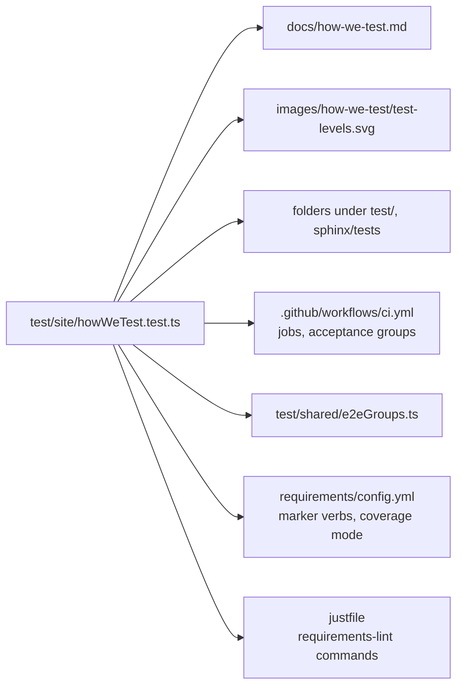

## Summary

The project writes every behaviour as a requirement and proves it with tests that name it, but no
single page said which kind of test proves which requirement, or where that proof runs. This pull
request adds a "How we test" page to the repository and the site, with a diagram, a table, and a
plain list of what is not enforced yet.

## Deliverables

The page `docs/how-we-test.md`, published as `docs/how-we-test.html`, goes from the two levels of
requirements (use cases, or StRS, and software behaviours, or SwRS) to every test level, the marker
comment each level carries, and the coverage that the requirements tool counts. A hand-drawn SVG
diagram shows the test levels by when they run.

A drift test reads the shipped page and the repository, and fails when the two part:

The site header gains a sixth link:

| Before | After |
| --- | --- |
| Home, Contributing, How we ship, Gallery, Requirements | Home, Contributing, How we ship, **How we test**, Gallery, Requirements |

## Changes

- New page `docs/how-we-test.md` and its diagram `images/how-we-test/test-levels.svg`.
- Site: the header link (`test/site/siteHeader.ts`) and a social card for the new page
  (`SIMPLE_CARDS` in `test/site/buildSite.ts`).
- New `test/site/howWeTest.test.ts`: relative links resolve; every test folder, CI job, end-to-end
  group, marker verb and `just requirements-lint` command is named; the coverage mode and the groups
  with acceptance files match the repository; the diagram has a title, a description and an
  alternative text.
- Header, theme, social card and viewer page tests updated for the sixth link.
- The contributor guide, "How we ship" and the requirements guidelines link to the page.
- A CI guideline rule and a requirements guideline bullet make the author of a change keep the page
  current; the glossary gains "Test level" and "Bench".
- The site requirement `SwRS-MDOKFSTUDIO-CORE-086` names the six header links. Its source file is
  `test/site/siteTheme.ts` (unchanged); its tests are `test/site/siteLinks.test.ts` (a marker added
  on the header test), `test/site/siteTheme.test.ts` and
  `test/site/requirementsViewer/write.test.ts`.

## Impacts

The site shows a "How we test" link in its header and a new page. The extension itself does not
change. A change that adds or renames a CI job, a test folder, an end-to-end group or a command of
`just requirements-lint`, adds an acceptance group, or changes the coverage mode now fails the unit
tests until the page says so.

The screenshots show the built site, which has a light theme only: the header before and after, then
the top of the new page with its diagram, its table, and its section "What is not enforced yet".

Header before, at `4e4eeb4`:

Header after, at `6c5106e`:

Top of the new page with its diagram, at `6c5106e`:

The table, at `6c5106e`:

"What is not enforced yet", at `6c5106e`:

## Blast radius

Grade: 1

Documentation, the project site and one new unit test. A plain `git revert` removes them.

## Autonomous decisions

- The page describes the repository as it is. Where a planned description did not match it, the page
  says what the repository does:
  - no `test/core/render/*.contract.ts` file exists, and no contract test carries a marker;
  - `just sphinx-check` and `just audit` run in `just ci-static`, not in `just check`;
  - `test/shared/e2eGroups.ts` is linked by its GitHub URL, because the site rewrites only Markdown
    links; example test files are named, not linked;
  - the end-to-end groups are listed without a count, and described as the first part of the visual
    scenario ids, which are the folders of their captures;
  - the simulated bench also holds the table and code block breakout tests of `test/page`;
  - mutation testing has a second phase against the tests of the other layers, and a full run takes
    hours;
  - `check:diagrams` fails on a diagram that Mermaid cannot parse; `scripts/check_main_paths.py` also
    fails on a cited behaviour that is not active and accepts a `depends_on` citation;
  - stress runs in a trusted window, then in a Restricted Mode window;
  - `just check-markers` also requires a source marker on every in-force software requirement that is
    not exempt;
  - no test accepts a path of the release, site or built-package use cases yet, so the page says
    they "may be accepted" on the test closest to their product;
  - unit, contract and security commands need `just compile` first;
  - the published requirements viewer is deployed with each release, so its counts are those of that
    release;
  - integration runs in real VS Code windows, not one window per suite;
  - not every check of an acceptance file walks a path: the checks of the built-package file carry no
    marker and accept no path;
  - the lint commands are named with `--check`, as `just requirements-lint` runs them;
  - "Keeping this page current" is longer than planned: it states what the drift test fails on and
    what it does not see, and the new CI guideline rule says the same.
- The page adds that a green job does not prove that every marked test ran (see Known gaps).
- The statement that a human step of an acceptance test is a simulated input records a maintainer
  decision that no other file of the repository holds.
- The glossary entry "Site header" and one scenario of `SwRS-MDOKFSTUDIO-CORE-086` also name the new
  page.
- The built site was checked with `just site-from-run` (the reports of a green full CI run, then
  `just site-assemble` on this branch), because `just site-assemble` alone needs end-to-end reports.
- The change is two commits where one was planned: the second names the second visual job,
  `visual-2`, which a change merged underneath added, and states which stress scenarios run only
  when named. Commits already pushed are not folded together.
- The rebases of this branch conflicted only in the requirements log: all entries are kept whole.

Seen and left as they are: `AGENTS.md` names `tests/fixtures/` while the Sphinx fixtures are in
`sphinx/tests/fixtures/`; no target calls `test/release/audit-lockfile.mjs`.

## Known gaps

- Some unit tests that need Chromium run in no CI job, although their markers count toward coverage.
  The page says so; changing the CI jobs is outside this documentation change.
- The site shows the diagram scaled from 1240 to 880 pixels wide, so its text is small there.
- The diagram draws unit and contract tests marking software requirements, while no contract test
  carries a marker today; the table says so.
- The drift test does not see a removed or renamed item that the page still names (except in the
  coverage mode and acceptance group lines), when a level runs, or the content of the diagram, and no
  guideline rule covers a change of a test level's own `just` command.
- The first of the two commits fails the page's drift test on its own. It does not name the
  `visual-2` job of the current CI workflow; the second commit does.

## Test plan

- [x] New or changed tests (they fail on the previous code): 13 of the 49 tests of the five new or
  changed test files fail on the base `4e4eeb4`; all 49 pass at `6c5106e`
- [x] Requirements: SwRS updated, markers in code and tests, `just requirements-update`; at
  `6c5106e`, `just requirements-lint` passes with nothing left to update
- [x] Changelog: no user-facing change
- [x] Local gates at `6c5106e`: `just preflight` (static stage on Windows) passed: unit 5443 tests,
  5435 pass, 0 fail, 8 skipped; security 116 of 116; release tests 296 passed; requirements 0 errors;
  Sphinx 4 passed; audit 0 vulnerabilities
- [x] Review: approved at `6c5106e` (carried from `166532f`: a clean rebase after the last review
  left the files unchanged)
- [x] Verified at `6c5106e`: the tests against the base, `just requirements-lint`, the site build and
  the drift probes
- [x] CI green at `6c5106e`: `static`, `static-windows`, `visual`, `visual-2`, `viewer-graph`,
  `report` and `checks`; the real VS Code jobs do not run on a pull request

The tests that fail on the base `4e4eeb4`:

- The nine checks of the drift test on the shipped files fail, with `ENOENT` on
  `docs/how-we-test.md` (the diagram check: on `images/how-we-test/test-levels.svg`).
- "the site header links How we ship then How we test from root and nested pages":
  `index.html holds <a href="docs/how-we-ship.html">How we ship</a><a href="docs/how-we-test.html">How we test</a>`.
- "a viewer page brands and links the site relative to its own folder": `the six links, in order`.
- "a main page and a viewer page carry the same brand and the six links, only the viewer has a
  breadcrumb": the header lists Home, Contributing, How we ship, Gallery, Requirements.
- "SIMPLE_CARDS covers the home, Contributing, How we ship and How we test pages": the entry
  `docs/how-we-test.md` is missing.

Built site at `6c5106e`, made with the reports of a green full CI run on a commit with the same
files as one below this branch, then a scan: the new page has 20 headings and one table of 10 rows,
header row included; its 11 relative links and image addresses all resolve; all 643 pages with a site
header, requirements viewer pages included, list the six header links in order; and the site manifest
lists the page and `og/how-we-test.png`.

Drift probes at `6c5106e`, each a temporary edit then `just unit`, each with one failing test (5443
tests, 5435 pass, 1 fail, 7 skipped):

- every `stress` code span removed from the page: "How we test names every CI job", missing `stress`;
- coverage mode set to `linked-swrs-and-acceptance-paths`: `the page names the coverage mode
  linked-swrs-and-validation-test, requirements/config.yml has linked-swrs-and-acceptance-paths` and
  `the page keeps "## What is not enforced yet" under the mode linked-swrs-and-acceptance-paths`;
- a second group `gfm` in the `acceptance` job: `groups of the acceptance job missing from the page:
  gfm`.

## Internal references

- CR-507 how-we-test.

🤖 Generated with [Claude Code](https://claude.com/claude-code)

