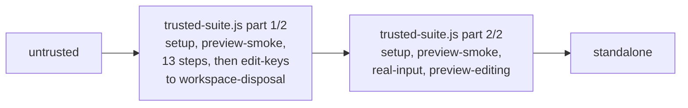

## Summary

The heavy CI run (the real VS Code `integration` job) failed intermittently on correct code. The
trusted VS Code launch needed about 92 % of its 900 s deadline when healthy, so a slower runner
pushed it over, and one step also failed on a frame lookup that never returned. This change runs
the trusted suite as two launches, and the Studio frame lookup and the open-at-line marked-line
count no longer ask anything but its URL of a frame that cannot be the Studio frame.

## Deliverables

Every step that ran before still runs. The trusted suite is now two VS Code windows, each with its
own 900 s deadline, CDP port, user-data directory and heartbeat file:



Part 1 holds 53 steps and part 2 holds 4; `setup` and `preview-smoke` run in both. A unit test
hard-codes the 55 step names of the former single launch and checks that the two parts hold each
of them exactly once, in order, with those two exceptions.

Durations read from the job logs of heavy runs, before (one trusted launch) and after (two parts).
A launch or part lasts from its `setup` step to its last step.

| Heavy run | Commit | Single trusted launch (deadline 900 s) | Part 1 (bar 600 s) | Part 2 (bar 600 s) | `real-input` step | `open-at-line-probe` step | Whole `just ci-integration` step (limit 1200 s) |
| --- | --- | --- | --- | --- | --- | --- | --- |
| Before: 45476952370 | `63ef752` | 834 s | none | none | 404 s | 178 s | 1011 s |
| Before: 45713440510 | `17b779d` | 831 s | none | none | 405 s | 178 s | 1002 s |
| After: 45729384181 | `5e7b4a3` | none | 428 s | 502.5 s | 462 s | 182 s | 1128 s |
| After: 45734265223 | `b24d3bf` | none | 422 s | 493 s | 452 s | 181 s | 1111 s |
| After: 45734267839 | `b24d3bf` | none | 409 s | 453 s | 418 s | 179 s | 1056 s |

The frame lookup now chooses its candidates from `frame.url()` alone, before any call that needs
the frame's document:

```ts
// test/shared/webviewFrames.ts
// undefined for a "vscode-webview://" URL, else why the frame is skipped
// ("" = no document yet, about:blank, any other scheme)
export function frameUrlSkipReason(url: string): string | undefined { ... }

// a skipped frame receives no call but url(); `inspect` only sees webview frames
const scan = await scanWebviewFrames(page.frames(), async (frame) => ...);
frameLookups.record(scan);   // listed by waitFor if it times out
return scan.found;
```

A timeout on a webview frame still fails the step (the 10 s bound is unchanged). When a wait for
the Studio frame times out, the message now lists every frame seen, with why each was skipped.

## Changes

- `test/shared/trustedParts.ts` (new): the steps of each part, the part read from
  `STUDIO_TRUSTED_PART` (an unknown or missing value fails at once), and the two launch
  descriptions. The single-scenario runs (`STUDIO_REAL_INPUT_SCENARIO`, used by `ci-stress`,
  `ci-toc-loop` and the probe) stay one launch.
- `test/integration/trusted-suite.ts` runs the steps of the received part and logs
  `TRUSTED LAUNCH: <name>`; `test/integration/run-tests.ts` starts part 1, then part 2. The
  frontmatter evidence is written after part 2, the part that produces it, so its recorded suite
  result now covers part 2 only (serializer and workspace disposal run in part 1).
- `test/shared/launchWatchdog.ts`: the dump folder of a launch timeout or hang names the trusted
  part.
- `test/shared/webviewFrames.ts` (new), `test/integration/realInput/harness.ts` and the marked-line
  count of `openAtLine.test.ts`: the URL filter and the frame list in the timeout message.
- `test/shared/hangWatchdog.ts`: comments only; the note above the step budgets now records the
  durations of the two launches measured on heavy run 45729384181.
- `CONTRIBUTING.md` describes the two launches. No deadline, step budget or `timeout-minutes`
  value changes, and no test assertion changes.

### What the failed frame lookup showed

The job log of the failed attempt (run 45706313890, attempt 2) shows
`TIMEOUT: locator.count did not return within 10000 ms (frame )` 12.6 s into the open-at-line
step: a bounded call hung on a frame whose URL was empty. The report that attempt uploaded
(`e2e-integration-attempt-2`) holds only the integration manifest, the campaign file, a process
list taken after the step ended and the screenshots of earlier launches: no in-window dump. So
neither shows which frame it was, why it had no URL, or the other frames of the window. An earlier
`CodeWindow: failed to load (code: -3)` line in the same run is not evidence: passing runs log it
too. The empty-URL observation is consistent with a frame that never loaded a document.

The Studio content frame has a `vscode-webview://.../fake.html` URL (seen in an earlier real
window run on Windows). On the CI runner, in the browser target lists saved with the two timed-out
launches of the same run, the only `vscode-webview://` targets are service workers (the other
targets are the workbench page and two of its own workers), so they confirm the scheme and not the
content frame's URL. The filter therefore keeps every `vscode-webview://` URL.

## Impacts

No visual change: only tests, CI behaviour and contributor documentation change. A full local or
CI integration run now opens one more VS Code window.

## Blast radius

Grade: **2**. Test code and contributor documentation only, nothing shipped in the extension
changes, but the frame lookup is shared by most real-window steps and the launches belong to the
CI job that releases depend on. A `git revert` restores the single trusted launch and the former
frame lookup; it needs one heavy run to confirm.

## Autonomous decisions

- The cause is fixed rather than hidden: no deadline, budget or time limit is raised, no test is
  skipped, and a re-run until green does not count.
- The bar for each part is 600 s, two thirds of its 900 s launch deadline, in each of two heavy
  runs on the same commit: that leaves 300 s, four times the spread seen between passing and
  failing runs. The long `real-input` step is not split, because the two parts reach the bar
  without it.
- The whole integration step only has to stay under its 1200 s limit: parallel CI jobs would
  change the report and release jobs, and shortening the open-at-line probe's fixed pauses is a
  separate change (see Known gaps).
- No new stress scenario for the frame lookup: it failed once and the open-at-line steps are not
  stress scenarios, so this change adds the URL filter and the frame list in the failure message
  only.
- The last group of steps (`edit-keys` to `workspace-disposal`) moved to part 1 rather than
  keeping a contiguous split: reading the code found no state it takes from the two steps it no
  longer follows, and the contiguous split would leave part 2 over 600 s on a slow runner. One
  difference remains: `preview-editing` leaves the preview theme dark, so `edit-keys`, `save-key`
  and `grid-card-editor-blur` now run under the `current` theme instead (none of them asserts a
  theme).
- Each launch logs its name in the extension host, so a passing log also says which part ran.
- The two proof runs were started at the same time on one commit rather than one after the other:
  the CI workflow sets no concurrency limit, so each runs on its own machines and neither cancels
  the other.
- The visual job cancelled in one proof run was not run again: the proof of this change rests on the
  integration and stress jobs, green in both runs, and a second try would hide a limit that needs
  its own fix.
- Beyond the shared Studio frame lookup, the URL filter also covers the second frame scan of the
  open-at-line step and the frame dump written when the current preview frame is not found. The
  other frame scans of the test suite are left as they were (see Known gaps).

## Known gaps

- The whole integration step has a thin margin under its 1200 s limit: it took 1056 to 1128 s on the
  three heavy runs of this change, 6 to 12 % under, so a slower runner could still stop the step.
  Running integration as parallel CI jobs, or replacing the fixed pauses of the open-at-line probe
  (about 180 s) with readiness signals, would widen it.
- The simulated visual job runs close to its 15-minute limit, also on the default branch (885 s of
  900 s in run 45713440510), and was cancelled at that limit in one of the two proof runs. This
  change does not touch that job or what it runs, so it is left for a change of its own.
- The frame lookup is not proven fixed: one failure in many runs cannot be shown gone by two green
  runs, and the open-at-line steps are not stress scenarios, so the repetition proof the project's
  CI rules ask for a flaky test is not provided. The URL filter and the frame list in the failure
  message are what make a next failure explain itself. That longer timeout message has not been
  seen in a real run: no heavy run of this change timed out while waiting for the Studio frame, and
  only the frame list it appends has a unit test.
- Other test steps still scan every frame without the URL filter (block actions, edit toolbar,
  find in preview, table empty column, tall block scroll, preview editing helpers, render patching,
  reload and scroll-sync suites, window focus), so a frame without a document could still stall one
  of them.
- No real-window run of these changes was made locally: on the Windows development machine the
  local gates skip the real VS Code stage. Only the CI runs exercise the two launches and the
  filter in a real window.

## Test plan

- [x] New or changed tests (they fail on the previous code), at `b24d3bf`: the 9 tests of
      `test/build/trustedParts.test.ts` and `test/build/webviewFrames.test.ts` all failed against
      stand-ins of the new modules that mimicked the previous behaviour, and pass in the local gate
- [x] Requirements: no behaviour change; the requirements checks of the local gate pass at
      `b24d3bf` (`okfreq validate`, `lint --check`, `update-coverage --check`)
- [x] Changelog: no user-facing change
- [x] Local gates at `b24d3bf`: `just preflight` on Windows, static stage only, passed (unit tests
      5307 passed, 8 skipped, none failed); the other stages are left to CI
- [x] Heavy CI at `b24d3bf`: two runs on the same head, 45734265223 (every job green) and
      45734267839, `integration` and `stress` green in both and each trusted part under 600 s; run
      45734267839 is not green as a whole, its simulated visual job was cancelled at its time limit,
      so its report and checks jobs failed too (see Known gaps)
- [x] Review: approved at `b24d3bf`
- [ ] Verified
- [x] CI green at `b24d3bf`: static, static on Windows, visual, viewer-graph, report and checks of
      the pull request's own run; the real VS Code jobs do not run on a pull request

## Internal references

CR-509 heavy-ci-trusted-suite-timeout.

🤖 Generated with [Claude Code](https://claude.com/claude-code)
