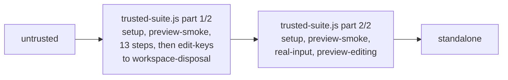

## Summary

The heavy CI run (the real VS Code `integration` job) failed intermittently on correct code. The
trusted VS Code launch needed about 92 % of its 900 s deadline when healthy, so a slower runner
pushed it over, and one step also failed on a frame lookup that never returned. This change runs
the trusted suite as two launches, and the Studio frame lookup and the open-at-line marked-line
count no longer ask anything but its URL of a frame that cannot be the Studio frame.

## Deliverables

Every step that ran before still runs. The trusted suite is now two VS Code windows, each with its
own 900 s deadline, CDP port, user-data directory and heartbeat file:



Part 1 holds 53 steps and part 2 holds 4; `setup` and `preview-smoke` run in both. A unit test
hard-codes the 55 step names of the former single launch and checks that the two parts hold each
of them exactly once, in order, with those two exceptions.

| | Part 1 | Part 2 |
| --- | --- | --- |
| Estimated on CI, from the durations of an earlier single-launch run | about 393 s | about 439 s |

The frame lookup now chooses its candidates from `frame.url()` alone, before any call that needs
the frame's document:

```ts
// test/shared/webviewFrames.ts: only a VS Code webview URL can be a Studio frame
// skipped: "" (no document yet), about:blank, any URL that is not vscode-webview://
// a skipped frame receives no call but url()
```

A timeout on a webview frame still fails the step (the 10 s bound is unchanged). When a wait for
the Studio frame times out, the message now lists every frame seen, with why each was skipped.

## Changes

- `test/shared/trustedParts.ts` (new): the steps of each part, the part read from
  `STUDIO_TRUSTED_PART` (an unknown or missing value fails at once), and the two launch
  descriptions. The single-scenario runs (`STUDIO_REAL_INPUT_SCENARIO`, used by `ci-stress`,
  `ci-toc-loop` and the probe) stay one launch.
- `test/integration/trusted-suite.ts` runs the steps of the received part and logs
  `TRUSTED LAUNCH: <name>`; `test/integration/run-tests.ts` starts part 1, then part 2. The
  frontmatter evidence is written after part 2, the part that produces it.
- `test/shared/launchWatchdog.ts`: the dump folder of a launch timeout or hang names the trusted
  part.
- `test/shared/webviewFrames.ts` (new), `test/integration/realInput/harness.ts` and the marked-line
  count of `openAtLine.test.ts`: the URL filter and the frame list in the timeout message.
- `CONTRIBUTING.md` describes the two launches. No deadline, step budget or `timeout-minutes`
  value changes, and no test assertion changes.

### What the failed frame lookup showed

The job log of the failed attempt (run 45706313890, attempt 2) shows
`TIMEOUT: locator.count did not return within 10000 ms (frame )` 12.6 s into the open-at-line
step: a bounded call hung on a frame whose URL was empty. The report that attempt uploaded
(`e2e-integration-attempt-2`) holds only the integration manifest, the campaign file, a process
list taken after the step ended and the screenshots of earlier launches: no in-window dump. So
neither shows which frame it was, why it had no URL, or the other frames of the window. An earlier
`CodeWindow: failed to load (code: -3)` line in the same run is not evidence: passing runs log it
too. The empty-URL observation is consistent with a frame that never loaded a document.

The Studio content frame has a `vscode-webview://.../fake.html` URL (seen in an earlier real
window run on Windows). On the CI runner, the browser target lists saved with the two timed-out
launches of the same run hold only webview service workers, so they confirm the
`vscode-webview://` scheme and not the content frame's URL. The filter therefore keeps every
`vscode-webview://` URL.

## Impacts

No visual change: only tests, CI behaviour and contributor documentation change. A full local or
CI integration run now opens one more VS Code window.

## Blast radius

Grade: **2**. Test code and contributor documentation only, nothing shipped in the extension
changes, but the frame lookup is shared by most real-window steps and the launches belong to the
CI job that releases depend on. A `git revert` restores the single trusted launch and the former
frame lookup; it needs one heavy run to confirm.

## Autonomous decisions

- The cause is fixed rather than hidden: no deadline, budget or time limit is raised, no test is
  skipped, and a re-run until green does not count.
- The bar for each part is 600 s, two thirds of its 900 s launch deadline, in each of two heavy
  runs on the same commit. The long `real-input` step is not split to reach it.
- The whole integration step only has to stay under its 1200 s limit: no parallel CI jobs and no
  change to the open-at-line probe's fixed pauses here (see Known gaps).
- No new stress scenario for the frame lookup: the URL filter and the frame list in the failure
  message are what this change adds.
- The last group of steps (`edit-keys` to `workspace-disposal`) moved to part 1 rather than
  keeping a contiguous split: reading the code found no state it takes from the two steps it no
  longer follows, and the contiguous split would leave part 2 over 600 s on a slow runner. One
  difference remains: `preview-editing` leaves the preview theme dark, so `edit-keys`, `save-key`
  and `grid-card-editor-blur` now run under the `current` theme instead (none of them asserts a
  theme).
- Each launch logs its name in the extension host, so a passing log also says which part ran.
- Beyond the shared Studio frame lookup, the URL filter also covers the second frame scan of the
  open-at-line step and the frame dump written when the current preview frame is not found. The
  other frame scans of the test suite are left as they were (see Known gaps).

## Known gaps

- The whole integration step stays near 1000 to 1030 s against its 1200 s limit, a margin of about
  15 %, because each extra window adds startup time. Running integration as parallel CI jobs, or
  replacing the fixed pauses of the open-at-line probe (about 180 s) with readiness signals, would
  widen it.
- The frame lookup is not proven fixed: one failure in many runs cannot be shown gone by two green
  runs, and the open-at-line steps are not stress scenarios, so the repetition proof the project's
  CI rules ask for a flaky test is not provided. The URL filter and the frame list in the failure
  message are what make a next failure explain itself.
- Other test steps still scan every frame without the URL filter (block actions, edit toolbar,
  find in preview, table empty column, tall block scroll, preview editing helpers, render patching,
  reload and scroll-sync suites, window focus), so a frame without a document could still stall one
  of them.
- No real-window run of these changes was made locally: on the Windows development machine the
  local gates skip the real VS Code stage. Only the CI runs exercise the two launches and the
  filter in a real window.

## Test plan

- [ ] New or changed tests (they fail on the previous code): `test/build/trustedParts.test.ts`,
      `test/build/webviewFrames.test.ts`
- [ ] Requirements: no behaviour change; `just requirements-lint` and `just requirements-update`
- [ ] Changelog: no user-facing change
- [ ] Local gates
- [ ] Heavy CI: two runs in a row on the same head
- [ ] Review
- [ ] Verified
- [ ] CI green

## Internal references

CR-509 heavy-ci-trusted-suite-timeout.

🤖 Generated with [Claude Code](https://claude.com/claude-code)
