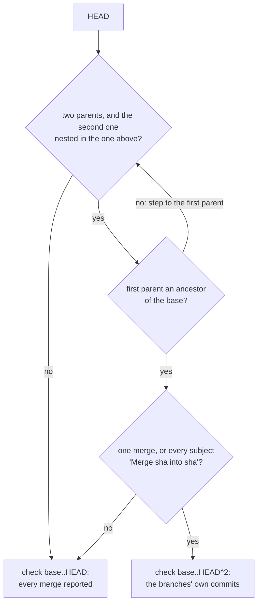

## Summary

New CI runs fail on a pull request above the bottom of a GitHub native stack: the checked-out test merge (`refs/pull/<n>/merge`) is then a chain of merges, one per pull request below plus its own, and the merge-commit check peeled only the last one. The check now peels the whole chain, so such a pull request passes `static`, `static-windows` and the required `checks`, while every merge commit that a branch of the stack really carries still fails it.

## Deliverables

The check walks down the first parents from the checked-out commit and ignores the chain only when it has the shape the forge builds:

| Checked-out commit | Before | After |
| --- | --- | --- |
| Single forge test merge (GitHub, GitLab merged results) | passes | passes (no subject required) |
| Chain of test merges over nested branches | fails, lists the chain | passes |
| Same chain, one branch of the stack carries a merge | fails, lists the chain and that merge | fails, lists that merge only |
| Chain over unrelated branches, not rooted on the base, or with another subject | fails | fails |

## Changes

- `scripts/check-no-merge-commits.sh`: the single-merge peel becomes a walk over two-parent merges down the first parents. The chain is ignored only when it reaches a first parent that is an ancestor of the base, each lower second parent is an ancestor of the one above, and, for two merges or more, each subject is the forge's `Merge <40-character sha> into <40-character sha>`. Git and bash only, no network.
- `test/build/test_no_merge_commits.py`: seven cases in both directions on chains built in a throwaway clone, most over a three-branch stack, one over unrelated branches.
- `.agents/guidelines/pull-request.guidelines.md` ("Updating a branch"): says what the check ignores and what it still reports.

## Impacts

No visual change: a CI build script, its tests and one guideline sentence. A contributor whose stacked pull request contains this fix no longer gets a red `static` job from the forge's own test merges.

## Blast radius

- **2**: several features or shared code; revert is possible but needs checks or follow-ups.

Grade: 2. The check is part of the required CI of every pull request; a defect would either block pull requests or let a merge commit through. A plain revert restores the previous check, and with it the red runs on stacked pull requests.

## Autonomous decisions

- The check stays as strict: no skipped job, no `continue-on-error` and no exemption for stacks. A merge commit carried by any branch of a stack still fails it, as far as git alone can tell.
- A chain of two or more merges is ignored only when each of them also has the forge's subject, to narrow what git's shape alone cannot tell. A single test merge keeps its previous behaviour (GitLab merged results included). The subjects of the failing run were read first: they are `Merge <40-character sha> into <40-character sha>`.
- The fix ships as a pull request low in the current stack, not as a separate one on the default branch: no pull request below it moves, and every pull request above it checks out the fixed script.

## Known gaps

- Git alone cannot tell a forge chain from a branch whose own history is a first-parent chain of two or more two-parent merges rooted on the base, with nested second parents and every subject written as `Merge <sha> into <sha>`: checked out at its tip, such a branch passes. A single merge at the tip keeps the same gap as before (no subject required). Merges carried inside the second parents are all still reported.
- The subject is checked for its form only, not that its two identifiers equal the merge's parents.
- A merge of three or more parents at the checked-out commit is no longer ignored (the forge's test merge has two). No test builds such a merge.
- A stack whose lower branch moved without the branches above being rebased on it is not nested: the check still fails there, until the stack is rebased.
- Pull requests below this one in the stack, above the bottom, do not contain the fixed script: a new CI run of theirs stays red until the fix reaches the default branch.
- **UNVERIFIED:** the check passing on a real chain in CI, on this pull request above the bottom of its stack. The tests build the chain locally; the live run is still to come.

## Test plan

- [x] New or changed tests (they fail on the previous code): `test/build/test_no_merge_commits.py`, 19 passed; on the previous script 4 of the new cases fail, and the 3 others guard against a looser check, so they pass on both by design
- [x] Requirements: no behaviour change of the extension (build tooling, no requirement covers it)
- [x] Changelog: no user-facing change (a `ci` change adds no line)
- [ ] Local gates: `just ci-static`, `just preflight`
- [x] Review: approved at `7d35be3`
- [ ] CI green

## Internal references

- CR-510 stack-merge-check.

🤖 Generated with [Claude Code](https://claude.com/claude-code)
