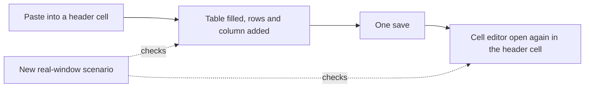

## Summary

When spreadsheet cells are pasted into a table cell, the cells are filled and the cell editor
should reopen in the cell where the paste started. While the feature clip of this paste was first
filmed, the editor stayed closed in three out of three attempts. This pull request reproduces the
conditions of the clip in a real VS Code window: the editor reopened in every run, so no product
code changes. The covered case becomes a permanent real-window test, and the clip records what it
finds.

## Deliverables

What was run, with real keyboard events in a real VS Code window, on product code identical to
`3478f09` (the main branch). The start cell is the header cell "Task" unless said otherwise, and
five rows of three values are pasted into a table of two columns and one body row.

| Condition | Editor reopened in "Task" |
| --- | --- |
| Clipboard written as plain text, automatic save off | yes (2 runs) |
| Clipboard filled by a copy in the VS Code text editor | yes (1 run) |
| Automatic save after a 200 ms delay | yes (1 run) |
| The clip's timing (a look 250 ms after the paste, then the table check) | yes (1 run) |
| Copy, automatic save and timing together | yes (1 run) |
| The committed test (after the existing body-cell paste test) | pass (2 runs) |
| The committed test, repeated in one window | pass, 20 of 20, in each of 2 runs |
| The clip itself, with both ways the clip tool can send the keys | yes (5 of 5 takes) |

## Changes

- `test/integration/realInput/tableGridPaste.ts`: new scenario
  `scenarioTableGridPasteFromHeader`. It first checks that its document, pasted text and expected
  table equal what the clip ships, pastes into "Task" without Select all, then expects that table
  in the source and one open editor in the header cell, still open once the page has settled.
- `test/integration/realInput/run.ts`: runs it with the existing paste scenario, alone and in the
  full real-window suite, and offers it as a repeatable stress step.
- `test/shared/stressPlan.ts`: that stress step, run on demand only.
- The paste clip (`docs/demo-video/clips/paste-spreadsheet-cells/`): the take waits for the editor
  until 4.4 s, records whether it was open (`cellEditorOpenAfterPaste`), and its notes no longer
  say the editor "may or may not" reopen.
- Feature clip guideline: a take waits for the state it films after a key press instead of reading
  the page once.
- Requirement of the grid paste: its verification notes name the new scenario; its behaviour is
  unchanged.

## Impacts

No visual change: no product code changes. Contributors get a real-window test of the header-cell
paste and a clip that records the state of the editor.

## Blast radius

- **1**: local and isolated; a plain `git revert` restores the previous behaviour.

Grade: 1. Only tests, documentation and the script of one demo clip change. The one risk is a
new real-window test that fails intermittently in the manually started or post-merge runs.

## Test plan

- [ ] New or changed tests: the new real-window scenario covers behaviour that already works, so it
      also passes on the previous code
- [ ] Requirements: verification notes updated, marker in the new test,
      `just requirements-update` and `just requirements-lint`
- [x] Changelog: no user-facing change
- [ ] Local gates: `just preflight` (on Windows, the static checks)
- [ ] Review
- [ ] Verified
- [ ] CI green

## Autonomous decisions

- The new scenario is also a stress step (repeated runs of one scenario), as the contribution
  guide asks for a new real-window scenario. It runs on demand only, because one more default step
  would leave too little time margin in the stress job.
- The clip take waits up to 4.4 s for the editor, instead of looking once at 4.0 s.

## Known gaps

- The cause of the three attempts that found the editor closed is not established: no page trace
  was recorded then. A rare, intermittent loss of the reopening is not excluded by these runs.
- When the editor opens late, the clip's click on Done can come about 0.3 s after 4.4 s, and the
  zoom that follows can start after 4.8 s; this is to be looked at when the clip is filmed again.
  The clip's output files are not re-rendered.
- The clip takes were made before the last edits of the test and of the clip's comments; no take
  was repeated after them.
- The clip's notes still say that the VS Code copy puts HTML on the clipboard; the page received no
  HTML after a copy of the `.tsv` file in these runs. Left unchanged, as it concerns the copy and
  not the reopening.

## Internal references

- CR-512 cell-reopen.
- The first clip takes: CR-489.
