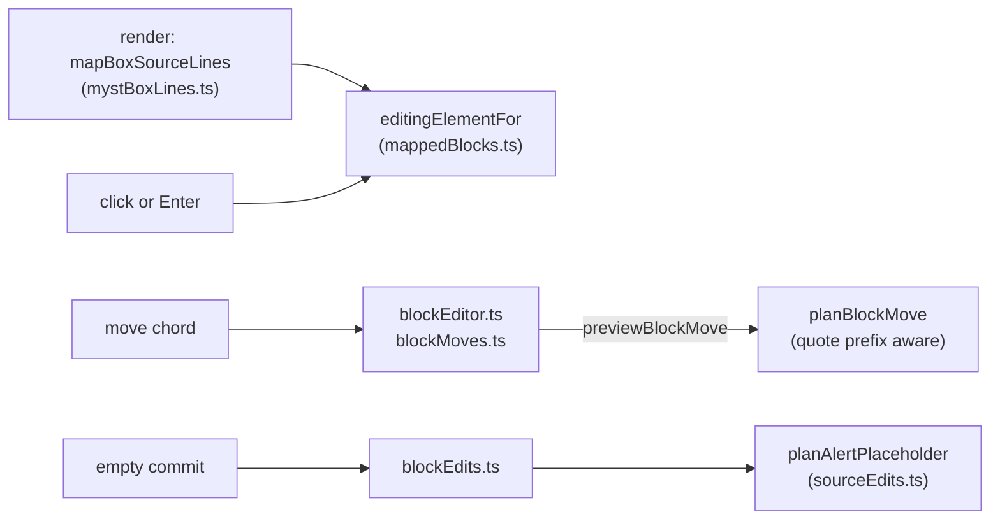

## Summary

In edit mode, an admonition (a MyST `{note}`-style box) or a GitHub alert (`> [!NOTE]`) opened as
one block: pressing Enter on a paragraph or list item reached with the arrows, or clicking one,
opened the whole box. Now the element you select or point at is the one that opens; the whole box
opens from its title or frame, or when it is itself selected.

## Deliverables

| In edit mode, inside an admonition or alert | Before | After |
| --- | --- | --- |
| Click a body paragraph or list item | the whole box opens | that paragraph or item opens |
| Click the title or the frame | the whole box opens | the whole box opens |
| Enter on an element reached with the arrows | the whole box opens | that element opens |
| Enter on the box selected as a whole | the whole box opens | the whole box opens |
| A diagram, formula or code directive of the body | the whole box opens | that directive opens as a whole, fences included |
| Ctrl/Cmd+Alt+Up/Down in the editor of a direct block of the body | no inner move | the block (for an item: its list) moves among the body's blocks, or the move is refused with a reason |
| Down at the end of a list, Up at its start | the next block outside would open | the caret stays in the editor |
| Erase an alert paragraph or item, then commit | an empty line cuts the alert | a `>` line keeps the alert whole |

Text written on a directive's opening line is not a block of its own: the one-line body of
`:::{warning} Text` or a card title opens the whole directive.

## Changes

- `editingElementFor` opens the whole admonition only when the box itself or its title is the
  target; a block of the body opens on its own lines, and a list around the box never takes it
  over. The nearest box decides when they are nested.
- A new render pass, `mapBoxSourceLines`, runs inside admonitions, alerts, callouts and dropdowns:
  no block there maps part of a fence around it, and a diagram, formula, code, `{list-table}` or
  `{csv-table}` directive maps its whole directive. A block held directly by a list item maps its
  own lines, up to the next block of the item and never across a fence. The body of a version
  admonition maps the lines it is written on. In an admonition left open at the end of the file, a
  block inside it keeps its own closing fence (one quoted case is listed under Known gaps). Blocks
  outside a box are mapped as before.
- The move chord works from the editor of a direct block of the body, never leaving the box; a
  refused move shows its reason next to the box's insert point. A block inside a list item, or in a
  quote, card or grid inside the box, does not move; nor does a `{table}` directive, with or
  without a caption, and no neighbouring block moves past it. A move that would put an unindented
  `---` line first in the body, or a heading first in an untitled admonition or in a callout, is
  refused: the content would not show, or the heading would become the title.
- The move planner understands a GitHub alert's `>` prefix: a prefix-only line counts as blank and
  an added separator carries the prefix.
- An erased block of an alert body is written as the alert's prefix alone.
- A directive admonition holding an open editor no longer scrolls its own overflow, so the block
  palette does not cover the text box.
- The keyboard navigation clip is re-filmed, down to an item of a nested sub-list; requirements,
  user guide and CHANGELOG follow.

## Impacts

Users reach any element of an admonition or alert directly, with the mouse or the keyboard. To
edit the whole box with the mouse, click its title or its frame. In the editor of a GitHub alert
block, the `> ` markers are part of the text. While an editor is open inside an admonition, wide
content of that admonition does not scroll.

The re-filmed keyboard navigation clip walks with the arrows into an admonition, down to an item of
a nested sub-list, and Enter opens that line alone. It lasts 26.0 s with 15 key presses (MP4
0.52 MB, WebM 0.35 MB, GIF 1.62 MB at 960 px, 12 fps, 128 colours, the first step of the size
ladder), filmed on Windows with VS Code 1.147.0 and the extension built from this change
([MP4](https://github.com/gsemet/markdown-okf-schema-studio/raw/739f9e3ecd771efce1938ebdb0685f324a6cf0a2/docs/demo-video/clips/keyboard-navigation/keyboard-navigation.mp4),
[WebM](https://github.com/gsemet/markdown-okf-schema-studio/raw/739f9e3ecd771efce1938ebdb0685f324a6cf0a2/docs/demo-video/clips/keyboard-navigation/keyboard-navigation.webm)).

## Blast radius

Grade: 2. It changes which block the most common editing gesture opens, the renderer's line mapping
inside boxes and the shared block move planner; a plain `git revert` restores the previous
behaviour, with no data or settings change.

## Autonomous decisions

- A neighbour that is not a direct block of the body (a `{table}` directive) also stops the move
  chord: moving past it would not keep its wrapper whole.
- A move between blocks under different quote prefixes is refused with the existing "out of date"
  refusal; no new message.
- Inside a box, a directive that shares no block of its own opens as a whole directive, and text on
  an opening line opens its directive, so that the lines a block of a box opens on hold no fence
  line of a directive around it.
- The chord's heading refusal covers every untitled admonition fence (colon, backtick, tilde) and
  callouts, and its `---` refusal every kind of box, because they all misrender the same way. A
  heading in a titled admonition, a dropdown or an alert, and a `***` line, still move.
- The palette overlap found by the new visual scenarios is fixed here, with a new requirement
  scenario.
- The real VS Code replay of the alert lazy line opens the alert from its title, so its assertions
  stay.
- The clip was filmed and rendered before the maintainer reviewed its storyboard: the review of
  `clip.md` and of the cut is pending, on this pull request.

## Known gaps

- Not yet approved: the maintainer's review of the clip's storyboard and of the clip itself.
- In the clip, after the save the selection is on the whole admonition, not on the saved sub-item.
- A `{table}` directive of a box does not move, and no neighbouring block moves past it.
- A paragraph holding one plain image, or an `{image}` directive, in a box does not open on its own
  with a click, and the move chord cannot cross it: such a move is refused, with the message about a
  comment or a link definition between the two blocks.
- The paragraphs of a `{topic}` body in a box edit one by one, but they do not move, and no block
  moves past them.
- When a `:::` admonition is left open at the end of the file and ends on a quoted one
  (`> :::{tip}` up to `> :::`), that quoted tip does not open on its own.
- Erasing the first block of a box body can leave a `---` line first, and the box then shows its
  title only, or leave a heading first in an untitled admonition, which then becomes its title; the
  text stays in the file. A card or a div inside a box whose body starts with dashes misrenders the
  same way.
- A paragraph that is only bold text, moved first in an untitled admonition or a callout, becomes
  its title; the move is not refused.
- A directive name written with spaces (`:::{ note }`) is not recognised by the new move refusals,
  so such a move there is done. Any `.callout-*` class counts as a callout for the heading refusal,
  one that renders no callout included.
- In a box that starts with a `---` block of options and holds a `---` rule further down, the
  renderer maps blocks one line down (as before this change), so a block opened on its own there
  shows the wrong line.
- A later paragraph of a list item in a box whose first source line is not known (text after a code
  block of a tight item) does not open on its own: its item opens.
- Erasing the first line of a list item that holds a directive removes the item's marker with it,
  so the directive leaves the list item (no fence line is cut).
- Outside a box, a move past a diagram, formula or code directive, or past a captioned `{table}`,
  can still put the moved paragraph inside its fence, and a click on a top-level diagram, formula or
  code directive opens its opening line only; likewise Enter on a `{figure}` caption in a top-level
  list opens its closing fence too (all as before this change).
- The clip's contact sheet shows neither the selection of the list nor that of the sub-list; only
  its named frames do.
- The real VS Code replay edited here runs only on the main branch or a heavy CI run.
- Erasing a block of an alert that holds a lazy continuation line (no `>`) still writes an empty
  line, so the quoted lines after it leave the alert.

## Test plan

- [ ] New or changed tests (they fail on the previous code). Among the unit and page tests that
  fail on the previous code:
  - "Enter on an element of a MyST admonition reached with the arrows opens that element only"
    (and the same for a GitHub alert);
  - "a click on a paragraph of a MyST admonition opens that paragraph, its title the whole
    directive";
  - "Right, Down, Right walk into a list item of an admonition and Enter opens that item only";
  - "Down at the end of the last item and Up at the start of the first, of a list in an admonition,
    keep the editor";
  - "the chord in the editor of a block of an admonition moves it among the blocks of that
    admonition";
  - "two blocks of an alert body swap and keep the quote's empty line between them";
  - "an erased paragraph of an alert body leaves the alert's prefix, so the alert stays whole";
  - "in an admonition or an alert, Enter on ... opens and erases no fence line";
  - "the chord is refused when it would start a box with a block that spoils it: ...".

  `boxBlockSourceLines.test.ts` holds 41 tests. The fence cases (an item holding a table, a figure
  caption, a card, text after a code block of a tight item) and the refused moves fail without
  their fixes; the accepted moves, a wrapped tight item and the 3 tests about a `{table}` and a card
  check behaviour that holds either way or is documented. Of the other renderer tests, 14 fail
  without the renderer change and 5 about unclosed fences fail without their fix. The new visual
  checks of a click in an alert body, a click in an admonition body and Enter on an element of an
  admonition fail on the previous code.
- [ ] Requirements: SwRS updated or added, markers in code and tests, `just requirements-update`
- [ ] Changelog: one user-facing line under `## Unreleased` in `CHANGELOG.md`
- [ ] Local gates:
- [ ] Review
- [ ] CI green

## Internal references

CR-514 enter-admonition.

🤖 Generated with [Claude Code](https://claude.com/claude-code)
