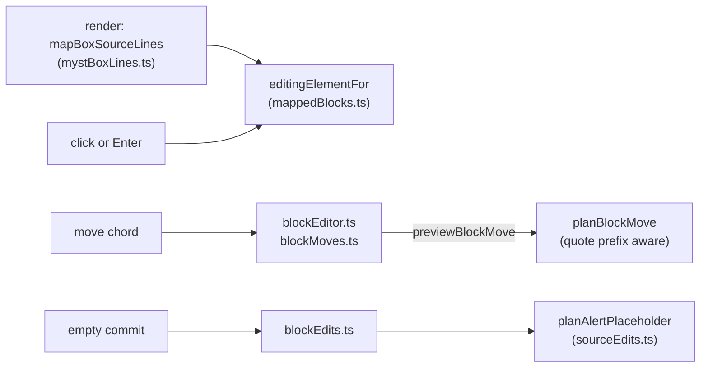

# feat(editor): edit the pointed block inside admonitions and alerts

## Summary

In edit mode, an admonition (a MyST `{note}`-style box) or a GitHub alert (`> [!NOTE]`) opened as
one block: pressing Enter on a paragraph or list item reached with the arrows, or clicking one,
opened the whole box. Now the element you select or point at is the one that opens; the whole box
opens from its title or frame, or when it is itself selected.

## Deliverables

| In edit mode, inside an admonition or alert | Before | After |
| --- | --- | --- |
| Click a body paragraph or list item | the whole box opens | that paragraph or item opens |
| Click the title or the frame | the whole box opens | the whole box opens |
| Enter on an element reached with the arrows | the whole box opens | that element opens |
| Enter on the box selected as a whole | the whole box opens | the whole box opens |
| A diagram, formula or code directive of the body | the whole box opens | that directive opens as a whole, fences included |
| Ctrl/Cmd+Alt+Up/Down in the editor of a direct block of the body | no inner move | the block (for an item: its list) moves among the body's blocks |
| Down at the end of a list, Up at its start | the next block outside would open | the caret stays in the editor |
| Erase an alert paragraph or item, then commit | an empty line cuts the alert | a `>` line keeps the alert whole |

Text written on a directive's opening line is not a block of its own: the one-line body of
`:::{warning} Text` or a card title opens the whole directive.

## Changes

- `editingElementFor` opens the whole admonition only when the box itself or its title is the
  target; a block of the body opens on its own lines, and a list around the box never takes it
  over. The nearest box decides when they are nested.
- A new render pass, `mapBoxSourceLines`, runs inside admonitions, alerts, callouts and dropdowns:
  no block there maps part of a fence around it, and a diagram, formula, code, `{list-table}` or
  `{csv-table}` directive maps its whole directive. The body of a version admonition maps the
  lines it is written on. Blocks outside a box are mapped as before.
- The move chord works from the editor of a direct block of the body, never leaving the box; a
  refused move shows its reason next to the box's insert point. A block inside a list item, or in a
  quote, card or grid inside the box, does not move; nor does a `{table}` directive, with or
  without a caption.
- The move planner understands a GitHub alert's `>` prefix: a prefix-only line counts as blank and
  an added separator carries the prefix.
- An erased block of an alert body is written as the alert's prefix alone.
- A directive admonition holding an open editor no longer scrolls its own overflow, so the block
  palette does not cover the text box.
- The keyboard navigation clip is re-filmed, down to an item of a nested sub-list; requirements,
  user guide and CHANGELOG follow.

## Impacts

Users reach any element of an admonition or alert directly, with the mouse or the keyboard. To
edit the whole box with the mouse, click its title or its frame. In the editor of a GitHub alert
block, the `> ` markers are part of the text. While an editor is open inside an admonition, wide
content of that admonition does not scroll.

The re-filmed keyboard navigation clip walks with the arrows into an admonition, down to an item of
a nested sub-list, and Enter opens that line alone. It lasts 26.0 s with 15 key presses (MP4
0.52 MB, WebM 0.35 MB, GIF 1.62 MB at 960 px, 12 fps, 128 colours, the first step of the size
ladder), filmed on Windows with VS Code 1.147.0 and the extension built from this change. The GIF
and the MP4 and WebM links are added here from the files at the pushed head.

## Blast radius

Grade: 2. It changes which block the most common editing gesture opens, the renderer's line mapping
inside boxes and the shared block move planner; a plain `git revert` restores the previous
behaviour, with no data or settings change.

## Autonomous decisions

- A neighbour that is not a direct block of the body (a `{table}` directive) also stops the move
  chord: moving past it would not keep its wrapper whole.
- A move between blocks under different quote prefixes is refused with the existing "out of date"
  refusal; no new message.
- Inside a box, a directive that shares no block of its own opens as a whole directive, and text on
  an opening line opens its directive, so that nothing ever cuts or writes into a fence.
- The palette overlap found by the new visual scenarios is fixed here, with a new requirement
  scenario.
- The real VS Code replay of the alert lazy line opens the alert from its title, so its assertions
  stay.
- The clip was filmed and rendered before the maintainer reviewed its storyboard: the review of
  `clip.md` and of the cut is pending, on this pull request.

## Known gaps

- Not yet approved: the maintainer's review of the clip's storyboard and of the clip itself.
- In the clip, after the save the selection is on the whole admonition, not on the saved sub-item.
- Outside a box, a move past a diagram directive can still put the moved paragraph inside its
  fence, and a click on a top-level diagram, formula or code directive opens its opening line only
  (both as before this change).
- The move chord next to a `{table}` directive has no test.
- The clip's contact sheet shows neither the selection of the list nor that of the sub-list; only
  its named frames do.
- The real VS Code replay edited here runs only on the main branch or a heavy CI run.
- An erased line of an alert block that holds a lazy continuation line (no `>`) keeps the previous
  behaviour.

## Test plan

- [ ] New or changed tests (they fail on the previous code). On the previous code, 36 tests of the
  changed unit and page files fail, among them:
  - "Enter on an element of a MyST admonition reached with the arrows opens that element only"
    (and the same for a GitHub alert);
  - "a click on a paragraph of a MyST admonition opens that paragraph, its title the whole
    directive";
  - "Right, Down, Right walk into a list item of an admonition and Enter opens that item only";
  - "Down at the end of the last item and Up at the start of the first, of a list in an admonition,
    keep the editor";
  - "the chord in the editor of a block of an admonition moves it among the blocks of that
    admonition";
  - "two blocks of an alert body swap and keep the quote's empty line between them";
  - "an erased paragraph of an alert body leaves the alert's prefix, so the alert stays whole".

  The 14 tests of `boxBlockSourceLines.test.ts` fail without the renderer change, and the new
  visual checks of a click in an alert body, a click in an admonition body and Enter on an element
  of an admonition fail on the previous code.
- [ ] Requirements: SwRS updated or added, markers in code and tests, `just requirements-update`
- [ ] Changelog: one user-facing line under `## Unreleased` in `CHANGELOG.md`
- [ ] Local gates:
- [ ] Review
- [ ] CI green

## Internal references

CR-514 enter-admonition.

🤖 Generated with [Claude Code](https://claude.com/claude-code)
