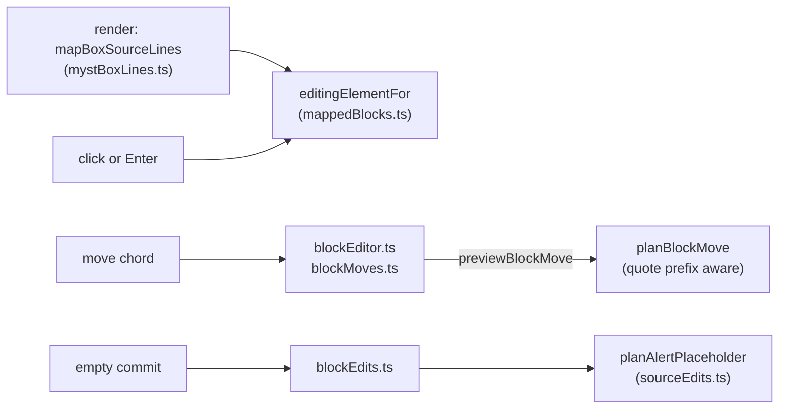

## Summary

In edit mode, an admonition (a MyST `{note}`-style box) or a GitHub alert (`> [!NOTE]`) opened as
one block: pressing Enter on a paragraph or list item reached with the arrows, or clicking one,
opened the whole box. Now the element you select or point at is the one that opens; the whole box
opens from its title or frame, or when it is itself selected.

## Deliverables

| In edit mode, inside an admonition or alert | Before | After |
| --- | --- | --- |
| Click a body paragraph or list item | the whole box opens | that paragraph or item opens |
| Click the title or the frame | the whole box opens | the whole box opens |
| Enter on an element reached with the arrows | the whole box opens | that element opens |
| Enter on the box selected as a whole | the whole box opens | the whole box opens |
| A diagram, formula or code directive of the body | the whole box opens | that directive opens as a whole, fences included |
| Ctrl/Cmd+Alt+Up/Down in the editor of a direct block of the body | no inner move | the block (for an item: its list) moves among the body's blocks, or the move is refused with a reason |
| Down at the end of a list, Up at its start | the next block outside would open | the caret stays in the editor |
| Erase an alert paragraph or item, then commit | an empty line cuts the alert | a `>` line keeps the alert whole |

Text written on a directive's opening line is not a block of its own: the one-line body of
`:::{warning} Text` or a card title opens the whole directive. Where the lines of an element cannot
be told, the block or box around it opens (see Known gaps).

## Changes

- `editingElementFor` opens the whole admonition only when the box itself or its title is the
  target; a block of the body opens on its own lines, and a list around the box never takes it
  over. The nearest box decides when they are nested.
- A new render pass, `mapBoxSourceLines`, runs inside admonitions, alerts, callouts and dropdowns:
  no block there maps part of a fence around it, or one fence line or HTML tag line of a pair
  without the other, and a diagram, formula, code, `{list-table}` or `{csv-table}` directive maps
  its whole directive. A block held directly by a list item keeps its own lines and takes only the
  empty lines under it; one the parser gives no position (the first paragraph of a tight item)
  reaches the next block of the item or its end. A formula whose own lines cannot be told is no
  block of its own, so the block or box around it opens. A `{div}` callout maps all of its lines,
  so its title opens the whole callout. The body of a version admonition maps the lines it is
  written on. In an admonition left open at the end of the file, a block inside it keeps its own
  closing fence (one quoted case is listed under Known gaps). Blocks outside a box are mapped as
  before.
- The move chord works from the editor of a direct block of the body, never leaving the box; a
  refused move shows its reason next to the box's insert point. A block inside a list item, or in a
  quote, card or grid inside the box, does not move; nor does a `{table}` directive, with or
  without a caption, and no neighbouring block moves past it. A move that would put an unindented
  `---` line first in the body, or a heading first in an untitled admonition or in a callout, is
  refused, however the box is written (a callout class given by `:class:` or by a `---` block of
  options included): the content would not show, or the heading would become the title.
- The move planner understands a GitHub alert's `>` prefix: a prefix-only line counts as blank and
  an added separator carries the prefix.
- An erased block of an alert body is written as the alert's prefix alone.
- A directive admonition holding an open editor no longer scrolls its own overflow, so the block
  palette does not cover the text box.
- The keyboard navigation clip is re-filmed, down to an item of a nested sub-list; requirements,
  user guide and CHANGELOG follow.

## Impacts

Users reach the elements of an admonition or alert directly, with the mouse or the keyboard. To
edit the whole box with the mouse, click its title or its frame. In the editor of a GitHub alert
block, the `> ` markers are part of the text. While an editor is open inside an admonition, wide
content of that admonition does not scroll.

The re-filmed keyboard navigation clip walks with the arrows into an admonition, down to an item of
a nested sub-list, and Enter opens that line alone. It lasts 26.0 s with 15 key presses (MP4
0.52 MB, WebM 0.35 MB, GIF 1.62 MB at 960 px, 12 fps, 128 colours, the first step of the size
ladder), filmed on Windows with VS Code 1.147.0 and the extension built from this change
([MP4](https://github.com/gsemet/markdown-okf-schema-studio/raw/f9dc2c630b852635e8bffcd0b00b42cc886b293c/docs/demo-video/clips/keyboard-navigation/keyboard-navigation.mp4),
[WebM](https://github.com/gsemet/markdown-okf-schema-studio/raw/f9dc2c630b852635e8bffcd0b00b42cc886b293c/docs/demo-video/clips/keyboard-navigation/keyboard-navigation.webm)).

## Blast radius

Grade: 2. It changes which block the most common editing gesture opens, the renderer's line mapping
inside boxes and the shared block move planner; a plain `git revert` restores the previous
behaviour, with no data or settings change.

## Autonomous decisions

- A neighbour that is not a direct block of the body (a `{table}` directive) also stops the move
  chord: moving past it would not keep its wrapper whole.
- A move between blocks under different quote prefixes is refused with the existing "out of date"
  refusal; no new message.
- Inside a box, a directive that shares no block of its own opens as a whole directive, and text on
  an opening line opens its directive, so that the lines a block of a box opens on hold no fence
  line of a directive around it.
- Where an element's own lines cannot be told, the enclosing block or box opens, rather than a
  narrower range that could be wrong.
- The chord's heading refusal covers every untitled admonition fence (colon, backtick, tilde) and
  callouts, and its `---` refusal every kind of box, because they all misrender the same way. A
  heading in a titled admonition, a dropdown or an alert, and a `***` line, still move. For a
  `{div}`, refusing too much was chosen over missing a way to write its callout class.
- The palette overlap found by the new visual scenarios is fixed here, with a new requirement
  scenario.
- The real VS Code replay of the alert lazy line opens the alert from its title, so its assertions
  stay.
- The clip was filmed and rendered before the maintainer reviewed its storyboard: the review of
  `clip.md` and of the cut is pending, on this pull request.

## Known gaps

The clip and its checks:

- Not yet approved: the maintainer's review of the clip's storyboard and of the clip itself.
- In the clip, after the save the selection is on the whole admonition, not on the saved sub-item.
- The clip's contact sheet shows neither the selection of the list nor that of the sub-list; only
  its named frames do.
- The real VS Code replay edited here runs only on the main branch or a heavy CI run.

Elements of a box that do not open on their own (emptying the editor that opens erases all it
holds):

- The block or the box around them opens for: a formula written right under text, a quote or a
  `+++` line, under the text of a list item, in a table cell, after other text of its paragraph, or
  followed by more text in a list item or a longer paragraph; inline HTML in a definition of
  several lines; the summary or a table of an unpaired `
`, the summary of a `
`
  nested in another, a table or text written right under a closing HTML tag, and a list item whose
  HTML element closes outside its list.
- A later paragraph of a list item whose first source line is not known (text after a code block or
  a directive of a tight item) opens its item.
- In a directive that starts with a `---` block of options and has a later `---` line, no block of
  the body opens on its own: the box opens.
- A paragraph holding one plain image, or an `{image}` directive, opens the box, and the move chord
  cannot cross it: such a move is refused, with the message about a comment or a link definition
  between the two blocks.
- A `{table}` caption opens the admonition around it (as before this change), and a tab panel its
  tab item.
- A paragraph holding only one tag of an HTML element (`<b>One` then `Two</b>`, or
  `Para
`) opens the whole box (as before this change).
- When a `:::` admonition is left open at the end of the file and ends on a quoted one
  (`> :::{tip}` up to `> :::`), the title and frame of that quoted tip open the whole outer
  admonition, so emptying that editor removes all of it (before this change the tip's title opened
  the tip alone).

Opening or emptying a block that takes more than itself, or leaves the box worse:

- Clicking the first paragraph of a tight list item followed by hidden content or content that is
  no block of its own (an HTML comment, HTML, a footnote or link definition, a target, a `%`
  comment) opens that content with it, so emptying the editor removes it too.
- Enter on the first paragraph of a list item that holds more (code, another paragraph, a
  directive) opens it with the item's marker; emptying it removes the marker, so the rest leaves
  the list item, still indented (no fence line is cut).
- A `$$` line written right under a table is read as one of its rows: it opens that line, and
  emptying it removes the row.
- A raw `<svg>` inside a directive nested in a list item breaks the preview (as before this
  change), and emptying the item opened there can remove one fence line of that directive and
  leave the other.
- Emptying the first block of a box body can bring a heading first, which becomes the title of an
  untitled admonition, or a `---` line first: a note, an alert or a callout then shows its title
  only, a dropdown disappears from the preview, and a dropdown with the `:open:` option stops the
  preview of the file. The text stays in the file.
- Emptying a block of an alert that holds a lazy continuation line (no `>`) writes an empty line,
  so the quoted lines after it leave the alert.

The move chord, and drawing:

- A `{table}` directive of a box does not move, and no neighbouring block moves past it.
- The paragraphs of a `{topic}` body in a box edit one by one, but they do not move, and no block
  moves past them.
- A paragraph that is only bold text, moved first in an untitled admonition or a callout, becomes
  its title; the move is not refused.
- A `{div}` whose braces or options mention a `callout-` class or name counts as a callout for the
  move refusals, even when it renders no callout.
- A card of a box whose body starts with `---`, or holds it after its first block, shows only part
  of its body, and a `{div}` that is not shown as a box (the callout class written as its
  argument) and starts with `---` stops the preview (both as before this change); the move chord
  does not refuse to write that in such a `{div}`.
- A move inside a box adds an empty line after the opening fence and before the closing fence (in
  an alert, a `>` line after its marker); the preview does not change because of it.

Outside a box:

- A move past a diagram, formula or code directive, or past a captioned `{table}`, can still put
  the moved paragraph inside its fence, and a click on a top-level diagram, formula or code
  directive opens its opening line only; likewise Enter on a `{figure}` caption in a top-level
  list opens its closing fence too (all as before this change).

## Test plan

- [ ] New or changed tests (they fail on the previous code). Among the unit and page tests that
  fail on the previous code:
  - "Enter on an element of a MyST admonition reached with the arrows opens that element only"
    (and the same for a GitHub alert);
  - "a click on a paragraph of a MyST admonition opens that paragraph, its title the whole
    directive";
  - "Right, Down, Right walk into a list item of an admonition and Enter opens that item only";
  - "Down at the end of the last item and Up at the start of the first, of a list in an admonition,
    keep the editor";
  - "the chord in the editor of a block of an admonition moves it among the blocks of that
    admonition";
  - "two blocks of an alert body swap and keep the quote's empty line between them";
  - "an erased paragraph of an alert body leaves the alert's prefix, so the alert stays whole";
  - "in an admonition or an alert, Enter on ... opens and erases no fence line";
  - "the chord is refused when it would start a box with a block that spoils it: ...".

  `boxBlockSourceLines.test.ts` holds 94 tests. Most fail without the change they cover (the line
  mapping inside boxes, the fence and tag cases, the elements whose lines cannot be told, the
  refused moves); the others, the accepted moves among them, guard behaviour that holds either way
  or is documented. The new visual checks of a click in an alert body, a click in an admonition
  body and Enter on an element of an admonition fail on the previous code.
- [ ] Requirements: SwRS updated or added, markers in code and tests, `just requirements-update`
- [ ] Changelog: one user-facing line under `## Unreleased` in `CHANGELOG.md`
- [ ] Local gates:
- [ ] Review
- [ ] CI green

## Internal references

CR-514 enter-admonition.

🤖 Generated with [Claude Code](https://claude.com/claude-code)
