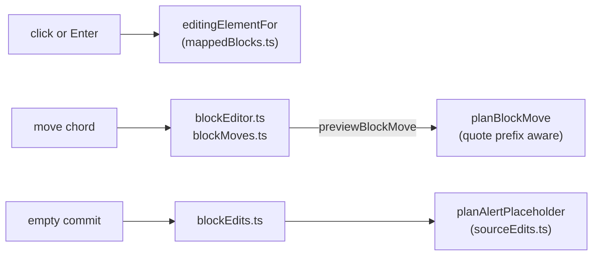

# feat(editor): edit the pointed block inside admonitions and alerts

## Summary

In edit mode, an admonition (a MyST `{note}`-style box) or a GitHub alert (`> [!NOTE]`) opened as
one block: pressing Enter on a paragraph or list item reached with the arrows, or clicking one,
opened the whole box. Now the element you select or point at is the one that opens; the whole box
opens from its title or frame, or when it is itself selected.

## Deliverables

| In edit mode, inside an admonition or alert | Before | After |
| --- | --- | --- |
| Click a body paragraph or list item | the whole box opens | that paragraph or item opens |
| Click the title or the frame | the whole box opens | the whole box opens |
| Enter on an element reached with the arrows | the whole box opens | that element opens |
| Enter on the box selected as a whole | the whole box opens | the whole box opens |
| Ctrl/Cmd+Alt+Up/Down in the editor of a direct block of the body | no inner move | the block (for an item: its list) moves among the body's blocks |
| Down at the end of a list, Up at its start | the next block outside would open | the caret stays in the editor |
| Erase an alert paragraph or item, then commit | an empty line cuts the alert | a `>` line keeps the alert whole |

## Changes

- `editingElementFor` opens the whole admonition only when the box itself or its title is the
  target; a block of the body opens on its own lines, and a list around the box never takes it
  over. The nearest box decides when they are nested.
- The move chord works from the editor of a direct block of the body, never leaving the box; a
  refused move shows its reason next to the box's insert point. A block inside a list item, or in a
  quote, card or grid inside the box, does not move; nor does a captioned code block or table.
- The move planner understands a GitHub alert's `>` prefix: a prefix-only line counts as blank and
  an added separator carries the prefix.
- An erased block of an alert body is written as the alert's prefix alone.
- A directive admonition holding an open editor no longer scrolls its own overflow, so the block
  palette does not cover the text box.
- Requirements, user guide and CHANGELOG follow.

## Impacts

Users reach any element of an admonition or alert directly, with the mouse or the keyboard. To
edit the whole box with the mouse, click its title or its frame. In the editor of a GitHub alert
block, the `> ` markers are part of the text. While an editor is open inside an admonition, wide
content of that admonition does not scroll.

## Blast radius

Grade: 2. It changes which block the most common editing gesture opens, and the shared block move
planner; a plain `git revert` restores the previous behaviour, with no data or settings change.

## Autonomous decisions

- A neighbour that is not a direct block of the body (a captioned code block or table) also stops
  the move chord: moving past it would not keep its wrapper whole.
- A move between blocks under different quote prefixes is refused with the existing "out of date"
  refusal; no new message.
- The palette overlap found by the new visual scenarios is fixed here, with a new requirement
  scenario.
- The real VS Code replay of the alert lazy line opens the alert from its title, so its assertions
  stay.

## Known gaps

- The captioned code block or table case of the move chord has no test.
- The real VS Code replay edited here runs only on the main branch or a heavy CI run.
- An erased line of an alert block that holds a lazy continuation line (no `>`) keeps the previous
  behaviour.

## Test plan

- [ ] New or changed tests (they fail on the previous code)
- [ ] Requirements: SwRS updated or added, markers in code and tests, `just requirements-update`
- [ ] Changelog: one user-facing line under `## Unreleased` in `CHANGELOG.md`
- [ ] Local gates:
- [ ] Review
- [ ] CI green

## Internal references

CR-514 enter-admonition.

🤖 Generated with [Claude Code](https://claude.com/claude-code)
