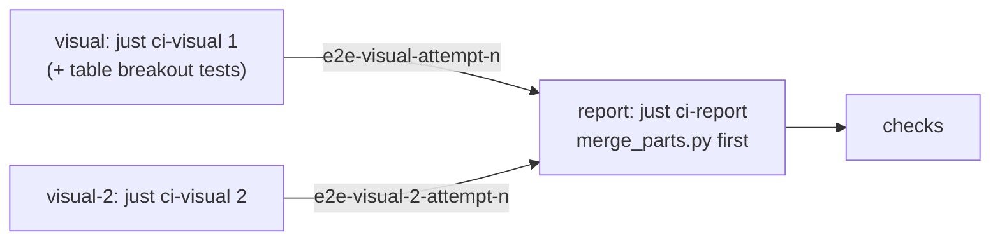

## Summary

The CI job `visual`, which captures and checks the screenshot campaign, ran out of its 15-minute
limit: it took 804 to 890 seconds of 900 on `main`, and one pull request run printed its pass line
one second after the limit and was cancelled. The campaign now runs in two jobs side by side,
`visual` and `visual-2`, and the `report` job merges their results. The limit stays at 15 minutes,
every scenario and check still runs, and no retry is added.

## Deliverables

Each part runs about half of the campaign's end-to-end groups (the named sets of screenshot
scenarios), and the report job puts them back together:

| | Before | After |
| --- | --- | --- |
| Jobs | `visual` | `visual` and `visual-2`, in parallel |
| Scenarios per job (this branch) | 523 | 269 (`rendering-core` to `layout-width`) and 254 (`theme-zoom` to `trust-security`) |
| Job limit | 15 minutes | 15 minutes each |
| Local run | `just ci-visual` | `just ci-visual` (both parts, then the merge); `just ci-visual 1` or `2` runs one part |

## Changes

- `test/visual/capture.py --part 1|2` runs the groups listed for that part (`VISUAL_PARTS`) and
  writes its own manifest, index and machine-check report. A group in no part, or in two parts,
  stops the script with exit code 2 and names the group.
- `test/visual/merge_parts.py` (new) writes the same full manifest, index and machine-check report
  as a full run. It fails, naming the cause, on a missing part, a scenario in no part, parts from
  another revision or run, a failed part, or identical screenshots across the parts.
- `test/visual/capture_report.py` (new) is the one writer of those files.
- `justfile`: `ci-visual` takes an optional part, and `ci-report` merges the parts first. With no
  part, `ci-visual` also removes the earlier first-gap and width-margins reports under
  `out/reports/visual/`.
- `.github/workflows/ci.yml`: new job `visual-2`, which restores the system package cache that
  `visual` saves; `report` and `checks` need both jobs.
- `scripts/select_e2e_run.py`: the site deployment reuses a run's reports only when the run also
  holds the second part's artifact.
- Contributor docs and the CI requirement describe the two parts.

## Impacts

No visual change: only CI, its scripts, its tests and the contributor docs change.

- CI shows one more job, `visual-2`.
- Locally, `just ci-visual` empties `out/reports/e2e/screenshots/` before it runs both parts, so
  real-window captures of an earlier `just ci-integration` in that folder have to be made again
  before `just ci-gallery`.
- Locally, `just ci-report` refuses parts that were run one by one without a pinned run id (its
  review step reports that the visual campaign start time does not match). Run `just ci-visual`
  with no part before it.
- A run made before this change has no second artifact, so the site deployment runs the end-to-end
  suite itself for such a run instead of reusing its reports.

## Blast radius

- **2**: several features or shared code; revert is possible but needs checks or follow-ups.

Grade: 2. It changes the CI jobs that gate merges and which runs the site deployment reuses. It
changes no data, file format or public API, and no publication step: a plain `git revert` restores
the single job, with nothing to migrate. The first runs after the merge show whether the time limit
holds.

## Autonomous decisions

- Two named jobs rather than a matrix: each part keeps one exact artifact name that `report`
  downloads, the way it already does for the single-job stages, so no new artifact selector is
  needed. The cost is some duplicated workflow lines, which the workflow tests keep consistent.
- In CI, where the run id is pinned (`STUDIO_E2E_RUN_ID`), the merge step also sets the start time
  recorded for the visual campaign to the merged run's start: each part job records its own start,
  and the final review check requires it to match the merged manifest. Without a pinned id the
  merge leaves that time alone, so that an older part left on a developer machine cannot pass beside
  a newer one.
- `test/visual` is added to the source folders of the requirements bundle
  (`requirements/config.yml`), so that the requirement can list the new files.

## Known gaps

- Locally, when the two parts were run one by one without a pinned run id, the merge step prints
  `visual parts: merged` and the review step then fails with a message that names no remedy. The
  `justfile` comment and the contributor guide give it: run `just ci-visual` with no part.
- One sentence of the contributor guide, on the job that also runs the table breakout width tests,
  reads awkwardly ("and in part 1 then ..."); its meaning is unchanged.

## Test plan

- [x] New or changed tests (they fail on the previous code): new `test/build/test_visual_parts.py`
  and changed workflow and run selection tests; against the code of the base branch the new file does
  not import and the changed tests fail
- [x] Requirements: `SwRS-MDOKFSTUDIO-CORE-076` updated (new scenario S12), markers in code and
  tests, `just requirements-update` leaves no change
- [x] Changelog: No user-facing change
- [ ] Local gates:
- [x] Review: approved at `2fb89df` (carried from `0b310d4`)
- [ ] CI green

## Internal references

- Change request 515.

🤖 Generated with [Claude Code](https://claude.com/claude-code)
