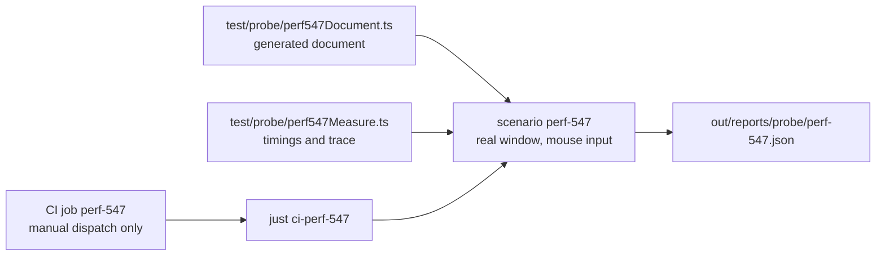

## Summary

Creating a review comment in the preview gets slower the larger the document is
(https://github.com/gsemet/markdown-okf-schema-studio/issues/547, reported on a document with many
tables and SVG images). This first step adds a measure of text selection and comment creation in a
real VS Code window, so the fix that follows is compared before and after on the same runner setup.

## Deliverables

One local command, also run by a manual CI job, measures a generated document of the reported shape:

| In the report | Meaning |
|---|---|
| `selectionRelease` | from the mouse release that ends a selection to the **Comment** button shown |
| `commentCreate` | from the save of a new comment to its highlight drawn |
| `commentCreateRestyledElements` | elements restyled by one comment creation |
| longest-task series | longest main-thread task of each drag and release, over text and across cells |

## Changes

- A deterministic generator of a document with about 464 lines, 22 tables, 11 SVG images, 9 comment
  threads and about 3,000 page elements. Its text is filler written for the project.
- A real-window scenario, `perf-547`, that drags selections with the mouse and creates comments from
  the **Comment** button, then writes every sample and the medians. It sets no limit.
- `just ci-perf-547`, and a CI job of the same name started only by a manual run with
  `perf_547=true`. Pull requests and pushes do not run it.

## Impacts

No visual change: this adds a test measure and a manual CI job, and no extension code.
Developers get a new command and a new workflow input.

## Blast radius

- **1**: local and isolated; a plain `git revert` restores the previous behaviour.

Grade: 1

## Test plan

- [ ] New or changed tests (they fail on the previous code)
- [x] Requirements: no behaviour change
- [x] Changelog: no user-facing change
- [ ] Local gates:
- [ ] Review
- [ ] CI green

Known gaps:

- No local real-window run: the real-window stages do not run on Windows. The measure was checked
  locally in a headless browser only.

## Internal references

- Change request CR-516 (perf-547).

🤖 Generated with [Claude Code](https://claude.com/claude-code)
