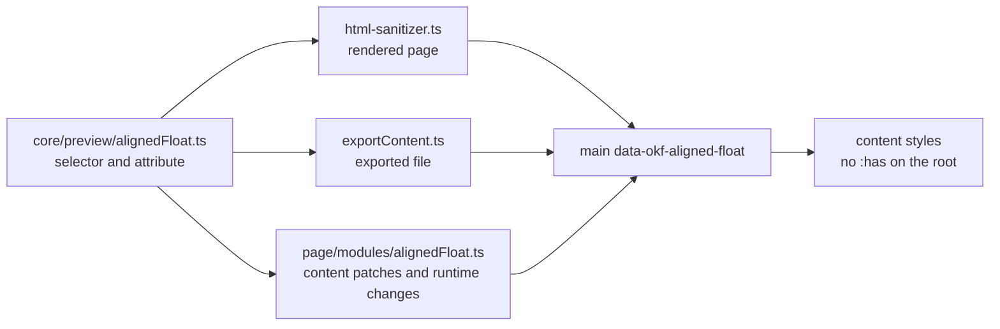

## Summary

Creating a review comment in the preview gets slower the larger the document is
(https://github.com/gsemet/markdown-okf-schema-studio/issues/547, reported on a document with many
tables and SVG images). The main cost found: three style rules made the browser restyle the whole
page after any change of its content. This change removes that cost, does the selection and hover
work of the page at most once per frame, and adds a measure in a real VS Code window to compare
before and after. The issue stays open: updating only the changed comment threads follows later.

## Deliverables

The three rules that asked "does the page hold an aligned image, figure or table?" with `:has()` now
read one attribute on the content root, written by whoever renders or changes the content:

| In the page | Before | After |
|---|---|---|
| Elements restyled by saving one comment (headless browser, page of 3072 elements) | 3125 | 26 |
| **Comment** button on a selection change | recomputed at every event | at most once per frame; the comment shortcut pressed before that frame reads it at once |
| **Comment** button on a scroll | selection read again | button moved only; the selection is read once more, at the next frame, only after the page changed under it |
| Hover outline and copy button | recomputed at every pointer event | at most once per frame |
| Selection text in scroll position reports | read at every report | read again only when it can have changed |
| Source line of a selection that ends at the very start of a block | every source line of the document listed | walks back from that block |

## Changes

- The content root carries `data-okf-aligned-float` exactly while it holds an aligned image, figure
  or table. The rules keep the same specificity and the page lays out as before, also in an exported
  file, which runs no page script. The attribute is left out of the page shell compared by content
  patches, so a patch stays a patch.
- The page's selection, hover and scroll handlers above.
- A test in a headless browser fails if saving one comment on a generated large document restyles
  more than 100 elements. It runs with the visual stage.
- A real-window scenario, `perf-547`, measures a generated document of the reported shape (about 464
  lines, 22 tables, 11 SVG images, 9 comment threads, about 3,100 elements): `just ci-perf-547`, and
  a CI job of the same name started only by a manual run with `perf_547=true`. The **How we test**
  page names it.

## Impacts

No visual change: the layout around aligned images and tables is the same, and the **Comment**
button, the hover outline and the copy button appear and disappear in the same situations, at the
next frame.

Real VS Code window on a Linux CI runner, before the change (median of each of three runs):

| Measure | Run 1 | Run 2 | Run 3 | Median of runs |
|---|---|---|---|---|
| Elements restyled by one comment creation | 3109 | 3109 | 3109 | 3109 |
| Selection release to **Comment** button shown (ms) | 17.8 | 18.45 | 17.75 | 17.8 |
| Comment save to highlight drawn (ms) | 53.4 | 51.0 | 53.9 | 53.4 |
| Longest task, drag over text (ms) | 2.65 | 2.46 | 2.66 | 2.65 |
| Longest task, drag across cells (ms) | 2.64 | 2.62 | 2.69 | 2.64 |
| Longest task, release over text (ms) | 2.28 | 2.41 | 2.17 | 2.28 |
| Longest task, release across cells (ms) | 2.62 | 2.79 | 2.60 | 2.62 |

The slowness of a text selection was not reproduced there: no drag or release blocked the page for
more than 50 ms (largest sample 12.26 ms).

## Blast radius

- **2**: several features of the preview page and the rendered and exported pages; a plain
  `git revert` restores the previous behaviour, no data or file format changes.

Grade: 2

## Test plan

- [x] New or changed tests (they fail on the previous code): new tests for the restyle count, the
      layout with and without an aligned float and the switch between them, the once-per-frame
      handlers and the unchanged behaviours. On the previous code the new-behaviour tests fail and
      the unchanged-behaviour tests pass (the comment shortcut test was not run on it).
- [x] Requirements: SwRS updated or added, markers in code and tests, `just requirements-update`
- [x] Changelog: one user-facing line under `## Unreleased` in `CHANGELOG.md`
- [x] Local gates: `just check` green twice in a row (5538 unit tests, 5531 pass, 7 skipped; 298
      Python tests); 20 of 20 browser tests; the five timing-dependent test files pass 10 times in a
      row each, and once each while `just check` runs beside them; `just ci-visual` on Windows on the
      final code: 524 of 530 captures pass, the 6 failed captures fail the same way without this
      change
- [x] Review: the change approved at e52cd28
- [ ] CI green

Autonomous decisions:

- The pointer-move listener of the edit mode outline is not throttled: it only records that the
  pointer, not the keyboard, owns the hover actions, once per switch.
- The time limits of the manual `perf-547` job follow its measured duration (job 5 minutes, step 4).

Known gaps:

- No local real-window run: the real-window stages do not run on Windows.
- The real-window runs after the change are not done yet.

## Internal references

- Change request CR-516 (perf-547).

🤖 Generated with [Claude Code](https://claude.com/claude-code)
