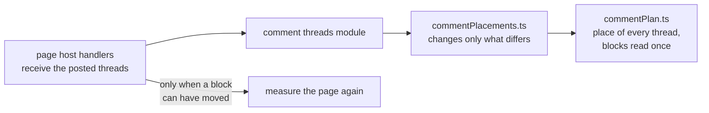

## Summary

After a review comment is created, answered, resolved or deleted, the preview removed the highlight
of every comment thread and placed all of them again, then measured every block of the page. This
change updates only what differs, and measures the page again only when a block can have moved. It
also measures two other costs behind the same report: the wait of a comment write for the Git user
name, and the indexing of a document for its comment threads.

Part of https://github.com/gsemet/markdown-okf-schema-studio/issues/547 (creating a comment is
slow on a large document). Stacked on #549: this pull request adds only the commits above that one.

## Deliverables

A posted thread list now goes through a read-only plan of where every thread belongs, then only the
elements that differ are changed (arrows are calls):

| After a comment write | Before | After |
|---|---|---|
| Highlights, badges, orphan entries of unchanged threads | removed and created again | the same elements, not written |
| Reads of the page's mapped blocks | one or two per thread | one per update |
| Measure of every block's position | every time | only when a block can have moved (below) |

A content change or a new render still places every thread from nothing, as before.

The page measures again, with comments shown or hidden, when an update:

- adds or removes a highlight: its line can wrap anew, and it counts for `:last-child` style rules;
- adds, moves or removes a badge below a block;
- gives a block that holds another element its first badge inside, or takes the last one away.

It does not measure for replies, resolved or reopened threads, a further badge or one badge fewer in
a block that keeps one, badges inside a block that holds only text, or the orphan list. So a new or
deleted comment on selected words still measures the page, as before.

### Cost of the comment thread index

Medians in ms of three runs on a Linux CI runner, plain Node, on generated documents where every
thread anchors at its stored place; the last column is the median comment creation time measured
in a real window by the same runs.

| Document | Index the document, 3 runs | Re-anchor all threads (indexes too), 3 runs | Comment creation, 3 runs |
|---|---|---|---|
| 464 lines, 65 KB, 9 threads | 1.77, 1.41, 1.21 | 2.11, 1.75, 1.55 | 46.6, 35.2, 35.5 (this document) |
| 1856 lines, 261 KB, 36 threads | 7.00, 5.53, 4.79 | 10.28, 8.36, 7.70 | not measured at this size |

Runs: [1](https://github.com/gsemet/markdown-okf-schema-studio/actions/runs/45928962519),
[2](https://github.com/gsemet/markdown-okf-schema-studio/actions/runs/45928965278),
[3](https://github.com/gsemet/markdown-okf-schema-studio/actions/runs/45928968671), at 7d24547,
the commit that adds the measure and changes no behaviour.

When the extension host runs these two functions, as read in the code (nothing there changes):

| User action, on a previewed document | What runs |
|---|---|
| First preview of a document that has comments, or a preview switching to one | index and re-anchor all threads |
| Preview page reloaded or restored | threads posted again; re-anchored only when no result is kept for that text |
| Comment created, answered, resolved or deleted | index and re-anchor all threads, once per write for each preview of the document; nothing when the last thread is deleted |
| Comments file created or changed outside the preview | index and re-anchor all threads |
| First change of a document with no unsaved changes (first keystroke or paste, reload, revert) | index and re-anchor all threads |
| Undo or redo | index and re-anchor all threads |
| Later typing while a thread is orphaned | index, and re-anchor the orphaned threads |
| Every save | index, even with no comments file; re-anchor when the comments file is valid; nothing when the comments file has unsaved changes in an editor. A save that moves stored lines while a thread is orphaned indexes a second time, to place the orphans again |

While a document has unsaved changes and no thread is orphaned, further typing does not index again.

## Changes

- `commentPlan.ts` computes where each thread belongs (highlight, badge, orphan entry) from one read
  of the mapped blocks; `commentPlacements.ts` applies only the differences. The open popover, its
  typed draft and pending question, the focus colour and hidden comments behave as before.
- The page measures its source positions after a thread update only when a block can have moved;
  this holds with comments hidden too, since hidden highlights and badges still count for style
  rules.
- The manual real-window job `perf-547` now runs in a test folder that is a Git repository with a
  user name, reports the wait of each comment write for that name (`authorWait`), and times the
  thread index on two document sizes (`threadIndex`). It sets no limit.

## Impacts

No visual change: highlights, badges and the orphan list sit where they did; a test compares the
page updated in place with a page placed from nothing. Creating a comment on selected words is not
expected to be measurably faster: its new highlight still measures the page.

Wait of a comment write for the Git user name, in the same three runs (12 samples each, medians
10.74, 8.69 and 6.79 ms; median of the runs 8.69 ms, median of all 36 samples 9.64 ms): at or under
the 10 ms threshold set for this work, so the author name lookup is unchanged.

## Blast radius

- **2**: the comment highlights, badges and orphan list of the preview page; a plain `git revert`
  restores the previous behaviour, no data or file format changes.

Grade: 2

## Autonomous decisions

- The Git author name is not cached: the median wait of the three runs is 8.69 ms, under the 10 ms
  threshold, although one of the three runs measured 10.74 ms.
- The page measures after every added or removed highlight, without comparing the layout: in
  headless Chromium a highlight moved a list block by 4.19 px while the size of the content did not
  change, so no other observer would have measured it.

## Known gaps

- The thread index is timed on documents where every thread anchors at its stored place; the cost of
  an orphaned thread or of a search for a changed quote is not measured, and the two functions are
  timed in plain Node, not inside VS Code.
- Each update still searches the text of the blocks of every thread to find its place; only the
  changes to the page are limited to what differs.
- Where two text nodes touch and a highlight spans their seam, a page updated in place can split the
  text into nodes differently from a page placed from nothing. Nothing visible differs; the previous
  code did the same when it placed the highlights again.
- The real VS Code integration and acceptance jobs do not run at this pull request's head: they run
  once, at the last commit of the stack of pull requests this one ships with.

## Test plan

- [x] New or changed tests: `test/page/modules/commentThreadsUpdate.test.ts` (25 tests; on the
  previous code 4 of them fail: other threads' elements replaced with extra block reads, replies and
  resolved states replacing elements, and a measure after an update that moves nothing, comments
  shown and hidden; the 21 others check "same result as before" and the measures that stay) and
  `test/build/perf547ThreadIndex.test.ts` for the new measure
- [x] Requirements: SwRS-MDOKFSTUDIO-REVIEW-224 added, markers in code and tests,
  `just requirements-update`
- [x] Changelog: one user-facing line under `## Unreleased` in `CHANGELOG.md`
- [ ] Local gates:
- [ ] Review
- [ ] CI green

## Internal references

- Change request CR-517 (perf-547-comment-update-and-author).

🤖 Generated with [Claude Code](https://claude.com/claude-code)
