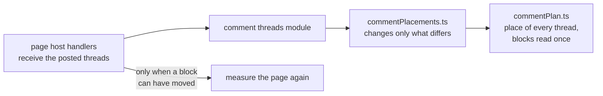

## Summary

After a review comment is created, answered, resolved or deleted, the preview removed the highlight
of every comment thread and placed all of them again, then measured every block of the page. This
change updates only what differs, and measures the page again only when a block can have moved. It
also measures two other costs behind the same report: the wait of a comment write for the Git user
name, and the indexing of a document for its comment threads.

Part of https://github.com/gsemet/markdown-okf-schema-studio/issues/547 (creating a comment is
slow on a large document). Stacked on #549: this pull request adds only the commits above that one.

## Deliverables

A posted thread list now goes through a read-only plan of where every thread belongs, then only the
elements that differ are changed (arrows are calls):

| After a comment write | Before | After |
|---|---|---|
| Highlights, badges, orphan entries of unchanged threads | removed and created again | the same elements, not written |
| Reads of the page's mapped blocks | one or two per thread | one per update |
| Measure of every block's position | every time | only when a block can have moved (below) |

A content change or a new render still places every thread again, as before (see the case of text
nodes that sit side by side under Known gaps).

The page measures again, with comments shown or hidden, when an update:

- adds or removes a highlight: its line can wrap anew, and it counts for `:last-child` style rules;
- adds, moves or removes a badge below a block;
- gives a block that holds another element its first badge inside, or takes the last one away.

It does not measure for replies, resolved or reopened threads, a further badge or one badge fewer in
a block that keeps one, badges inside a block that holds only text, or the orphan list. So a new or
deleted comment on selected words still measures the page, as before.

### Cost of the comment thread index

Medians in ms of the three real-window runs below, timed in plain Node on a Linux CI runner, on
generated documents where every thread anchors at its stored place; the last column is the median
comment creation time measured in a real window by the same runs.

| Document | Index the document, runs 1, 2, 3 | Re-anchor all threads (indexes too), runs 1, 2, 3 | Comment creation, runs 1, 2, 3 |
|---|---|---|---|
| 464 lines, 65 KB, 9 threads | 1.41, 1.41, 1.04 | 1.96, 1.74, 1.35 | 32.4, 35.4, 23.7 (this document) |
| 1856 lines, 261 KB, 36 threads | 5.62, 5.48, 4.20 | 8.94, 8.35, 6.37 | not measured at this size |

When the extension host runs these two functions, as read in the code (this pull request does not
change when they run):

| User action, on a previewed document | What runs |
|---|---|
| First preview of a document that has comments, or a preview switching to one | index and re-anchor all threads |
| Preview page reloaded or restored | threads posted again; re-anchored only when no result is kept for that text |
| Comment created, answered, resolved or deleted | index and re-anchor all threads, once per write for each preview of the document; nothing when the last thread is deleted |
| Comments file created or changed outside the preview | index and re-anchor all threads |
| First change of a document with no unsaved changes (first keystroke or paste, reload, revert) | index and re-anchor all threads |
| Undo or redo | index and re-anchor all threads |
| Later typing while a thread is orphaned | index, and re-anchor the orphaned threads |
| Every save | index, even with no comments file; re-anchor when the comments file is valid; nothing when the comments file has unsaved changes in an editor. A save that moves stored lines while a thread is orphaned indexes a second time, to place the orphans again |

A save indexes and re-anchors once, however many previews of the document are open; everything
else in the table, the second index of a save included, runs once for each open preview. Apart from
the save, a document without comment threads runs neither function. While a document has unsaved
changes and no thread is orphaned, further typing does not index again.

## Changes

- `commentPlan.ts` computes where each thread belongs (highlight, badge, orphan entry) from one read
  of the mapped blocks; `commentPlacements.ts` applies only the differences. The open popover, its
  typed draft and pending question, the focus colour and hidden comments behave as before.
- The page measures its source positions after a thread update only when a block can have moved;
  this holds with comments hidden too, since hidden highlights and badges still count for style
  rules.
- The manual real-window job `perf-547` now runs in a test folder that is a Git repository with a
  user name, reports the wait of each comment write for that name (`authorWait`), and times the
  thread index on two document sizes (`threadIndex`). It sets no limit.

## Impacts

No visual change: highlights, badges and the orphan list sit where they did; a test compares the
page updated in place with a page placed from nothing (one exception under Known gaps, as before
this change).

### Real-window timings

Three manual `perf-547` runs at 44a2e93, in a real VS Code window on a Linux CI runner:
[run 1](https://github.com/gsemet/markdown-okf-schema-studio/actions/runs/45947065460),
[run 2](https://github.com/gsemet/markdown-okf-schema-studio/actions/runs/45947068376),
[run 3](https://github.com/gsemet/markdown-okf-schema-studio/actions/runs/45947071021).
They are compared with the three runs reported by #549, and with three runs of 7d24547, the commit
of this pull request that adds the measure and keeps the behaviour of #549. The runs of 7d24547
and of 44a2e93 use a test folder that is a Git repository with a user name; those of #549 did not.
Each cell lists the median of each of the three runs, in ms except the last row.

| Interaction | This change, runs 1, 2, 3 | #549 | Same test folder, without this change | Result |
|---|---|---|---|---|
| Comment creation | 32.4 / 35.4 / 23.7 | 47.1 / 45.9 / 37.1 | 46.6 / 35.2 / 35.5 | not separable from runner noise |
| Selection release | 16.9 / 16.65 / 3.6 | 18.2 / 17.65 / 18.05 | 17.45 / 17.8 / 18.05 | not separable (samples cluster near 4 and 17 ms) |
| Longest task, text drag | 2.16 / 2.29 / 1.92 | 2.72 / 2.68 / 2.62 | 2.97 / 2.30 / 1.95 | not separable |
| Longest task, cell drag | 2.22 / 2.18 / 1.87 | 2.54 / 3.40 / 2.71 | 2.81 / 2.09 / 2.41 | not separable |
| Longest task, text release | 2.21 / 1.98 / 1.98 | 2.41 / 2.55 / 2.92 | 2.33 / 2.19 / 2.21 | not separable |
| Longest task, cell release | 2.28 / 2.44 / 2.10 | 2.73 / 2.92 / 2.91 | 2.68 / 2.48 / 2.32 | not separable |
| Elements restyled by one comment creation | 4 / 4 / 4 | 41 / 41 / 41 | 41 / 41 / 41 | drops from 41 to 4 |

No interaction got slower. The result column compares with the runs of the same test folder.
Against #549, comment creation and the four longest tasks are lower in every run, but its test
folder differed, so that difference is not credited to this change.

### Wait for the Git user name

Milliseconds one comment write waited for the Git user name, 12 writes per run:

| Run | Samples | Median |
|---|---|---|
| 1 | 9.45, 9.66, 9.41, 6.71, 6.8, 6.77, 5.25, 4.65, 6.59, 6.76, 6.79, 6.79 | 6.78 |
| 2 | 12.46, 12, 12.27, 12.86, 11.79, 36.15, 7.88, 7.81, 7.61, 7.75, 7.44, 7.59 | 9.83 |
| 3 | 12.74, 13.11, 13.96, 8.91, 9.17, 8.54, 7.93, 7.85, 8.31, 8.33, 8.79, 8.78 | 8.79 |

The median of the three runs is 8.79 ms (median of all 36 samples: 8.32 ms). The three runs of
7d24547 had medians of 10.74, 8.69 and 6.79 ms (median of the runs 8.69 ms, of all samples
9.64 ms). Both are under the 10 ms threshold set for this work, so the author name lookup is
unchanged.

## Blast radius

- **2**: the comment highlights, badges and orphan list of the preview page; a plain `git revert`
  restores the previous behaviour, no data or file format changes.

Grade: 2

## Autonomous decisions

- The Git author name is not cached: the median wait of the three runs of 7d24547 is 8.69 ms,
  under the 10 ms threshold, although one of those runs measured 10.74 ms; the three runs at
  44a2e93 confirm it (8.79 ms).
- The pull request refers to issue 547 and does not close it: the slow text selection it reports
  was not reproduced (no drag or release blocks for 50 ms in any of these runs), and these runs do
  not show that slow comment creation is fixed.
- The page measures after every added or removed highlight, without comparing the layout: in
  headless Chromium a highlight moved a list block by 4.19 px while the size of the content did not
  change, so no other observer would have measured it.

## Known gaps

- The thread index is timed on documents where every thread anchors at its stored place; the cost of
  an orphaned thread or of a search for a changed quote is not measured, and the two functions are
  timed in plain Node, not inside VS Code.
- Each update still searches the text of the blocks of every thread to find its place; only the
  changes to the page are limited to what differs.
- Where two text nodes of a block sit side by side, a highlight that starts or ends between them
  joins them: after the next thread list (a reply or any other comment change) or a content patch
  that keeps the block, a quote crossing that place turns from a badge into a highlight that a
  freshly opened page does not show, and a thread whose words that highlight takes turns into a
  badge. The page code before this change does the same, and no rendered page checked in headless
  Chromium 156 holds such nodes, so no user action that meets this is known; older Chromium builds,
  as in older VS Code releases, were not checked.
- Three descriptions lag behind the case above or behind a corrected comment and are not changed
  here: the module comment of the comment stylesheet still says its output is unchanged, one function
  comment of the comment threads module still says threads are placed "again from nothing", and the
  repeat-apply criterion of SwRS-MDOKFSTUDIO-REVIEW-017 does not cover text nodes that sit side by
  side.
- The real VS Code integration and acceptance jobs do not run at this pull request's head: they run
  once, at the last commit of the stack of pull requests this one ships with.

## Test plan

- [x] New or changed tests: `test/page/modules/commentThreadsUpdate.test.ts` (25 tests; on the
  previous code 4 of them fail: other threads' elements replaced with extra block reads, replies and
  resolved states replacing elements, and a measure after an update that moves nothing, comments
  shown and hidden; the 21 others check "same result as before" and the measures that stay),
  `test/build/perf547ThreadIndex.test.ts` for the new measure,
  `test/session/reviewReqComments.requirements.test.ts` for the recorded wait for the Git user name,
  and the pinned stylesheet text of `test/core/preview/commentStyles.test.ts`, updated for a
  corrected stylesheet comment
- [x] Requirements: SwRS-MDOKFSTUDIO-REVIEW-224 added, markers in code and tests,
  `just requirements-update`; no stakeholder requirement text changes (two gain the generated link
  to the new requirement)
- [x] Changelog: one user-facing line under `## Unreleased` in `CHANGELOG.md`
- [x] Local gates: `just preflight` passes at 44a2e93 (run on Windows, where it runs the static
  stage only, `just check` included)
- [x] Review: the changes are reviewed and approved, committed as 44a2e93
- [x] CI green: the pull request checks pass at 44a2e93 (real VS Code jobs are skipped on pull
  requests, see Known gaps)

## Internal references

- Change request CR-517 (perf-547-comment-update-and-author).

🤖 Generated with [Claude Code](https://claude.com/claude-code)

