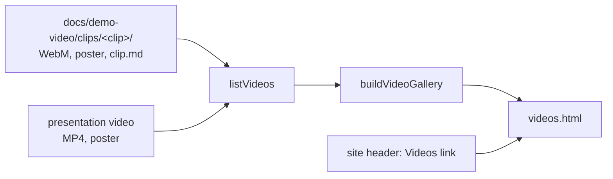

## Summary

The videos of the extension (17 short feature clips and a one-minute demo) could not be watched in one place, and the README showed its features only as still pictures. The project site gets a **Videos** page with all of them, and the README shows five features in motion.

## Deliverables

The site build writes one new page from whatever the video folders hold, so a new clip appears on the next build with no code change:

| README section | Before | After |
| --- | --- | --- |
| Highest respect for the raw Markdown | no picture | table drag GIF |
| Edit MyST visually | three stills (the editing still and a Cream and Dark pair) | the same three, with the slash menu grid and figure editor GIFs after the editing still |
| See what changed since the last commit | still of the change marks | side-by-side diff GIF |
| Decide in the page: choices in your plans | Cream and Dark stills | radio buttons GIF |

## Changes

- `test/site/videoGalleryPage.ts` lists the videos and builds the page body: each card is a `<video>` with `controls`, `preload="none"`, no `autoplay`, and its poster when the folder has one. Clips are muted and loop; the presentation video does neither.
- A few lines of script make a click on a picture play a video that has not been loaded yet; every later click is left to the browser's controls.
- `test/site/buildSite.ts` writes `videos.html`, copies the presentation video and its poster, adds the page and its social card to the site manifest.
- The site header gets a **Videos** link between **Gallery** and **Requirements**, and the README's top line links the page.
- A poster picture for the presentation video (its first frame, stored with Git LFS).
- The new browser test joins the CI job that runs the other site tests in Chromium.
- Documentation, glossary and requirements follow the new page and the seven header links.

## Impacts

- Site visitors find a **Videos** link in the header. No video byte loads until a video is played.
- A click on a picture starts its video; the browser's controls and the space bar work as usual.
- README readers see five animated clips (about 7.3 MB of GIFs in total). On the site's home page they play as looping videos, like clips on the documentation pages. In the packaged extension the README loads them from the repository's Git LFS host, and they are not part of the VSIX.

Pictures: before at `6b1dd90`, after at `8541bed`. The README sections are rendered locally with markdown-it, not by GitHub, and each GIF is caught at one frame. The site has one theme, so there is no light and dark pair.

The new Videos page, posters shown and nothing playing (it did not exist before):

Site header, before and after:

| README section | Before | After |
| --- | --- | --- |
| Highest respect for the raw Markdown |  |  |
| Edit MyST visually |  |  |
| See what changed since the last commit |  |  |
| Decide in the page |  |  |

## Blast radius

Grade: 1. Only the site build, the README and documentation change; no extension code. A plain `git revert` restores the previous pages; an already published extension README changes with the next release.

## Test plan

- [x] New or changed tests (they fail on the previous code): page builder tests over a fixture tree and over the shipped clips, a Chromium test of loading and playing, a README test, header link assertions
- [x] Requirements: SwRS updated or added, markers in code and tests, `just requirements-update` (the new gallery requirement: `test/site/videoGalleryPage.ts`, `test/site/buildSite.ts`, `test/site/videoGalleryPage.test.ts`, `test/site/videoGallery.browser.test.ts`; the header requirement: marked in `test/site/siteTheme.ts`, unchanged here, and covered by the header link tests)
- [x] Changelog: one user-facing line under `## Unreleased` in `CHANGELOG.md`
- [x] Local gates: `just preflight` (static stage on Windows, with `just check` and its 298 release tests inside it) passes at 8541bed
- [x] Review: approved at 8541bed
- [x] CI green: the checks that ran pass at 8541bed (`static`, `static-windows`, `visual`, `visual-2`, `viewer-graph`, `report`, `checks`); the other jobs were skipped

## Autonomous decisions

- The page order in the header, the card layout, titles taken from each clip's first on-screen text, and the title "One-minute demo" for the presentation video were chosen without the owner.
- Each README clip sits in the section of its feature: the table drag clip in "Highest respect for the raw Markdown"; the slash menu grid and figure editor clips in "Edit MyST visually", after the editing still; the side-by-side diff clip replaces the still of the change marks, and the radio buttons clip replaces the Cream and Dark stills.
- The poster of the presentation video is its first frame, committed with Git LFS; the README top line links the new page; the cards show the 16:9 pictures uncropped.
- The three still pictures the README no longer shows stay in the repository with their visual scenarios.

## Known gaps

- The click on a picture was checked in Chromium and Chrome only; Firefox and Safari, whose own click may already play a video, were not.
- With scripts disabled, a click on a picture does not start the video; the browser's play button is the way.
- Pausing a video while it is still loading leaves an unhandled `play()` rejection in the browser console.
- No test runs the "the build passes" half of the case with no video at all.
- The full site build with the screenshot gallery filled from real VS Code runs was not run locally; neither was a dry run of the Pages deployment.
- The real VS Code jobs (integration, acceptance, stress) were skipped on this pull request; no extension code changes.

## Internal references

- CR-522; requirements SwRS-MDOKFSTUDIO-CORE-098 (new), CORE-086, CORE-095, StRS CORE-008.

🤖 Generated with [Claude Code](https://claude.com/claude-code)

