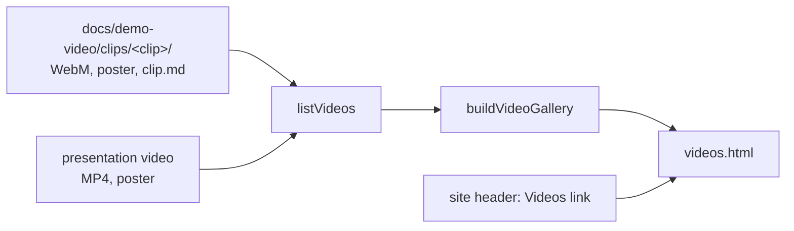

## Summary

The videos of the extension (17 short feature clips and a one-minute demo) could not be watched in
one place, and the README showed its features only as still pictures. The project site gets a
**Videos** page with all of them, and the README shows five features in motion.

## Deliverables

The site build writes one new page from whatever the video folders hold, so a new clip appears on
the next build with no code change:

| README section | Before | After |
| --- | --- | --- |
| Highest respect for the raw Markdown | no picture | table drag GIF |
| Edit MyST visually | one still | the same still, then slash menu grid and figure editor GIFs |
| See what changed since the last commit | still of the change marks | side-by-side diff GIF |
| Decide in the page: choices in your plans | Cream and Dark stills | radio buttons GIF |

## Changes

- `test/site/videoGalleryPage.ts` lists the videos and builds the page body: each card is a
  `<video>` with a poster, `controls` and `preload="none"`, no `autoplay` and no script. Clips are
  muted and loop; the presentation video does neither.
- `test/site/buildSite.ts` writes `videos.html`, copies the presentation video and its poster,
  adds the page and its social card to the site manifest.
- The site header gets a **Videos** link between **Gallery** and **Requirements**, and the README's
  top line links the page.
- A poster picture for the presentation video (its first frame, stored with Git LFS).
- Documentation, glossary and requirements follow the new page and the seven header links.

## Impacts

- Site visitors find a **Videos** link in the header. No video byte loads until a video is played.
- In Chromium, a video starts from the play button of its controls or the space bar; a click in the
  middle of the picture does nothing.
- README readers see five animated clips (about 7.3 MB of GIFs in total). On the site's home page
  they play as looping videos, like clips on the documentation pages. In the packaged extension the
  README loads them from the repository's Git LFS host, and they are not part of the VSIX.

## Blast radius

Grade: 1. Only the site build, the README and documentation change; no extension code. A plain
`git revert` restores the previous pages; an already published extension README changes with the
next release.

## Test plan

- [x] New or changed tests (they fail on the previous code): page builder tests over a fixture tree
      and over the shipped clips, a Chromium test of loading and playing, a README test, header
      link assertions
- [x] Requirements: SwRS updated or added, markers in code and tests, `just requirements-update`
- [x] Changelog: one user-facing line under `## Unreleased` in `CHANGELOG.md`
- [ ] Local gates:
- [ ] Review
- [ ] CI green

## Autonomous decisions

- The page order in the header, the card layout, titles taken from each clip's first on-screen text,
  and the title "One-minute demo" for the presentation video were chosen without the owner.
- Videos play through the browser's own controls with no script. Because a click on the picture
  does not start a video in Chromium, the page text and documentation speak of the play button.
- The three still pictures the README no longer shows stay in the repository with their visual
  scenarios.

## Known gaps

- A click in the middle of a video's picture does not play it in headless Chromium and Chrome; only
  the play button or the space bar does. Firefox, Safari and a headed window were not checked.
- The full site build with the screenshot gallery filled from real VS Code runs was not run
  locally; neither was a dry run of the Pages deployment.

## Internal references

- CR-522; requirements SwRS-MDOKFSTUDIO-CORE-098 (new), CORE-086, CORE-095, StRS CORE-008.

🤖 Generated with [Claude Code](https://claude.com/claude-code)
