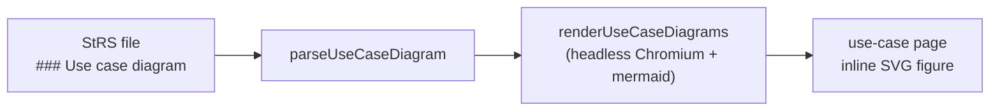

## Summary

A use case (StRS) in the requirements can now carry a small Mermaid diagram that shows who takes
part and what happens. GitHub draws the fence natively; the published requirements site draws it
at build time as an inline SVG, so the page stays light and needs no JavaScript. A use case with
no diagram looks exactly as before. This change adds the rule and the site rendering; it writes no
diagram for the existing use cases.

## Deliverables

- A new guideline section "Use case diagram of a StRS" (kind per use case, placement before Main
  paths, no SwRS id in a diagram, no PlantUML).
- The site shows the diagram under the user need, in the site's colours (one cream variant, no
  dark mode, no script).
- A diagram Mermaid cannot draw fails the site build with the StRS id and Mermaid's message.

## Changes

- `requirements/guidelines/project.guidelines.md`: the new section; Main paths placement agreed.
- `test/site/requirementsViewer/useCaseDiagram.ts` (new): section extraction and the renderer.
- `model.ts`, `write.ts`, `pages.ts`, `viewer.css`: carry, render and show the figure.
- A new SwRS in rendering-core, its marker and its tests; requirements regenerated and logged.

## Impacts

On three sample use cases (a sequence, a flowchart and a state diagram, on a scratch branch that is not part of this PR), the site shows each diagram in its cream colours with JavaScript off and no label is cut. GitHub draws the same three fences natively, in its own theme and a newer Mermaid than the site's 12.2.0, inside a figure with pan, zoom and copy buttons; layout and text match the site. The guideline states this.

## Blast radius

Grade: 1. Site build and guideline only; a use case without a diagram is byte-identical. A plain
`git revert` restores the previous behaviour.

## Test plan

- [x] New or changed tests (they fail on the previous code)
- [x] Requirements: SwRS added, markers in code and tests, `just requirements-update`
- [x] Changelog: No user-facing change (requirements site and guideline only)
- [x] Local gates: `just check`, `just requirements-lint`, `just requirements-report`, site tests 31 pass, `just preflight` (static stage, Windows)
- [ ] Review
- [ ] CI green

## Known gaps

- The sample screenshots are not attached to this description.
- In the CI-built site of the sample branch, the gallery job needed a scratch workflow tweak to run on a dispatch (not part of this PR); the "Workspace state" node of the state sample is taller than its text, which is cosmetic.
