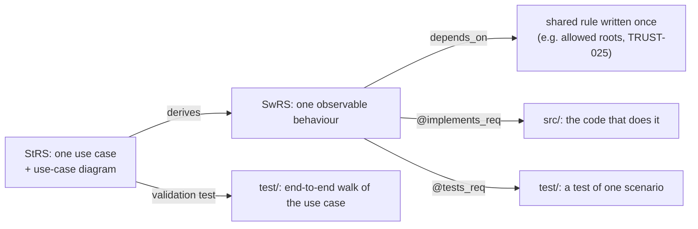

## Summary

The requirements of the rendering core, the diagrams and the trust and security of Studio were hard
to review: some use cases (StRS) mixed several stories or contradicted their behaviours (SwRS), some
behaviours repeated a shared rule, and several `@implements_req` and `@tests_req` markers sat away
from the code or the test they name. This PR gardens those three groups so a reviewer can read each
use case and follow it down to the code and to a test. It changes no product behaviour.

## Deliverables

Each use case of the three groups now reads as one story with a use-case diagram, and is traced
down to the code and to a validation test on a real scenario:

| | Before | After |
| --- | --- | --- |
| Use cases | some mixed several stories, no diagram | one story each, four new use cases, a use-case diagram each |
| Shared rules | repeated in several behaviours | written once, cited with `depends_on` |
| Markers | some on callers or unrelated tests | on the code that does the behaviour and the test that checks it |
| Use-case validation | missing for several use cases | a validation test per use case (unit or integration) |

Three approved use cases changed text and were re-approved by the maintainer; their final commits:

- `StRS-MDOKFSTUDIO-CORE-001` (faithful rendering): b606eb71
- `StRS-MDOKFSTUDIO-DIAG-001` (diagrams, Mermaid with PlantUML aside): 78bdac2c
- `StRS-MDOKFSTUDIO-DIAG-006` (diagram theming): 1e484260

Their `verified.at` now equals their `approved_at`: okfreq's coverage update sets it at
re-approval, so it cannot keep its earlier value.

## Blast radius

Grade: 1

Requirement text, markers and tests only; no product code path changes. A plain `git revert`
restores the previous bundle.

## Autonomous decisions

- StRS CORE-002 was reworded to what the code does: an included file is shown in place and edited in
  its own file; copy, cut and paste next to an included block are refused. No editing from the
  include location exists. See the open question below.
- The PlantUML JAR include check (`findEscapingPlantUmlInclude`) was kept as its own behaviour and
  does not cite the allowed-roots rule of TRUST-025, because the code runs it apart from
  `resolveResource`. See the open question below.
- Five places where the code and the requirement disagree are written as they behave today, with a
  "Known issue" line, instead of being fixed here: CORE-010, CORE-025, DIAG-005, DIAG-009,
  TRUST-042. Their fixes go to the backlog.
- `test/integration/realInput/markers.ts` was deleted: once its markers moved onto their code and
  tests it was empty, and nothing imports it.

Questions for the maintainer:

- CORE-002: should included blocks stay non-editable from the including document, as the reworded
  use case now says?
- TRUST-025: should the PlantUML JAR include containment share the allowed-roots rule of TRUST-025?

## Known gaps

- The TRUST-009 test only checks that a stale move is not applied; it does not check the
  out-of-date answer shown to the user.
- okfreq still counts 12 of the 17 use cases as not fully covered: their generated `derived_by`
  lists still hold superseded behaviours, and TRUST-070 and TRUST-075 are exempt; hand edits cannot
  fix generated fields.
- The five new integration scenarios (CORE-002, TRUST-004, TRUST-006 and TRUST-009 in two files)
  only type-check locally; they ran, green, only in the real VS Code integration job of CI.
- The gallery job of CI was skipped by the workflow even when dispatched with `gallery=true`, so
  the gallery was not rebuilt for this PR.
- DIAG-089 (stopping the PlantUML process group) is not checked on Windows.
- The Mermaid flowchart and state diagrams of CORE-003, CORE-006, CORE-008, TRUST-001, TRUST-012 and
  TRUST-014 are not parsed by any test under Node.
- The three re-approved use case commits do not name the re-approval in their messages, and only
  the two test commits carry the `Assisted-by` trailer.

Details

## Changes

- `requirements/tiers/strs/`: four new use cases, use cases reparented, split and reworded, a
  use-case diagram in each.
- `requirements/tiers/swrs/` (rendering-core, diagrams, trust-security): behaviours merged
  (superseded, never deleted), split and rewritten; shared rules cited with `depends_on`; the
  requirements log updated.
- `src/`: markers moved onto the code that does each behaviour (no logic change).
- `test/`: markers moved onto the tests that check each scenario; new tests for the scenarios left
  untested; a validation test that walks each use case end to end.

## Impacts

No visual change: requirement text, markers and tests only.

## Test plan

- [x] New or changed tests: scenarios left untested and one validation test per use case
- [x] Requirements: SwRS updated, markers in code and tests, `just requirements-update`
- [x] Changelog: No user-facing change
- [x] Local gates: `just requirements-lint`, `just check` and `just preflight` (static stage, on Windows) pass at 1e484260 (carried over a clean rebase onto main: same patches)
- [x] Review: approved at 1e484260 (carried over a clean rebase onto main: same patches)
- [x] CI green at 1e484260: pull request checks (static, static-windows, visual, report, checks);
      the real VS Code run (integration, stress) green at the head of the PR stacked above this one

## Internal references

- Change request CR-347 (`garden-cdt`), batch batch-06; bottom of the stack, on main (CR-345, #415, is merged).

🤖 Generated with [Claude Code](https://claude.com/claude-code)
