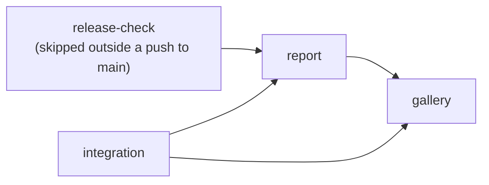

## Summary

Running the heavy CI jobs on a branch by hand (`gh workflow run ci.yml --ref <branch> -f heavy=true`)
never built the gallery and the site, even with `-f gallery=true`: the `gallery` job was skipped
on every such dispatch. So the site of a branch (for example the use case diagrams of the
requirements site) could not be checked without editing the workflow on that branch. This PR makes
a heavy dispatch build the gallery and the site and upload them as the `studio-site-attempt-<n>`
artifact, and keeps the `gallery` job off when a job it needs did not succeed.

## Deliverables

Why the job was skipped, and what it waits for now:



Before, `gallery`'s `if` had no status function, so GitHub added the implicit `success()`, which
is false when any ancestor job was skipped; `release-check` is always skipped on a dispatch. Now:

```yaml
gallery:
  needs: [integration, report]
  if: ${{ !cancelled() && github.event_name == 'workflow_dispatch' && inputs.heavy && inputs.gallery && needs.integration.result == 'success' && needs.report.result == 'success' }}
```

| Dispatch input `gallery` | Before | After |
| --- | --- | --- |
| default | `false` | `true` (the box is ticked in "Run workflow") |
| `-f heavy=true` alone | gallery skipped | gallery and site built when `integration` and `report` succeed |
| `-f gallery=false` | gallery skipped | gallery skipped (for example in a stress loop) |

## Changes

- `.github/workflows/ci.yml`: the `gallery` input defaults to `true`; the `gallery` job needs
  `integration` and `report`, opts out of the implicit `success()` with `!cancelled()`, and runs
  only when both results are `success`. Its steps, artifact name, timeout and permissions are
  unchanged; no other job changes, and `gallery` stays out of `checks` and of pull request and
  `main` runs.
- `test/build/test_workflows.py`: the skip-propagation test no longer exempts jobs whose condition
  mentions `inputs.heavy` (that exemption hid this bug); a new test evaluates the `gallery`
  condition for one dispatch where it runs and seven cases where it is skipped, and checks its
  `needs` and the input's default.
- `.agents/guidelines/ci.guidelines.md` and `CONTRIBUTING.md`: the on-demand heavy run now says
  the gallery and site are built too, and `-f gallery=false` skips them.
- Requirements: the CI wiring requirement of the end-to-end reports gains the two dispatch rows
  and one normative sentence; the requirements log has a dated entry.

## Impacts

No visual change: CI workflow, its tests and docs only; nothing ships in the extension.
Developers get the site artifact from a plain heavy dispatch.

## Blast radius

Grade: 1. Only on-demand dispatch runs change; pull request and `main` runs are untouched. A plain
`git revert` restores the previous behaviour.

## Test plan

- [x] New or changed tests (they fail on the previous code): with the exemption removed and the
      workflow not yet changed, `uv run pytest test/build/test_workflows.py -q -k
      opts_out_of_the_implicit` failed with "gallery: needs a skippable job but has no
      !cancelled()" (run while making the change; not re-run on the base commit since).
- [x] Requirements: SwRS updated, test marker on the new test, `just requirements-update`
- [x] Changelog: No user-facing change (CI only)
- [x] Local gates: `just check` and `just preflight` (its static stage, on Windows) pass at
      ebe9e7c (carried from 412ca69: clean rebase, same patch); the other stages run in CI.
- [x] Review: approved at ebe9e7c (carried from 412ca69: clean rebase, same patch)
- [x] CI green at ebe9e7c: the pull request run
      ([44703927613](https://github.com/gsemet/markdown-okf-schema-studio/actions/runs/44703927613))
      passes (`checks`, `report`, `static`, `static-windows`, `visual`), with `gallery` and the
      real VS Code jobs skipped as designed on a pull request.
- [x] Dispatch run at ebe9e7c's patch (carried from 412ca69: clean rebase onto main, same patch; `-f heavy=true`):
      [44694304978](https://github.com/gsemet/markdown-okf-schema-studio/actions/runs/44694304978)
      green on its second attempt: `release-check` skipped, `integration`, `stress`, `report`,
      `gallery` and `checks` green, `studio-site-attempt-2` uploaded. Its first attempt was red in
      `integration` at an unrelated real-window step (checkbox-toggle timed out waiting for the
      first checkbox render), passing on the re-run of the failed jobs at the same commit. An
      earlier dispatch at the same commit
      ([44690391950](https://github.com/gsemet/markdown-okf-schema-studio/actions/runs/44690391950))
      was red in `integration` on both attempts, at unrelated real-window steps (preview-editing,
      then paste-URL), so `gallery` was skipped, the failure branch again.
- [x] Dispatch run on this branch before the rebase, same patch (`-f heavy=true`, no
      `-f gallery`):
      [44652636266](https://github.com/gsemet/markdown-okf-schema-studio/actions/runs/44652636266):
      `release-check` skipped, `integration`, `report` and `gallery` green, `studio-site-attempt-1`
      uploaded with the `out/site/` content. An earlier dispatch at the same commit
      ([44647675614](https://github.com/gsemet/markdown-okf-schema-studio/actions/runs/44647675614))
      was red in `integration` at an unrelated real-window step (a race in the paste-URL test,
      which this change does not touch; it passed on the next dispatch) and showed `gallery` skipped, the failure branch observed live.

## Known gaps

None.
