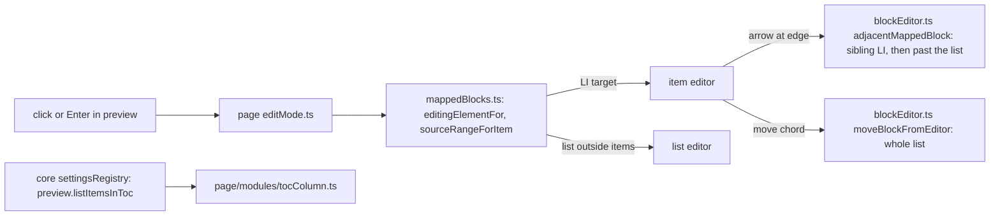

## Summary

A chapter written as one long list (for example a specification that writes each requirement as a
list item) opened every item in one editor on a click. Now a click on a list item edits that item
only, and a click on the list itself, outside its items, still edits the whole list. From the
keyboard, Enter edits the selected item or block instead of the whole list, and an opt-in setting
lists the items of top-level lists in the table of contents.

This pull request takes over the work of the external contributor `pspozio` from pull request 404
(https://github.com/gsemet/markdown-okf-schema-studio/pull/404). Their commit is kept as they wrote
it, with them as its author; the commits after it align the change with the project's
requirements and fix what the review found.

## Deliverables

What a click, the keys and the move chord do on a list, before and after:

| Action in edit mode | Before | After |
| --- | --- | --- |
| Click on a list item | edits the whole list | edits that item only |
| Click on the list, outside its items | edits the whole list | edits the whole list |
| Pointer over an item | outlines the whole list | outlines the item |
| Up/Down at the edge of an item editor | leaves the whole list | goes to the sibling item, then past the list |
| Up/Down at the edge of an admonition's inner block editor | stays in the text box | stays in the text box |
| Enter on a selected item or block of a list | edits the whole list | edits that item or block |
| Cmd/Ctrl+Alt+Up/Down in an item editor | moves the whole list | saves the item, then moves the whole list |
| Table of contents | headings h1 to h4 | the same; with `preview.listItemsInToc` on, also the items of top-level lists, cut to their first line or about 80 characters |

The table of contents, at `ea4d193` (carried from `a6f0de1`): with `preview.listItemsInToc` on, 23 entries instead of 11,
list items under their heading; off (the default), the same 11 headings.

| Before (setting on) | After, setting on | After, setting off |
| --- | --- | --- |
|  |  |  |

## Approved requirements changed

The owner re-approved this approved stakeholder requirement on 2026-11-20; it has its own commit,
739a011:

- **StRS-MDOKFSTUDIO-BLOCK-003** (the writer edits a block by clicking it): "A click on a list item
  edits the list that holds it" becomes "A click on a list item edits that item; a click on the
  list itself, outside its items, edits the whole list". `approved_by` is unchanged;
  `approved_at` and `verified.at` are 2026-11-20T09:41:00+01:00.

No other approved requirement changes. The proposed requirements edited with the code are listed
under Changes.

## Changes

- `mappedBlocks.ts` (`editingElementFor`, `sourceRangeForItem`, `sourceRangeForInnerBlock`): a list
  item, and a block inside it, is an element to edit, on the source lines the renderer gives it.
- `structuralNavigationView.ts`: Enter on a selected item or a block inside an item edits that
  element alone.
- `editMode.ts`: the editor reopens on the right element when an
  item and its first block start on the same line.
- `src/page/features/blockEditor.ts`: the arrow at the edge of an item editor steps to the sibling
  item, then past the list (only for items and blocks inside an item); the move chord in an item
  editor saves the item and moves the whole list.
- `src/page/modules/tocColumn.ts` and the `core` settings registry: the opt-in
  `preview.listItemsInToc` setting (boolean, off by default), which skips the `[TOC]` list,
  footnotes, tables and hidden elements; `package.json` regenerated from the registry.
- Edit-mode styles: an ordered list keeps its numbers while an item is edited, checked on the
  rendered list markers in Chromium.
- Requirements (proposed, edited with the code): StRS-MDOKFSTUDIO-TOOLBAR-006 (the opt-in list
  items), SwRS-MDOKFSTUDIO-BLOCK-001 (the outline), SwRS-MDOKFSTUDIO-BLOCK-014 and BLOCK-017 (item
  editing), SwRS-MDOKFSTUDIO-BLOCK-079 (the arrows between items, and an admonition's inner block
  keeping the key), SwRS-MDOKFSTUDIO-BLOCK-254 (Right, Left and Enter on lists and items),
  SwRS-MDOKFSTUDIO-TOOLBAR-040 (the table of contents' entries), new SwRS-MDOKFSTUDIO-TOOLBAR-138 (the setting). SwRS-MDOKFSTUDIO-BLOCK-130
  (the move chord) is unchanged. Entry in `requirements/tiers/log.md`.
- Docs: `docs/user/editing.md` (item click, the list, item and block levels, the keys),
  `docs/user/settings.md`, the toolbar docs, the glossary ("List item editor"), `CHANGELOG.md`.

Changed test assertions, each because the click or the pointer on an item now targets the item:

- the edit-mode hover test in `runtimeBlockEditor.test.ts`: the outline is on the item, not the
  list (renamed "edit mode hover marks the list item that a click would edit");
- `alertBlockEditOpen`: the editor opens on the item's lines `[8,8]` instead of the list's
  `[1,8]`, with the item's original text;
- the real-window editor-widgets check of a nested list: the editor opens on the nested `li`, not
  the `ul`;
- `capture_comment_checks`: the commented element is the `LI`, not the `UL`;
- `capture_edit_checks` and the matching visual capture of a list click at 460 px in dark theme:
  they now show the item editor, under a new capture name and lock text.

## Impacts

Writers who click a list item edit only that item; the list is edited by clicking beside its items
or from the keyboard. Readers who turn on `preview.listItemsInToc` see list items in the table of
contents. Screenshots at `ea4d193` (carried from `a6f0de1`), before (main) and after:

| Before | After |
| --- | --- |
|  |  |

Click on item 2 of an ordered list: the whole list in one editor before; after, item 2 alone, and
the next items keep numbers 3 and 4.

| Before | After |
| --- | --- |
|  |  |

Click on a list item: before, the editor replaces the whole list; after, it holds that item only.

| Before | After |
| --- | --- |
|  |  |

Pointer on a nested item: before, the outline is on the whole nested list; after, on the item.

| Before | After |
| --- | --- |
|  |  |

Narrow rail, setting on: 11 ticks before and after; list items get no tick.

## Blast radius

Grade: 2. It changes what a click, the pointer outline and the arrows do in edit mode on every
list, and adds one setting that is off by default. A `git revert` of the commits restores the
previous behaviour; the requirement wording of StRS-MDOKFSTUDIO-BLOCK-003 would then need the
owner's decision again.

## Autonomous decisions

- The contributor's commit is kept with its original message, author and date; only the commits
  after it are ours.
- No `Co-authored-by` lines: the project's commit guideline forbids them; the contributor stays
  the author of their commit.
- The arrow at the edge walks up to the list only for a list item or a block inside an item; every
  other inner block editor (an admonition's paragraph, for example) keeps the key, as before.
- The attribute `data-sphinx-preview-toc-list-item` was dropped: no style or code read it.
- `verified.at` of StRS-MDOKFSTUDIO-BLOCK-003 follows `approved_at`, as `just requirements-update`
  sets it.

## Known gaps

- The real-window checks prove the pointer outline on an item; the item click, the arrows and
  the move chord are proved in the simulated page only, and the Cmd+Alt chord was not tried on
  macOS.
- List items get no tick on the narrow table-of-contents rail.
- After Cmd/Ctrl+Alt+Up/Down from an item editor, the list editor reopens with the caret at the
  item's offset inside the list text, not at the same word.
- In a nested list, the arrow past the last nested item leaves the whole top-level list instead of
  going to the outer item's next sibling.
- A list item's table-of-contents entry includes its footnote reference digit.
- The cost of the table of contents with the setting on, on a document with thousands of list
  items, is not measured.
- The item click and pointer screenshots are in the dark theme only, and the ordered-list numbering
  is checked in Chromium (the webview's engine) only, not in Firefox or Safari.

## Test plan

- [x] New or changed tests (they fail on the previous code): item click and outline, the arrows
      between items, an admonition inner block keeping the arrow, the move chord in an item editor
      moving the whole list, the table of contents skipping the `[TOC]` list, footnotes and tables
      on a rendered page, an ordered list keeping its rendered numbers while an item is edited
- [x] Requirements: SwRS updated or added, markers in code and tests, `just requirements-update`

Requirements added or changed, with their source and test files:

| Requirement | Source | Tests |
| --- | --- | --- |
| StRS-MDOKFSTUDIO-BLOCK-003 (approved, re-approved) | wording only | through its SwRS |
| StRS-MDOKFSTUDIO-TOOLBAR-006 | wording only | through its SwRS |
| SwRS-MDOKFSTUDIO-BLOCK-001 | wording and test citation | `runtimeBlockEditor.test.ts` |
| SwRS-MDOKFSTUDIO-BLOCK-014 | `mappedBlocks.ts`, `editMode.ts`, `editModeStyles.ts` | `listItemEditOpen.test.ts`, `runtimeStructuralNavigation.test.ts`, `runtimeContentPatch.test.ts`, `blockReq.requirements.test.ts`, `test/visual/capture_list_numbers.py` |
| SwRS-MDOKFSTUDIO-BLOCK-017 | wording | `blockReq.requirements.test.ts` |
| SwRS-MDOKFSTUDIO-BLOCK-079 | `blockEditor.ts` | `runtimeBlockEditor.test.ts`, `runtimeStructuralNavigation.test.ts` |
| SwRS-MDOKFSTUDIO-BLOCK-130 (unchanged) | `blockEditor.ts` | `runtimeBlockMoves.test.ts` (new test for the item editor) |
| SwRS-MDOKFSTUDIO-BLOCK-254 | `mappedBlocks.ts` | `runtimeStructuralNavigation.test.ts`, `listItemEditOpen.test.ts` |
| SwRS-MDOKFSTUDIO-TOOLBAR-040 | wording | `tocColumn.test.ts` |
| SwRS-MDOKFSTUDIO-TOOLBAR-138 (new) | `settingsRegistry.ts`, `tocColumn.ts` | `tocColumn.test.ts`, `settingsRegistry.test.ts`, `previewConfiguration.test.ts` |

- [x] Changelog: user-facing lines under `## Unreleased` in `CHANGELOG.md`
- [x] Local gates (Windows) at `ea4d193` (carried from `06eda91`: a rebase with no conflict,
      each commit's patch unchanged): `just check` pass; `just preflight` (static stage on
      Windows) pass
- [x] Review: approved at `ea4d193` (carried from `06eda91`: a rebase with no conflict, each
      commit's patch unchanged)
- [x] Verified at `ea4d193` (carried from `a6f0de1`: a rebase with no conflict, each commit's patch unchanged)
- [x] CI green at `ea4d193`, with the real VS Code jobs run on demand (integration, stress, gallery)

## Internal references

- Origin: external pull request 404 by `pspozio`, its commit kept here as 16a4257, author unchanged.
- Change request CR-424 external-pr-404-list-item-edit.

🤖 Generated with [Claude Code](https://claude.com/claude-code)
