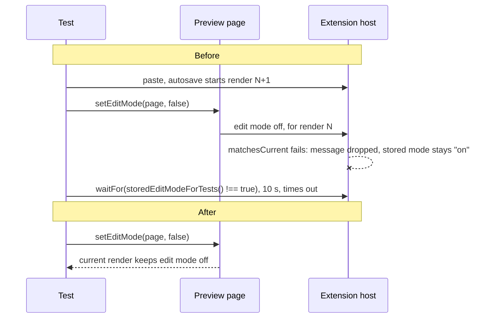

## Summary

Three steps of the real VS Code window suite (the `integration` job, which drives a real VS Code
window on every push to `main` and on heavy dispatches) failed on CI without any code change:
`paste-url`, `checkbox-toggle` and the schema badge part of `preview-editing`. Each red run turned
`integration`, then `report` and `checks`, red. This PR fixes the two races found in the tests
(`paste-url` with `drop-files`, which had the same wait, and `preview-editing`), and makes the
`checkbox-toggle` hang fail fast with the call that hung named, since its cause is not proven yet.
The product does not change.

## Deliverables

What each step waited for, and what it waits for now:

| Step | Before | After |
| --- | --- | --- |
| `paste-url`, `drop-files`, `find-in-preview` | After turning edit mode off, waited up to 10 s for the host's stored edit mode to read "off" | Waits only for the page's current render to keep edit mode off (`setEditMode`) |
| `preview-editing` (schema badge) | Read the highlighted cell after the click, but the page removes the highlight after 1.5 s | A recorder installed before the click keeps every highlight the page sets; the test reads the recorder once |
| `checkbox-toggle` | Its own unbounded frame lookup could hang the step for its whole 180 s budget | The suite's bounded frame lookup: a stuck call fails in about 10 s, named |

The `paste-url` race: the stored edit mode is a host value that no product code reads any more
(every document opens in preview mode), and the host drops on purpose a page message that names an
older render. When the test turns edit mode off right after an autosave started a new render, the
"off" message can name the older render, so the host keeps "on" and the wait times out:



The schema badge recorder, in the page frame (sketch):

```ts
await watchIssueHighlights(frame); // MutationObserver: each cell set to data-okf-issue-highlight="true",
                                   // with its row and the focused row at that moment
await badge.click();
// wait until the recorder holds an entry, then read it once (takeRecords, then disconnect)
const { record, active, errorRows } = await readIssueHighlights(frame);
// assert: exactly one entry, its row is `count`; a failure prints record, active and errorRows
```

## Changes

- `test/integration/pasteUrl.test.ts`, `dropFiles.test.ts`, `findInPreview.test.ts`: the wait on
  the host's stored edit mode is removed; the page-side wait that edit mode is off stays.
- `test/integration/previewEditing.test.ts`: the schema badge check reads the highlight through a
  `MutationObserver` recorder installed before the click; a failed wait reports the recorder's
  entries, the focused element and the rows with an error.
- `test/integration/checkboxToggle.test.ts`: uses the suite's bounded `waitFor`, `waitForRender`
  and `currentPreviewFrame` instead of its own copies, and logs a progress marker between the
  render wait and the frame lookup.
- `test/shared/stressPlan.ts`, `test/integration/realInput/run.ts`: `paste-url` and `drop-files`
  can be named in a stress dispatch (`STRESS_ON_DEMAND_SCENARIOS`); the default stress list is
  unchanged. `test/build/stressPlan.test.ts` covers it.
- `test/build/integrationEditModeRestore.test.ts`: its comment no longer says the workspace opens
  the next preview in edit mode; the check is unchanged.
- `justfile`: the `ci-stress` comment counts 19 default scenarios, not 17.
- Requirements: the `paste-url` test method of SwRS-MDOKFSTUDIO-PALETTE-264 no longer mentions the
  stored edit mode; SwRS-MDOKFSTUDIO-BLOCK-058 gets a Known issue for the `checkbox-toggle` hang;
  dated entry in `requirements/tiers/log.md`.

## Impacts

No visual change and no product change: test code, the stress plan and requirement text only.
Developers see fewer red `integration` runs, and a `checkbox-toggle` hang now ends in about 10 s
with the stuck call named, instead of a 180 s step timeout.

## Blast radius

Grade: 1. Test files, the stress plan and requirement text; a `git revert` restores the previous
tests.

## Human decisions

- All three flaky steps are fixed at their root cause in one change, not one at a time.
- A cause that stays unfound keeps its test as it is (no automatic retry, no quarantine, no raised
  timeout) and is written down as a Known issue with its analysis.

## Autonomous decisions

- `paste-url` and `drop-files` stay out of the default stress list and can only be named in a
  stress dispatch. Measured on a green `main` run, the 19 default scenarios average
  4.06 s per run; with the two added, 12 rounds would pass the margin the stress deadline check
  keeps (at most 3.69 s per run for 12 rounds within 24 min). The default rounds, the workflow and
  the deadline constant stay unchanged, and no existing scenario is dropped.
- `checkbox-toggle` gets no fix of its cause: the hang dumps support a lead (a frame still
  detaching from the previous step's teardown) but do not prove it, so the step only gets the
  bounded lookup, which turns the hang into a named failure.
- The analysis of the `checkbox-toggle` hang lives in a short Known issue of
  SwRS-MDOKFSTUDIO-BLOCK-058 and in this description; no separate document.
- The host's stored-edit-mode test hook stays: `find-in-preview` still reads it for its own
  diagnostics.

## Known gaps

- `paste-url` and `drop-files` are not in the default stress list, which the project's CI rule for
  a fixed flake asks for. With them the default stress job would pass its deadline margin (see
  Autonomous decisions); they are proved instead by one stress dispatch naming them, and would join
  the default list once the stress job's time budget allows it.
- The cause of the `checkbox-toggle` hang is not found. What the CI dumps prove and what they do not
  is in the Known issue of SwRS-MDOKFSTUDIO-BLOCK-058; the next failure names the stuck call.
- No local real VS Code window run of `paste-url` and `drop-files`: the desktop is shared with other
  sessions, so the heavy CI dispatches below carry the proof.

## Test plan

- [ ] New or changed tests (they fail on the previous code): the stress plan test of the
      on-demand names; the real-window changes are proved by the heavy dispatches below.
- [x] Requirements: PALETTE-264 method and BLOCK-058 Known issue updated, `just requirements-update`
      leaves no change; no behaviour change.
- [x] Changelog: no user-facing change.
- [x] Local gates (Windows) at `0b5005d` (carried from `6fffa85`, unchanged patch): `just check` pass, `just preflight` (static stage) pass
- [x] Review: approved at `0b5005d` (carried from `6fffa85`, unchanged patch)
- [x] Heavy dispatch with `stress_repeat=30` on `paste-url`, `drop-files`, `checkbox-toggle`:
      `integration` and `stress` green (carried from `6fffa85`, unchanged patch)
- [x] Three plain heavy dispatches: `integration` green (carried from `6fffa85`, unchanged patch)
- [x] CI green at `0b5005d`, and a heavy run at `0b5005d`: `integration` and `stress` green

## Internal references

- Planning surface CR-425 (real-window test flakes); the `paste-url` diagnosis is in CR-350
  (`work/diagnosis.md`); the full `checkbox-toggle` analysis is in CR-425
  `work/checkbox-hang-evidence.md`. Failing runs: 44647675614, 44690391950 (`paste-url`,
  `preview-editing`), 44651927198 and 44694304978 (`checkbox-toggle`). Stress timing measured on
  the green `main` run 44709272650.

🤖 Generated with [Claude Code](https://claude.com/claude-code)
