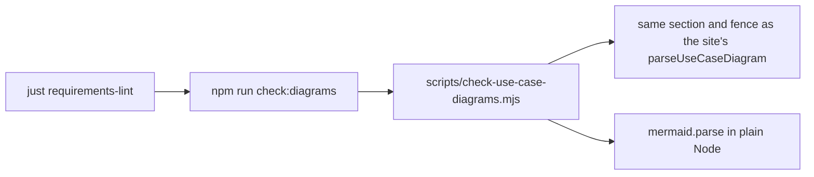

## Summary

A requirement's use case diagram (the Mermaid fence of a StRS's "Use case diagram" section) that
Mermaid cannot parse passed every local check and only broke the requirements site build, late and
far from its cause. For example, a sequence diagram that sends a message to a participant named
`Box` (a word Mermaid reserves) does not parse. The requirements lint now parses every use case
diagram with the project's Mermaid and fails at once, naming the file, the line, the requirement
and Mermaid's message. The guideline lists the ids to avoid.

## Deliverables

`just requirements-lint` (and so `just check` and CI's static jobs) runs a new step:



On a diagram that does not parse, it prints one report per failure and exits 1:

```text
requirements/tiers/strs/<group>/StRS-....md:<line>: StRS-...: the use case diagram does not parse (see "Use case diagram of a StRS" in requirements/guidelines/project.guidelines.md)
    Parse error on line <n>:
    ... got 'box'
```

When every diagram parses, its last line is
`use case diagrams: <n> StRS checked, all parse (Mermaid 12.2.0)`.

## Changes

- `scripts/check-use-case-diagrams.mjs`: reads the bundle's StRS folder from `config.yml`,
  extracts each use case diagram with the same rules as the site, normalises line endings, and
  parses each one with Mermaid in Node. A small no-op stand-in for DOMPurify's hooks is set before
  Mermaid loads: without a browser window DOMPurify has no hooks and every state diagram would
  fail. The check only parses and never renders, so sanitising does not matter here. Every
  failure is reported, not only the first. Mermaid drops `%%` comment and `%%{...}%%` directive
  lines before it counts lines, so the script maps Mermaid's line back through those lines to the
  file's line.
- `package.json` (`check:diagrams`) and the `requirements-lint` recipe of the `justfile` run it.
- `requirements/guidelines/project.guidelines.md`, "Use case diagram of a StRS": what the check
  does, and the ids Mermaid reserves per diagram kind.
- A new software requirement for the check, with its markers in the script and the tests; the
  generated coverage files and the requirements log are updated.
- `test/build/checkUseCaseDiagrams.test.ts`: scratch bundles for refusals, boundaries and line
  endings, the shipped bundle (its count must match the site's extraction), and every word of the
  guideline's list proved rejected.

## Impacts

No visual change: the change adds a lint step and a guideline section. Contributors see a clear
lint failure instead of a late site build failure.

## Blast radius

Grade: 1. Only the requirements lint and its tests change; a plain `git revert` restores the
previous behaviour.

## Test plan

- [x] New or changed tests (they fail on the previous code): seven new tests in
      `test/build/checkUseCaseDiagrams.test.ts`, `just unit` 4066 pass, 0 fail at c749c3b; with
      `Field` renamed to `Box` in a shipped StRS, the previous lint passes and the new step fails
      at the message line with "got 'box'" (verified at c749c3b, edit not committed)
- [x] Requirements: SwRS-MDOKFSTUDIO-CORE-090 added (`scripts/check-use-case-diagrams.mjs`,
      `test/build/checkUseCaseDiagrams.test.ts`), markers in code and tests,
      `just requirements-update`
- [x] Changelog: No user-facing change
- [x] Local gates: `just preflight` (static stage on Windows) pass at c749c3b; `just check` pass at
      c749c3b (use case diagrams: 93 StRS checked, all parse)
- [x] Review: approved at c749c3b
- [x] CI green at c749c3b: static, static-windows, visual, report and checks pass (the real
      VS Code jobs do not run on a pull request)

## Autonomous decisions

- In Mermaid 12.2.0 a reserved word declared as a sequence participant still parses; it fails
  once a message uses it (`A->>Box: x`). The guideline and the tests use the word in a message,
  so every word of the list is proved rejected.
- The reported line is mapped back through the `%%` comment and directive lines Mermaid removes,
  with its own test. A front matter block inside the fence is not mapped; no requirement uses one.

## Known gaps

None.
